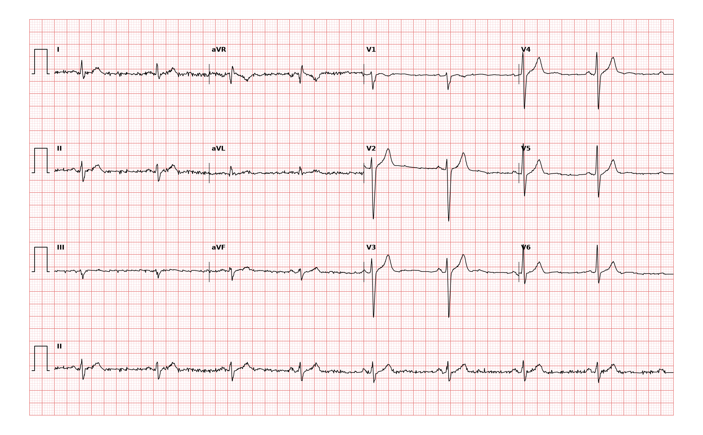

## 문제
54세 남자가 회사 건강검진 심전도에서 「축이 왼쪽으로 치우쳐 있다」는 말을 듣고 왔다. 두근거림, 어지럼, 실신, 흉통은 없고 주 3회 1시간씩 달리기를 한다. 복용하는 약은 없다. 혈압 124/78 mmHg, 맥박 56회/분이다. 심음은 정상이고 잡음은 없다. 혈청 전해질과 갑상샘 기능은 정상이다. 심장초음파에서 좌심실 벽 두께와 벽 운동은 정상이고 박출률은 62 % 이며 판막 이상은 없다. 12유도 심전도는 그림과 같다. 이 심전도 소견에 대한 처치로 가장 적절한 것은?

- A. 24시간 이내 전기생리 검사
- B. 베타차단제 투여
- C. 추가 치료 없이 경과 관찰
- D. 영구 심박동기 삽입
- E. 관상동맥 조영술

_12유도 심전도, 25 mm/s · 10 mm/mV, 3×4 + II 리듬 스트립 (PTB-XL ECG dataset, PhysioNet, CC BY 4.0 — 원신호 그대로 작도)_

## 정답 및 해설
> 정답: C

- **정답 핵심**: 동리듬 약 55회/분이다. I 은 양성이고 II·III·aVF 는 작은 r 뒤 깊은 S 의 rS 형태로 음성이 우세해 축이 −45° 보다 왼쪽(좌축 편위)이다. aVL 은 qR 이고 QRS 폭은 정상(< 120 ms)이다. 이는 좌전섬유속 차단이다. 증상이 없고 심장초음파가 정상이며 다른 전도 이상(우각차단, 1도 이상의 방실차단)이 함께 있지 않으므로 이 소견만으로 할 치료는 없고 경과 관찰한다. 운동하는 사람의 맥박 56회/분 동서맥도 생리적이다.
- **원리**: <b>왜 축이 왼쪽으로 가는가</b>: 좌각은 앞섬유속과 뒤섬유속으로 갈라진다. 앞섬유속은 좌심실 앞·위쪽 벽을 먼저 흥분시킨다. 이 섬유속이 막히면 흥분이 뒤섬유속을 따라 아래·뒤에서 시작해 위·왼쪽으로 늦게 퍼지므로, 처음 힘은 아래로(II·III·aVF 의 작은 r, aVL 의 q) 가다가 큰 힘이 위·왼쪽으로 향해(II·III·aVF 의 깊은 S, aVL 의 큰 R) 축이 −45° 이상 왼쪽으로 돈다. 섬유속 하나만 막히면 나머지 전도계로 금방 돌아가므로 QRS 는 거의 넓어지지 않는다.  <b>왜 치료하지 않는가</b>: 단독 좌전섬유속 차단은 그 자체로 서맥이나 방실차단을 일으키지 않는다. 심박동기는 증상이 있는 서맥이나 진행된 방실차단, 또는 섬유속 차단 + 실신처럼 완전 방실차단 위험이 높을 때의 적응증이다. 대신 이 소견은 고혈압·관상동맥질환·심근병증·대동맥판 질환의 표지일 수 있어 <b>구조적 심질환을 한 번 확인</b>하는 것이 의미가 있다 — 이 환자는 이미 확인되어 정상이다.  <b>추적</b>: 이후 우각차단이 더해지면(이섬유속 차단) 정기적으로 PR 간격과 증상을 본다.
- **비교**: <table><thead><tr><th style="width:24%">항목</th><th style="width:38%">단독 좌전섬유속 차단 — 경과 관찰(정답)</th><th>심박동기가 필요한 전도 장애(가장 가까운 오답)</th></tr></thead><tbody> <tr><td>심전도</td><td>좌축 편위, II·III·aVF rS, aVL qR, QRS 좁음</td><td>2도 Mobitz II · 3도 방실차단, 또는 교대 각차단</td></tr> <tr><td>증상</td><td>없음</td><td><b>실신·어지럼</b>, 운동 불내성</td></tr> <tr><td>심박수</td><td>정상 또는 생리적 동서맥</td><td>방실 해리에 의한 서맥</td></tr> <tr><td>처치</td><td>원인 심질환 확인 뒤 관찰</td><td>영구 심박동기</td></tr> </tbody></table> 축 편위는 전도로의 「우회」일 뿐 심박수를 떨어뜨리지 않는다. 심박동기는 방실 전도가 끊기거나 그 위험이 증상으로 드러날 때만이다.
- **오답 이유**:
  - ① 24시간 이내 전기생리 검사는 섬유속 차단 환자가 설명되지 않는 실신을 겪어 숨은 His-Purkinje 전도 장애를 찾아야 할 때 정답이 될 수 있다.
  - ② 베타차단제 투여는 증상이 있는 기외수축이나 빈맥, 고혈압이 있을 때 정답이 되며, 이 환자에서는 서맥을 악화시킬 수 있다.
  - ④ 영구 심박동기 삽입은 섬유속 차단에 실신이 있거나 2도 Mobitz II·3도 방실차단, 교대 각차단이 기록될 때 정답이 된다.
  - ⑤ 관상동맥 조영술은 노작성 흉통이나 부하 검사의 허혈 소견, 심장초음파의 국소 벽운동 이상이 있을 때 정답이 된다.
- **함정**: 축 편위나 맥박 56회/분을 보고 심박동기를 고르는 것 — 단독 섬유속 차단과 운동선수의 동서맥은 치료 대상이 아니다.
- **학습목표**: 무증상 성인의 좌축 편위·II·III·aVF rS·aVL qR 을 좌전섬유속 차단으로 판독하고, 구조적 심질환이 없으면 추가 치료 없이 경과 관찰함을 심박동기 적응증과 가른다
- **근거·출처**: Loscalzo J, Fauci AS, Kasper DL, et al., eds. Harrison's Principles of Internal Medicine, 22nd ed. McGraw Hill; 2025. Chapter 247: Electrocardiography · Loscalzo J, Fauci AS, Kasper DL, et al., eds. Harrison's Principles of Internal Medicine, 22nd ed. McGraw Hill; 2025. Chapter 252: The Bradyarrhythmias: Disorders of the Atrioventricular Node · Kusumoto FM, Schoenfeld MH, Barrett C, et al. 2018 ACC/AHA/HRS Guideline on the Evaluation and Management of Patients With Bradycardia and Cardiac Conduction Delay. Circulation. 2019;140(8):e382-e482

## 출처
- PTB-XL ECG dataset v1.0.3 (PhysioNet, CC BY 4.0) · record 12018 · Creative Commons Attribution 4.0 International · https://physionet.org/content/ptb-xl/1.0.3/LICENSE.txt
