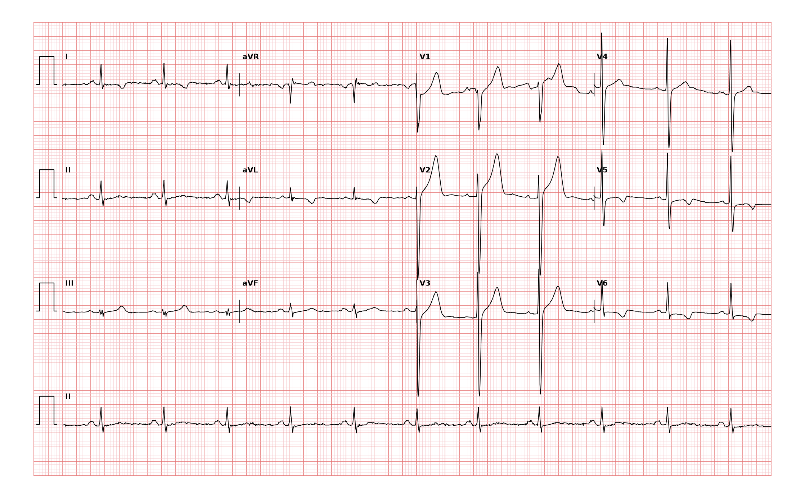

## 문제
A 40-year-old man comes to the emergency department because of 2 episodes of chest tightness during the past 2 days. Each episode began while he was climbing stairs, lasted about 10 minutes, and resolved with rest. He has never had such symptoms before. He has smoked 1 pack of cigarettes daily for 20 years. His father had a myocardial infarction at the age of 48 years. He is now pain-free. His blood pressure is 138/84 mm Hg, and pulse is 70/min. Heart sounds are normal, and there is no friction rub. High-sensitivity troponin I concentrations at arrival and 3 hours later are within the reference range. Echocardiography shows normal left ventricular wall thickness and wall motion. A 12-lead ECG is shown. Which of the following is the most likely diagnosis?

- A. Unstable angina
- B. Non-ST-elevation myocardial infarction
- C. Acute pericarditis
- D. Hypertrophic cardiomyopathy
- E. Acute pulmonary embolism

_12-lead ECG, 25 mm/s, 10 mm/mV, 3×4 + lead II rhythm strip (PTB-XL, PhysioNet, CC BY 4.0; raw signal, no filtering)_

## 정답 및 해설
> 정답: A

- **정답 핵심**: The ECG shows sinus rhythm at about 70/min with narrow QRS complexes. The T waves are inverted in leads I, aVL, V5, and V6, the leads facing the lateral wall, and there is no ST elevation. New-onset exertional chest pain within days (an accelerating pattern) with ischemic lateral T-wave changes indicates an acute coronary syndrome. Because high-sensitivity troponin is normal on serial measurement, there is no myocardial necrosis, so the diagnosis is unstable angina rather than non-ST-elevation myocardial infarction.
- **원리**: <b>Why ischemia inverts the T wave</b>: Normally the epicardium repolarizes before the endocardium, so the T wave points in the same direction as the QRS. Ischemia prolongs or alters action potentials in the affected region and reverses this sequence, producing flat or symmetrically inverted T waves in the leads facing that wall. Leads I, aVL, V5, and V6 face the lateral left ventricle, supplied by the left circumflex or diagonal branches.  <b>Why troponin separates the diagnoses</b>: Unstable angina and NSTEMI share the same mechanism, a nonocclusive thrombus on a ruptured plaque. The difference is whether myocytes have died: troponin above the 99th percentile with a rise or fall defines infarction. With high-sensitivity assays, a normal value at presentation and 3 hours later makes infarction unlikely, but the patient still has a high-risk acute coronary syndrome.  <b>Why it still matters</b>: New-onset angina in the past 2 days is classified as unstable. He needs antiplatelet therapy, anticoagulation, and an early invasive or stress evaluation, not discharge.
- **비교**: <table><thead><tr><th style="width:24%">Feature</th><th style="width:38%">Unstable angina (answer)</th><th>NSTEMI (closest distractor)</th></tr></thead><tbody> <tr><td>Mechanism</td><td>Nonocclusive coronary thrombus</td><td>Same</td></tr> <tr><td>ECG</td><td>ST depression, T-wave inversion, or normal</td><td>Same</td></tr> <tr><td>Serial troponin</td><td><b>Within the reference range</b></td><td><b>Rise or fall above the 99th percentile</b></td></tr> <tr><td>Myocyte necrosis</td><td>None</td><td>Present</td></tr> </tbody></table> The ECG cannot tell the two apart; only serial troponin does. ST elevation would move the case to STEMI regardless of troponin.
- **오답 이유**:
  - (B) Non-ST-elevation myocardial infarction would be correct if serial high-sensitivity troponin rose above the 99th percentile with the same ECG.
  - (C) Acute pericarditis would be correct with diffuse concave ST elevation and PR depression, pleuritic pain relieved by sitting forward, or a friction rub.
  - (D) Hypertrophic cardiomyopathy would be correct if echocardiography showed asymmetric septal thickening, which this normal wall thickness rules against.
  - (E) Acute pulmonary embolism would be correct with sudden dyspnea, tachycardia, hypoxemia, and right precordial T-wave inversion or an S1Q3T3 pattern.
- **함정**: Calling ischemic T-wave inversion an infarction — without a troponin rise, the acute coronary syndrome is unstable angina.
- **학습목표**: Read T-wave inversion in I, aVL, V5, and V6 without ST elevation in a man with new exertional chest pain and normal serial troponins as unstable angina, and separate it from NSTEMI and acute pericarditis
- **근거·출처**: Loscalzo J, Fauci AS, Kasper DL, et al., eds. Harrison's Principles of Internal Medicine, 22nd ed. McGraw Hill; 2025. Chapter 285: Non-ST-Segment Elevation Acute Coronary Syndrome (Non-ST-Segment Elevation Myocardial Infarction and Unstable Angina) · Loscalzo J, Fauci AS, Kasper DL, et al., eds. Harrison's Principles of Internal Medicine, 22nd ed. McGraw Hill; 2025. Chapter 247: Electrocardiography · Rao SV, O'Donoghue ML, Ruel M, et al. 2025 ACC/AHA/ACEP/NAEMSP/SCAI Guideline for the Management of Patients With Acute Coronary Syndromes. Circulation. 2025;151(13):e771-e862

## 출처
- PTB-XL ECG dataset v1.0.3 (PhysioNet, CC BY 4.0) · record 18213 · Creative Commons Attribution 4.0 International · https://physionet.org/content/ptb-xl/1.0.3/LICENSE.txt
