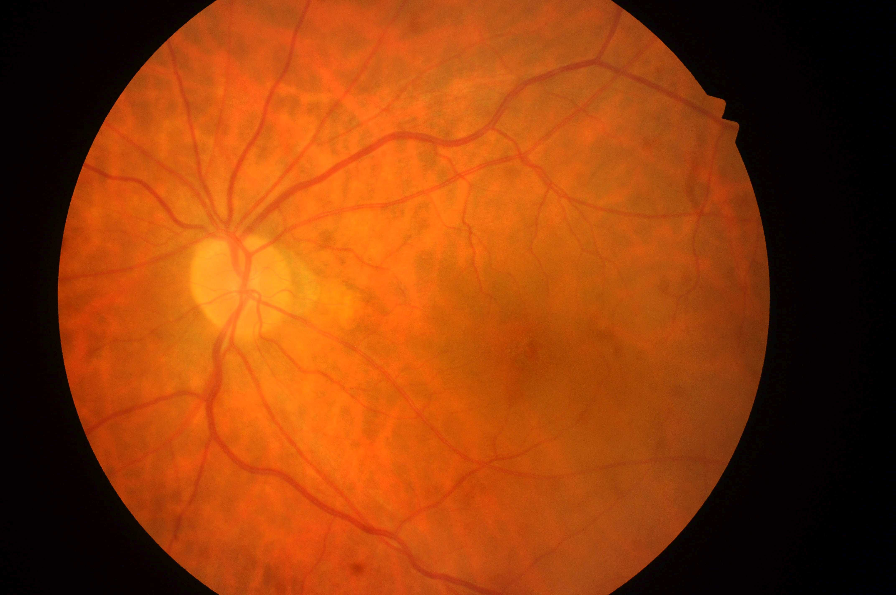

## 문제
3주 전 건강검진에서 제2형 당뇨병을 진단받은 환자가 내과의 의뢰로 안과에 왔다. 눈 증상은 없다. 메트포르민을 시작하였고 당화혈색소는 7.4 % 이다. 혈압은 128/78 mmHg 이다. 양눈 교정시력은 1.0 이고 안압은 정상이다. 산동 후 오른눈의 안저 사진은 그림과 같다. 왼눈 안저도 같은 소견이다. 이 환자에게 가장 적절한 다음 조치는?

- A. 유리체강내 항혈관내피성장인자 주사
- B. 1년 뒤 산동 안저검사
- C. 3개월 뒤 산동 안저검사
- D. 지금 형광안저혈관조영술
- E. 범망막광응고술

_안저 사진, 원본 그대로 축소만 (IEEE DataPort, CC BY 4.0) ※ 발문의 임상 상황은 문항 구성을 위한 가정이다 — 원 데이터에는 나이·병력이 없다_

## 정답 및 해설
> 정답: B

- **정답 핵심**: 시신경유두 경계가 뚜렷하고 혈관의 주행·굵기가 정상이며, 미세동맥류·점상출혈·경성삼출물·면화반·신생혈관이 없고 황반도 깨끗하다 — 당뇨망막병증이 없는 정상 안저다. 제2형 당뇨병은 진단 시점에 이미 망막병증이 있을 수 있어 진단 즉시 첫 검사를 하고, 망막병증이 없으면 1년(혈당 조절이 좋으면 1~2년)마다 다시 본다.
- **원리**: <b>왜 제2형은 진단 즉시, 제1형은 5년 뒤에 보는가</b>: 망막병증은 고혈당에 노출된 기간에 비례한다. 제1형은 발병 시점이 분명해 5년 안에는 망막병증이 거의 없지만, 제2형은 진단 전 몇 년간 모르는 채 고혈당이 지속된 경우가 많아 <b>진단 때 이미 망막병증이 있는 환자</b>가 적지 않다. 그래서 제2형은 진단 직후 산동 검사를 한다.  <b>왜 1년 간격인가</b>: 망막병증이 없는 눈이 1년 안에 치료가 필요한 단계(중증 비증식·증식·황반부종)로 넘어갈 확률은 매우 낮다. 반대로 비증식 망막병증이 있으면 중증도에 따라 3~12개월로 간격을 줄인다. 검사 간격은 「지금 단계에서 다음 치료 단계까지 걸리는 시간」으로 정해진다.  <b>치료는 언제</b>: 레이저(범망막광응고술)는 증식 망막병증, 항VEGF 주사는 중심부 황반부종에서 쓴다 — 망막병증이 없는 눈에는 혈당·혈압·지질 조절이 유일한 예방책이다.
- **비교**: <table><thead><tr><th style="width:24%">항목</th><th style="width:38%">1년 뒤 재검(정답 — 망막병증 없음)</th><th>3개월 뒤 재검(가장 가까운 오답)</th></tr></thead><tbody> <tr><td>해당 단계</td><td><b>망막병증 없음</b> 또는 경미한 비증식(일부 지침)</td><td>중등도~중증 비증식 망막병증</td></tr> <tr><td>안저 소견</td><td>미세동맥류·출혈·삼출물 없음</td><td>여러 사분면의 출혈·정맥 염주 모양·망막내 미세혈관 이상</td></tr> <tr><td>왜 그 간격인가</td><td>1년 안에 치료 단계로 진행할 위험이 매우 낮다</td><td>1년 안 증식 단계 진행 위험이 높다</td></tr> <tr><td>이 환자</td><td>안저 정상 — 일치</td><td>병변 없음 — 불일치</td></tr> </tbody></table> 검사 간격은 「보이는 망막병증 단계」로 정하고, 당뇨병의 종류는 「첫 검사 시점」을 정한다.
- **오답 이유**:
  - ① 유리체강내 항VEGF 주사는 중심부를 침범한 당뇨황반부종으로 시력이 떨어졌다면 정답이 된다.
  - ③ 3개월 뒤 재검은 중등도 이상의 비증식 망막병증(여러 곳 출혈·정맥 염주 모양)이 보였다면 정답이 된다.
  - ④ 형광안저혈관조영술은 원인 모를 시력 저하나 황반부종·신생혈관의 범위를 확인해야 할 때 정답이 되며, 정상 선별검사에는 쓰지 않는다.
  - ⑤ 범망막광응고술은 시신경유두·망막의 신생혈관이 있는 증식 당뇨망막병증이라면 정답이 된다.
- **함정**: 당뇨병 환자의 안저 사진이면 무언가 치료해야 한다고 생각하는 것 — 정상 안저는 간격을 정하는 문제다.
- **제작 가정**: IDRiD 는 안저 사진과 망막병증 등급만 있고 나이·성별·병력이 없다 — 제2형 당뇨병 진단 직후 첫 선별검사 상황과 시력·혈당 수치를 가정했다 (가정한 정보: 제2형 당뇨병을 진단받은 · 당화혈색소는 7.4 % 이다 · 양눈 교정시력은 1.0)
- **학습목표**: 제2형 당뇨병 진단 시 첫 안저검사에서 미세동맥류·출혈·삼출물이 없는 정상 안저를 확인하고 다음 선별검사 간격을 정한다
- **근거·출처**: Loscalzo J, Fauci AS, Kasper DL, et al., eds. Harrison's Principles of Internal Medicine, 22nd ed. McGraw Hill; 2025. Chapter 417: Diabetes Mellitus: Complications · American Diabetes Association Professional Practice Committee. 12. Retinopathy, Neuropathy, and Foot Care: Standards of Care in Diabetes—2025. Diabetes Care. 2025;48(Suppl 1):S252-S265 · Porwal P, Pachade S, Kamble R, et al. Indian Diabetic Retinopathy Image Dataset (IDRiD): a database for diabetic retinopathy screening research. Data. 2018;3(3):25

## 출처
- IDRiD (IEEE DataPort, CC BY 4.0) · IDRiD_359 · Creative Commons Attribution 4.0 International · https://creativecommons.org/licenses/by/4.0/
