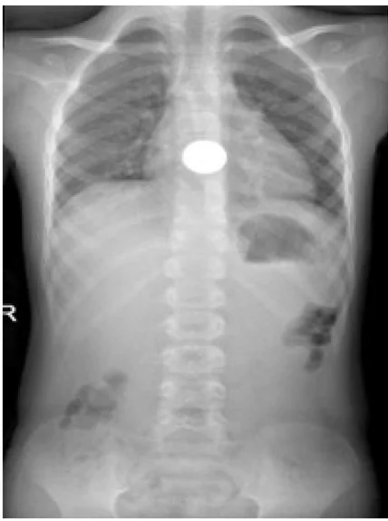

## 문제
A 6-year-old boy is brought to the emergency department 4 hours after he swallowed a coin while playing. Since then he has been drooling, has refused to drink, and points to the middle of his chest when he swallows. He has had no coughing spells, stridor, or wheezing. His temperature is 36.8°C, pulse is 104/min, respirations are 20/min, and oxygen saturation is 99% on room air. He is drooling but speaks in full sentences. The lungs are clear to auscultation. The abdomen is soft and nontender. A frontal radiograph of the chest and upper abdomen is shown. Which of the following is the most appropriate next step in management?

- A. Endoscopic removal within hours
- B. Rigid bronchoscopy
- C. Repeat radiograph in 24 hours
- D. Intravenous glucagon and discharge
- E. Ipecac-induced emesis

_Frontal radiograph of the chest and upper abdomen; left panel of the published two-panel case figure, side marker as in the original (PMC Open Access Subset, CC BY)_

## 정답 및 해설
> 정답: A

- **정답 핵심**: The radiograph shows a smooth, round, uniformly radiopaque disk projected over the midline of the upper chest. A coin appears as a full circle on a frontal view when it lies in the coronal plane, which is how it sits in the esophagus, whose lumen is widest from side to side; a coin in the trachea would usually lie sagittally and look like a line on the frontal view. With clear lungs and no stridor, the coin is in the esophagus. Because the boy cannot swallow his saliva, it must be removed endoscopically without waiting.
- **원리**: <b>Why the orientation localizes the coin</b>: The esophagus is flattened front-to-back, so a coin settles with its face toward the front (coronal plane) and appears as a full circle on a frontal radiograph and edge-on on the lateral. The trachea is held open by C-shaped cartilage rings that are incomplete posteriorly, so a coin there tends to align sagittally, appearing as a line on the frontal view. Airway coins also cause cough, stridor, or unilateral wheeze.  <b>Why drooling changes the timing</b>: The esophagus narrows at three points — the upper sphincter (most common site in children), the aortic arch, and the lower sphincter. A coin that stays at one of these points can cause pressure necrosis, perforation, or fistula. An <b>asymptomatic</b> child with an esophageal coin may be observed for up to 12–24 hours because many pass spontaneously; a child who <b>cannot manage secretions</b> has a complete obstruction and needs urgent removal because of aspiration risk.  <b>Why button batteries are different</b>: A disk battery shows a double-ring (halo) on the frontal view and causes caustic injury within 2 hours — it is removed immediately regardless of symptoms.
- **비교**: <table><thead><tr><th style="width:24%">Feature</th><th style="width:38%">Esophageal coin (answer — endoscopy)</th><th>Tracheal coin (closest distractor — bronchoscopy)</th></tr></thead><tbody> <tr><td>Frontal radiograph</td><td><b>Full circle</b> (coronal orientation)</td><td>Thin line (sagittal orientation)</td></tr> <tr><td>Why</td><td>The esophageal lumen is widest side to side</td><td>The posterior membranous trachea lets the coin align front to back</td></tr> <tr><td>Symptoms</td><td>Drooling, odynophagia, food refusal</td><td>Cough, stridor, wheeze, respiratory distress</td></tr> <tr><td>This patient</td><td>Drooling, clear lungs, no stridor — consistent</td><td>No respiratory symptoms — inconsistent</td></tr> </tbody></table> Shape on the frontal view plus the symptom pattern locates the coin; the ability to handle secretions decides how fast it must come out.
- **오답 이유**:
  - (B) Rigid bronchoscopy would be correct if the coin appeared edge-on on the frontal view with stridor or cough, indicating an airway foreign body.
  - (C) Repeat radiograph in 24 hours would be acceptable for an asymptomatic child who can swallow saliva, since many esophageal coins pass on their own.
  - (D) Intravenous glucagon relaxes the lower esophageal sphincter in some adult food impactions but is unreliable for coins and would not justify discharge here.
  - (E) Ipecac-induced emesis was abandoned because vomiting can push the coin into the airway and does not reliably dislodge esophageal objects.
- **함정**: Equating a coin over the chest with an airway foreign body — a round coin on the frontal view lies in the esophagus.
- **학습목표**: Read a round radiopaque disk seen en face in the midline of the upper chest as a coin lodged in the esophagus rather than the trachea, and choose urgent endoscopic removal for a child who cannot handle secretions
- **근거·출처**: Kramer RE, Lerner DG, Lin T, et al. Management of ingested foreign bodies in children: a clinical report of the NASPGHAN Endoscopy Committee. J Pediatr Gastroenterol Nutr. 2015;60(4):562-574 · Loscalzo J, Fauci AS, Kasper DL, et al., eds. Harrison's Principles of Internal Medicine, 22nd ed. McGraw Hill; 2025. Chapter 334: Diseases of the Esophagus · Front Pediatr. 2026;14:1936681. doi:10.3389/fped.2026.1936681 (PMC Open Access, CC BY) — source of the radiograph

## 출처
- A novel, non-invasive approach to esophageal coin removal in a child using oral olive oil: case report. Front Pediatr. 2026 Sep 4;14:1936681. doi: 10.3389/fped.2026.1936681 (CC BY) — Figure 1 · CC BY · https://creativecommons.org/licenses/
