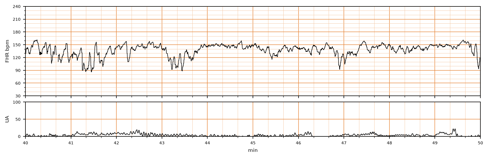

## 문제
40세 경산부가 임신 38주에 규칙적인 진통으로 입원하였다. 임신 중 합병증은 없었다. 자궁경부는 6 cm 열렸고 양막은 1시간 전에 저절로 터졌으며 양수는 맑다. 산모의 혈압은 118/72 mmHg, 맥박은 84회/분, 체온은 36.9°C 이다. 옥시토신은 쓰지 않았다. 입원 40분 뒤부터 10분간의 태아심박동·자궁수축 기록은 그림과 같다. 이때 가장 적절한 처치는?

- A. 겸자로 즉시 분만한다
- B. 분만이 끝날 때까지 감시를 멈춘다
- C. 산모 체위를 바꾸고 감시를 계속한다
- D. 즉시 제왕절개술을 한다
- E. 옥시토신을 시작해 분만을 앞당긴다

_분만 중 태아심박동(위)과 자궁수축(아래) 기록, 기록 시작 후 40~50분 구간; 3 cm/분, 세로선 = 1분 (CTU-UHB Intrapartum Cardiotocography Database, PhysioNet, ODC-BY 1.0 — 원자료 4 Hz 그대로, 평활화 없음)_

## 정답 및 해설
> 정답: C

- **정답 핵심**: 기저 태아심박수는 약 145회/분으로 정상이고 변이는 중등도(진폭 6~25회/분)로 유지된다. 41~42분, 43~44분, 47분에 심박수가 30초 안에 급격히 떨어져 90회/분 전후까지 내려갔다가 1분 안에 빠르게 회복하는 감속이 간헐적으로 있다 — 변이성 감속이다. 중등도 변이가 유지되는 간헐적 변이성 감속은 범주 II 이며 태아 산증 가능성이 낮으므로, 탯줄 압박을 줄이는 체위 변경 등 자궁내 소생술을 하며 감시를 계속한다.
- **원리**: <b>왜 변이성 감속은 모양이 급한가</b>: 변이성 감속은 탯줄 압박 때문이다. 탯줄 정맥이 먼저 눌리면 태아 혈량이 줄어 잠깐 심박수가 오르고(어깨), 동맥까지 눌리면 태아 혈압이 갑자기 올라 압수용체 → 미주신경 반사로 <b>심박수가 몇 초 만에 뚝 떨어진다</b>. 압박이 풀리면 반사도 즉시 사라져 회복도 빠르다. 그래서 시작이 30초 미만으로 급하고, 모양·깊이·수축과의 관계가 매번 다르다.  <b>왜 변이가 판단의 중심인가</b>: 중등도 변이는 태아 뇌간이 산소를 충분히 받고 있다는 가장 믿을 만한 표지다. 변이가 유지되면 감속이 있어도 대사성 산증 가능성은 낮다. 변이가 없어지거나 감속이 반복·심해지면 범주 III 로 가고 즉시 분만을 준비한다.  <b>자궁내 소생술</b>: 산모를 옆으로 눕히거나 체위를 바꿔 탯줄 압박을 풀고, 저혈압을 교정하고, 자궁 과다수축이 있으면 옥시토신을 줄인다. 반복되는 변이성 감속이 계속되면 양수주입을 고려한다.
- **비교**: <table><thead><tr><th style="width:24%">항목</th><th style="width:38%">간헐적 변이성 감속 + 중등도 변이(정답 — 범주 II)</th><th>즉시 분만이 필요한 기록(가장 가까운 오답 — 범주 III)</th></tr></thead><tbody> <tr><td>변이</td><td><b>중등도(6~25회/분) 유지</b></td><td>소실(≤ 2회/분)</td></tr> <tr><td>감속</td><td>간헐적, 빠른 회복</td><td>반복되는 후기·변이성 감속, 또는 서맥, 또는 사인곡선</td></tr> <tr><td>태아 산증 가능성</td><td>낮다 — 뇌간 산소 공급 유지</td><td>높다</td></tr> <tr><td>처치</td><td>체위 변경·자궁내 소생술, 감시 지속</td><td>자궁내 소생술과 동시에 신속 분만</td></tr> </tbody></table> 감속의 종류보다 「변이가 남아 있는가」가 분만을 서두를지를 정한다.
- **오답 이유**:
  - ① 겸자 분만은 자궁경부가 완전히 열리고 태아 머리가 충분히 내려온 2기에서 태아 상태가 나쁠 때 정답이 되며, 지금은 6 cm 다.
  - ② 감시 중단은 감속이 없는 범주 I 에서도 분만 중에는 하지 않으며, 감속이 있는 이 기록에서는 더욱 맞지 않는다.
  - ④ 즉시 제왕절개술은 변이가 소실된 채 반복되는 후기·변이성 감속이나 지속 서맥(범주 III)이 보이면 정답이 된다.
  - ⑤ 옥시토신 시작은 진통이 멈춰 분만이 진행하지 않을 때 고려하며, 감속이 있는 지금은 수축을 늘려 탯줄 압박을 더 키울 수 있다.
- **함정**: 감속만 보고 바로 수술을 고르는 것 — 중등도 변이가 남은 간헐적 변이성 감속은 범주 II 로 자궁내 소생술 대상이다.
- **학습목표**: 분만 중 태아심박동에서 기저 심박수·중등도 변이와 급격히 시작해 빨리 회복하는 간헐적 감속을 읽고 범주 II 로 분류해 자궁내 소생술과 감시 지속을 고른다
- **근거·출처**: Macones GA, Hankins GDV, Spong CY, et al. The 2008 National Institute of Child Health and Human Development workshop report on electronic fetal monitoring. Obstet Gynecol. 2008;112(3):661-666 · American College of Obstetricians and Gynecologists. Practice Bulletin No. 116: Management of intrapartum fetal heart rate tracings. Obstet Gynecol. 2010;116(5):1232-1240 · Chudáček V, Spilka J, Burša M, et al. Open access intrapartum CTG database. BMC Pregnancy Childbirth. 2014;14:16

## 출처
- CTU-UHB Intrapartum Cardiotocography Database (PhysioNet, ODC-BY 1.0) · record 1420 · Open Data Commons Attribution License v1.0 · https://opendatacommons.org/licenses/by/1-0/
