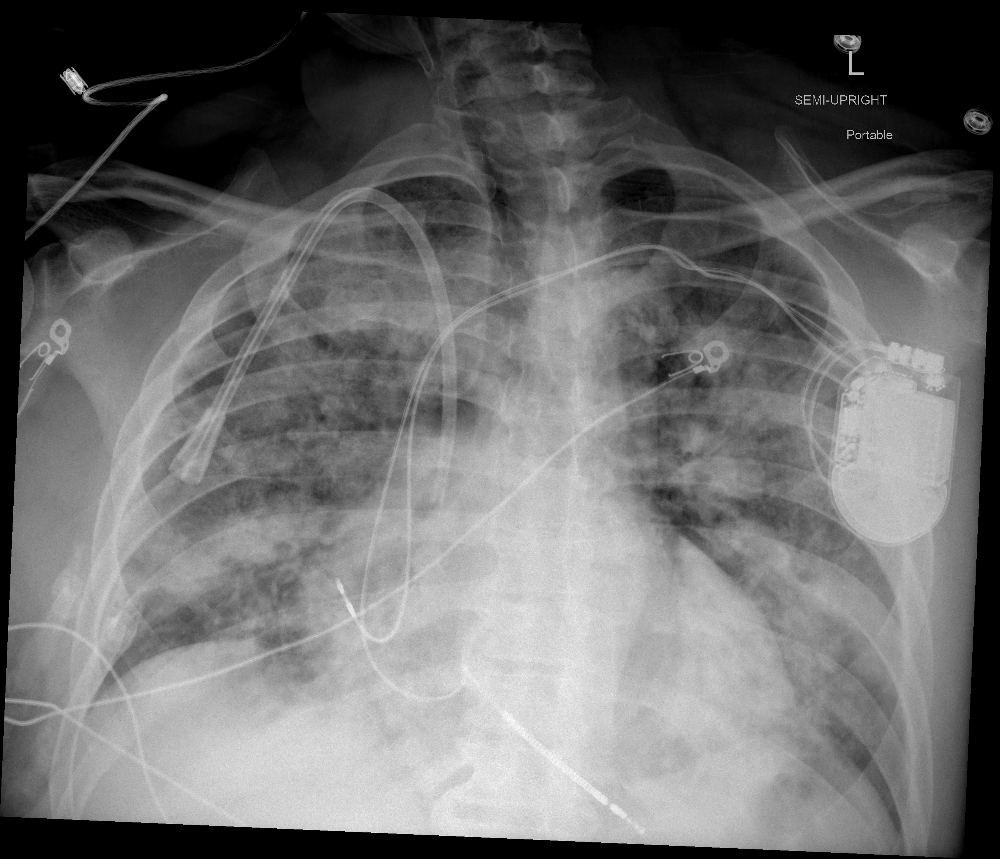

## 문제
60세 남자가 7일 전부터 열과 기침이 나고 3일 전부터 숨이 차서 응급실에 왔다. 확장성 심근병증으로 4년 전 이식형 제세동기를 넣었다. 체온 38.4°C, 맥박 102회/분, 호흡 28회/분, 혈압 118/70 mmHg 이고, 실내 공기에서 산소포화도는 88 % 이다. 양쪽 폐 아래쪽에서 수포음이 들린다. 비인두 검체의 SARS-CoV-2 핵산증폭검사는 양성이고, 인플루엔자 검사는 음성이다. 혈청 C-반응단백질은 9.8 mg/dL, 프로칼시토닌은 0.08 ng/mL 이다. 비강 캐뉼라로 산소 4 L/분을 시작해 산소포화도가 94 % 가 되었다. 이동형 흉부 X선 사진은 그림과 같다. 산소 투여와 함께 가장 적절한 약물은?

- A. 오셀타미비르
- B. 이버멕틴
- C. 로피나비르·리토나비르
- D. 덱사메타손
- E. 하이드록시클로로퀸

_반좌위 이동형 흉부 전후면 X선, 원 픽셀 그대로 (The Cancer Imaging Archive, CC BY 4.0 — 크롭·창 조절 없음)_

## 정답 및 해설
> 정답: D

- **정답 핵심**: 흉부 X선에서 양쪽 폐야, 특히 중·하폐야 말초에 반점·망상형 공기공간 음영이 넓게 퍼져 있다(왼쪽 앞가슴의 기기·유도선과 중심정맥관·비위관은 원래 있던 장치다). SARS-CoV-2 양성, 발병 7일째, 실내 공기 산소포화도 88 % 로 산소가 필요한 중증 코로나바이러스감염증-19 폐렴이다. 이 단계의 폐 손상은 바이러스 증식보다 과도한 염증 반응이 주도하므로, 산소가 필요한 환자에게 덱사메타손 6 mg 을 최대 10일 쓰면 사망률이 줄었다(RECOVERY 시험).
- **원리**: <b>왜 병의 시기에 따라 약이 다른가</b>: 코로나바이러스감염증-19 는 대개 두 단계로 진행한다. 첫 5~7일은 <b>바이러스 증식</b>이 주도해 항바이러스제(니르마트렐비르·렘데시비르)가 효과적이다. 그 뒤 일부 환자는 바이러스 양이 줄어도 사이토카인 분비·폐포 손상·혈관 내피 염증이 계속되는 <b>염증 단계</b>로 넘어가 저산소증이 생긴다. 이때 사망을 줄이는 것은 염증을 누르는 약이다.  <b>왜 덱사메타손이고 왜 산소가 기준인가</b>: RECOVERY 시험에서 덱사메타손 6 mg 은 기계환기 환자의 사망률을 약 3분의 1, 산소만 받는 환자는 약 5분의 1 줄였지만, <b>산소가 필요 없는 환자에서는 이득이 없고 해로울 수 있었다</b>. 그래서 산소 필요 여부가 투여 기준이다. 산소 요구가 빠르게 늘면 토실리주맙·바리시티닙을 더한다.  <b>영상의 역할</b>: 양쪽 말초·하폐야 우세의 다발성 음영은 바이러스 폐렴의 전형이며, 한 엽에 모인 경화가 아니어서 세균성 폐렴의 가능성을 낮춘다(낮은 프로칼시토닌도 같은 방향).
- **비교**: <table><thead><tr><th style="width:24%">항목</th><th style="width:38%">덱사메타손(정답)</th><th>하이드록시클로로퀸(가장 가까운 오답 — 대유행 초기 쓰였던 약)</th></tr></thead><tbody> <tr><td>작용</td><td><b>염증 반응 억제</b>(글루코코르티코이드)</td><td>시험관 내 바이러스 진입 억제(엔도솜 pH 상승)</td></tr> <tr><td>무작위 시험 결과</td><td>산소 필요 환자의 사망률 감소</td><td>사망·입원 기간 이득 없음, QT 연장</td></tr> <tr><td>대상</td><td>산소 또는 환기가 필요한 환자</td><td>권고 대상 없음(쓰지 않음)</td></tr> <tr><td>이 환자</td><td>실내 공기 88 %, 산소 필요 — 일치</td><td>이식형 제세동기 환자에서 QT 연장은 더 위험</td></tr> </tbody></table> 산소가 필요한가가 스테로이드를 정하고, 발병 시기가 항바이러스제를 정한다 — 어느 쪽으로 물어도 이 두 축으로 답한다.
- **오답 이유**:
  - ① 오셀타미비르는 인플루엔자 검사가 양성이거나 유행기에 결과를 기다리는 중이라면 정답이 되며, 이 환자는 음성이다.
  - ② 이버멕틴은 분선충 같은 기생충 감염이라면 정답이 되며, 무작위 시험에서 코로나바이러스감염증-19 의 회복을 앞당기지 못했다.
  - ③ 로피나비르·리토나비르는 인간면역결핍바이러스 감염의 병합요법이라면 정답이 되며, 입원 코로나바이러스감염증-19 에서 사망률 이득이 없었다.
  - ⑤ 하이드록시클로로퀸은 대규모 무작위 시험에서 사망률 이득이 없고 QT 를 늘려, 어떤 단계의 코로나바이러스감염증-19 에서도 정답이 되지 않는다.
- **함정**: 바이러스 감염이니 항바이러스·항기생충 약을 고르는 것 — 산소가 필요한 시기에는 염증을 누르는 덱사메타손이 사망률을 줄인다.
- **학습목표**: 이동형 흉부 X선의 양쪽 말초·하폐야 우세 다발성 음영과 저산소증으로 산소가 필요한 코로나바이러스감염증-19 폐렴을 판단하고 덱사메타손을 고른다
- **근거·출처**: RECOVERY Collaborative Group. Dexamethasone in hospitalized patients with Covid-19. N Engl J Med. 2021;384(8):693-704 · WHO Solidarity Trial Consortium. Repurposed antiviral drugs for Covid-19 — interim WHO Solidarity Trial results. N Engl J Med. 2021;384(6):497-511 · Desai SB, Pareek A, Lungren MP. Chest imaging representing a COVID-19 positive rural U.S. population. Sci Data. 2020;7:414

## 출처
- COVID-19-AR, The Cancer Imaging Archive (CC BY 4.0) · series …78050475 · Creative Commons Attribution 4.0 International · https://www.cancerimagingarchive.net/data-usage-policies-and-restrictions/
