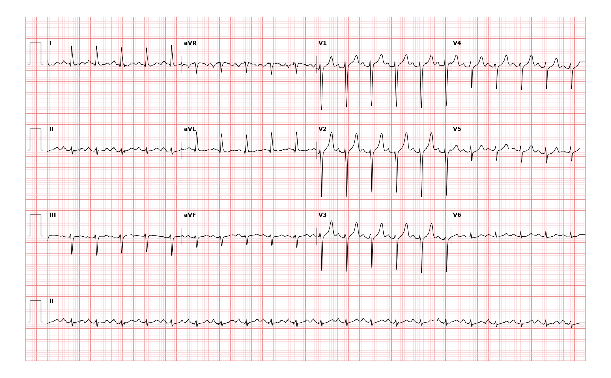

## 문제
53세 남자가 2일 전부터 열이 나고 가슴이 두근거려 응급실에 왔다. 두근거림은 갑자기 시작하거나 갑자기 멈추지 않았고 열이 오를 때 심해졌다. 기침과 누런 가래가 있다. 체온 38.9°C, 혈압 128/76 mmHg, 맥박 128회/분, 호흡 22회/분이다. 오른쪽 아래 폐에서 수포음이 들린다. 혈청 갑상샘자극호르몬은 정상이다. 12유도 심전도는 그림과 같다. 심전도 판독으로 가장 적절한 것은?

- A. 심방세동
- B. 동빈맥
- C. 발작성 상심실빈맥
- D. 2:1 전도 심방조동
- E. 다소성 심방빈맥

_12유도 심전도, 25 mm/s · 10 mm/mV, 3×4 + II 리듬 스트립 (PTB-XL ECG dataset, PhysioNet, CC BY 4.0 — 원신호 그대로 작도)_

## 정답 및 해설
> 정답: B

- **정답 핵심**: 리듬 스트립(II)에서 RR 간격이 일정하고 박동수는 약 128회/분이다. 모든 QRS 앞에 II 에서 양성인 P파가 같은 PR 간격으로 있고 QRS 는 좁다 — 동결절에서 시작한 빈맥, 즉 동빈맥이다. 열이 오를 때 심해지고 서서히 시작한 경과도 원인(발열·폐렴)에 대한 생리적 반응과 맞는다. 치료는 리듬이 아니라 원인이다.
- **원리**: <b>왜 P파의 축과 모양이 리듬을 정하는가</b>: 동결절은 우심방 위·바깥쪽에 있어 흥분이 위→아래, 오른쪽→왼쪽으로 퍼진다. 그래서 동리듬의 P파는 <b>I·II·aVF 에서 양성, aVR 에서 음성</b>이다. 같은 모양의 P파가 모든 QRS 앞에 같은 PR 로 오면 동결절이 지휘하고 있다는 뜻이다. 접합부·역행 전도 리듬은 II·III·aVF 에서 P파가 음성이거나 QRS 뒤에 숨는다.  <b>왜 박동수만으로는 부족한가</b>: 130~150회/분의 규칙적 좁은 QRS 빈맥은 동빈맥·2:1 심방조동·발작성 상심실빈맥이 모두 가능하다. 조동은 II·III·aVF 에서 톱니 모양 조동파(약 300회/분)가 보이고 하나는 QRS 에 묻힌다. 발작성 상심실빈맥은 갑자기 시작·종료하고 P파가 보이지 않거나 QRS 바로 뒤에 있다.  <b>동빈맥의 원인 찾기</b>: 발열(1°C 마다 약 10회/분), 탈수·출혈, 통증, 저산소증, 빈혈, 갑상샘항진증, 폐색전증, 약물을 차례로 본다.
- **비교**: <table><thead><tr><th style="width:24%">항목</th><th style="width:38%">동빈맥(정답)</th><th>발작성 상심실빈맥(가장 가까운 오답)</th></tr></thead><tbody> <tr><td>P파</td><td><b>모든 QRS 앞, II 양성, 일정한 PR</b></td><td>보이지 않거나 QRS 바로 뒤(II 음성 역행 P)</td></tr> <tr><td>시작·종료</td><td>서서히(원인에 따라 오르내림)</td><td>갑자기 시작하고 갑자기 멈춘다</td></tr> <tr><td>박동수</td><td>대개 &lt; 150회/분, 원인 따라 변동</td><td>150~250회/분으로 고정</td></tr> <tr><td>치료</td><td>원인 치료(해열·수액·항생제)</td><td>미주신경 자극 → 아데노신</td></tr> </tbody></table> P파가 앞에 있고 모양이 정상이면 빠르기와 상관없이 동리듬이다.
- **오답 이유**:
  - ① 심방세동은 P파 없이 기저선이 불규칙하게 떨리고 RR 간격이 완전히 불규칙하다면 정답이 된다.
  - ③ 발작성 상심실빈맥은 P파가 보이지 않는 150회/분 이상의 규칙적 좁은 QRS 빈맥이 갑자기 시작하고 멈췄다면 정답이 된다.
  - ④ 2:1 전도 심방조동은 II·III·aVF 에서 톱니 모양 조동파가 보이고 심실박동이 약 150회/분으로 고정돼 있다면 정답이 된다.
  - ⑤ 다소성 심방빈맥은 모양이 다른 P파가 3가지 이상이고 PR·RR 이 불규칙하다면(중증 폐질환 환자에서) 정답이 된다.
- **함정**: 빠르면 상심실빈맥이라고 부르는 것 — 모든 QRS 앞에 정상 축의 P파가 있으면 동빈맥이다.
- **학습목표**: 모든 QRS 앞에 II 양성 P파가 일정한 PR 로 오는 규칙적 빈맥을 동빈맥으로 판독하고, 발열이라는 원인과 연결해 발작성 상심실빈맥·심방조동과 가른다
- **근거·출처**: Loscalzo J, Fauci AS, Kasper DL, et al., eds. Harrison's Principles of Internal Medicine, 22nd ed. McGraw Hill; 2025. Chapter 254: Physiologic and Nonphysiologic Sinus Rhythm · Loscalzo J, Fauci AS, Kasper DL, et al., eds. Harrison's Principles of Internal Medicine, 22nd ed. McGraw Hill; 2025. Chapter 247: Electrocardiography · Wagner P, Strodthoff N, Bousseljot RD, et al. PTB-XL, a large publicly available electrocardiography dataset. Sci Data. 2020;7:154

## 출처
- PTB-XL ECG dataset v1.0.3 (PhysioNet, CC BY 4.0) · record 14306 · Creative Commons Attribution 4.0 International · https://physionet.org/content/ptb-xl/1.0.3/LICENSE.txt
