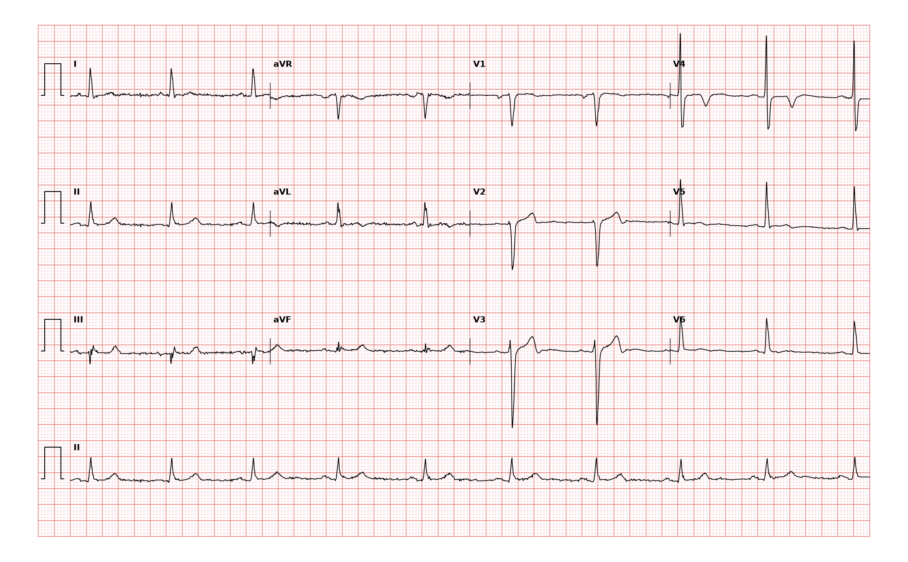

## 문제
62세 남자가 오늘 새벽 쉬고 있을 때 가슴이 조이는 통증이 20분 동안 이어져 응급실에 왔다. 이틀 전에도 같은 통증이 있었다. 지금은 통증이 없다. 고혈압과 이상지질혈증으로 약을 먹고 있고 30년간 담배를 피웠다. 혈압 138/84 mmHg, 맥박 56회/분이다. 심음은 규칙적이고 잡음은 없으며 폐는 깨끗하다. 고감도 트로포닌 I 는 처음 기준치 이하였고 2시간 뒤 기준치의 4배로 올랐다. 12유도 심전도는 그림과 같다. 아스피린을 투여한 뒤 가장 적절한 처치는?

- A. 통증이 없으므로 외래에서 추적
- B. 흉부 CT 혈관조영술로 대동맥박리 확인
- C. 입원해 항응고제를 쓰고 24시간 안에 관상동맥조영술
- D. 즉시 혈전용해제 정맥 투여
- E. 당일 트레드밀 운동부하검사

_12유도 심전도, 25 mm/s · 10 mm/mV, 3×4 + II 리듬 스트립 (PTB-XL ECG dataset, PhysioNet, CC BY 4.0 — 원신호 그대로 작도)_

## 정답 및 해설
> 정답: C

- **정답 핵심**: 리듬 스트립(II)은 규칙적 동리듬 약 56회/분이다. V4 에 깊고 좌우 대칭인 T파 역위, V5 에 편평·얕은 T파 역위가 있고, V1·V2 는 QS 형이며 어느 유도에도 ST 상승은 없다 — 전벽 허혈 소견이다. 안정 시 반복된 흉통과 고감도 트로포닌의 상승·하강 패턴은 비ST분절상승 심근경색이며, 트로포닌 상승과 동적 T파 변화로 고위험군이다. 항혈소판 2제와 항응고제를 쓰고 24시간 안에 조기 침습적 관상동맥조영술을 한다. 운동부하검사는 불안정한 관상동맥 병변에 위험하다.
- **원리**: <b>왜 T파가 뒤집히는가</b>: 정상에서는 심외막이 심내막보다 먼저 재분극해 재분극 파면이 탈분극과 반대 방향으로 움직이고, 그래서 T파가 QRS 와 같은 방향(양성)이 된다. 허혈이 일어나면 그 부위의 활동전위 지속이 바뀌어 재분극 순서가 뒤집히고, 해당 영역을 보는 유도에서 <b>깊고 대칭인 T파 역위</b>가 나타난다. 전흉부(V2~V5)는 좌전하행지가 공급하는 전벽을 본다.  <b>왜 ST 상승이 없으면 혈전용해제를 쓰지 않는가</b>: ST 상승은 관상동맥이 완전히 막혀 심근 전층이 손상될 때 나타난다. 비ST분절상승 급성관상동맥증후군은 대개 부분 폐쇄·혈소판 풍부 혈전이라, 혈전용해제는 이득 없이 출혈과 혈소판 활성화만 늘린다.  <b>침습적 전략의 시기</b>: 혈역학 불안정·지속 통증·심부전·악성 부정맥 → 2시간 이내, 트로포닌으로 확진된 심근경색·동적 ST-T 변화·GRACE > 140 → 24시간 이내, 나머지 → 입원 중 선택적. 이 환자는 24시간 이내 군이다.
- **비교**: <table><thead><tr><th style="width:24%">항목</th><th style="width:38%">조기 관상동맥조영술(정답)</th><th>운동부하검사(가장 가까운 오답)</th></tr></thead><tbody> <tr><td>대상</td><td><b>트로포닌 상승 · 동적 ST-T 변화</b>가 있는 급성관상동맥증후군</td><td>트로포닌 정상 · 심전도 정상인 저위험 흉통</td></tr> <tr><td>목적</td><td>원인 병변을 찾아 바로 재관류</td><td>안정형 협심증의 허혈 유발 여부 확인</td></tr> <tr><td>왜 그 기준인가</td><td>불안정 판막(플라크)이 이미 파열돼 있다</td><td>운동이 파열된 플라크에 부하를 줘 경색을 일으킬 수 있다</td></tr> <tr><td>이 환자</td><td>트로포닌 4배 상승 · V4 깊은 T파 역위 — 해당</td><td>금기</td></tr> </tbody></table> 트로포닌이 오르면 「부하 검사로 확인」이 아니라 「혈관을 직접 본다」로 넘어간다.
- **오답 이유**:
  - ① 외래 추적은 고감도 트로포닌이 두 번 모두 정상이고 심전도 변화가 없는 저위험 흉통이라면 고려할 수 있다.
  - ② 흉부 CT 혈관조영술은 등으로 찢어지는 통증·양팔 혈압 차·종격동 확장이 있어 대동맥박리를 의심할 때 정답이 된다.
  - ④ 혈전용해제는 두 개 이상의 인접 유도에서 ST 상승이 있고 120분 안에 경피적 관상동맥중재술을 할 수 없을 때 정답이 된다.
  - ⑤ 트레드밀 운동부하검사는 연속 트로포닌과 심전도가 정상인 저위험 흉통 환자를 퇴원 전에 평가할 때 정답이 된다.
- **함정**: 통증이 없으니 안정형으로 보고 부하검사를 고르는 것 — 트로포닌 상승과 전흉부 T파 역위는 고위험 급성관상동맥증후군이다.
- **학습목표**: 안정 시 흉통 뒤 통증이 없는 환자의 전흉부 깊고 대칭인 T파 역위를 고위험 비ST분절상승 급성관상동맥증후군으로 보고, 운동부하검사가 아니라 입원·항혈소판·항응고와 조기 관상동맥조영술을 고른다
- **근거·출처**: Loscalzo J, Fauci AS, Kasper DL, et al., eds. Harrison's Principles of Internal Medicine, 22nd ed. McGraw Hill; 2025. Chapter 285: Non-ST-Segment Elevation Acute Coronary Syndrome (Non-ST-Segment Elevation Myocardial Infarction and Unstable Angina) · Byrne RA, Rossello X, Coughlan JJ, et al. 2023 ESC Guidelines for the management of acute coronary syndromes. Eur Heart J. 2023;44(38):3720-3826 · Wagner P, Strodthoff N, Bousseljot RD, et al. PTB-XL, a large publicly available electrocardiography dataset. Sci Data. 2020;7:154

## 출처
- PTB-XL ECG dataset v1.0.3 (PhysioNet, CC BY 4.0) · record 6120 · Creative Commons Attribution 4.0 International · https://physionet.org/content/ptb-xl/1.0.3/LICENSE.txt
