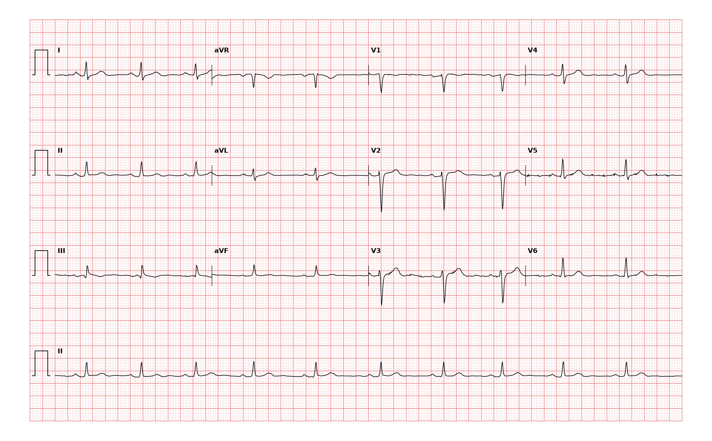

## 문제
A 43-year-old woman comes to the physician for a follow-up visit. Five weeks ago, she had severe chest pressure for several hours that she attributed to stress and did not seek care. Since then she has had mild dyspnea when climbing two flights of stairs. She has type 1 diabetes mellitus and smokes 1 pack of cigarettes daily. Her blood pressure is 122/76 mm Hg, and pulse is 62/min. The lungs are clear, and there is no jugular venous distention. High-sensitivity troponin I concentration is within the reference range. A 12-lead ECG is shown. Occlusion of which of the following arteries is the most likely cause of these findings?

- A. Left anterior descending artery
- B. Left circumflex artery
- C. Right coronary artery
- D. Left main coronary artery
- E. Posterior descending artery

_12-lead ECG, 25 mm/s, 10 mm/mV, 3×4 + lead II rhythm strip (PTB-XL, PhysioNet, CC BY 4.0; raw signal, no filtering)_

## 정답 및 해설
> 정답: A

- **정답 핵심**: The rhythm is sinus at about 62/min. V1 and V2 show QS complexes with no initial r wave, and V3 has only a tiny r wave followed by a deep S wave, so R-wave progression is lost across the septal–anterior leads. There is no ST elevation, and the limb leads and V5–V6 have normal R waves. Pathologic Q waves in V1–V3 indicate an anteroseptal infarction, which is supplied by the septal and proximal diagonal branches of the left anterior descending artery. With a normal troponin and an event 5 weeks ago, it is an established (old) infarction.
- **원리**: <b>Why a Q wave appears</b>: Normally the septum depolarizes left to right first, producing a small r in V1–V2. When the septum and anterior wall are replaced by scar, that tissue no longer generates forward-pointing forces; the electrode then "looks through" the electrically silent window to the opposite wall, whose forces point away, recording a QS complex. In the precordial leads, any Q wave in V1–V3, or loss of the expected increase in R amplitude from V1 to V4, suggests anteroseptal infarction.  <b>Why it maps to the LAD</b>: The LAD runs in the anterior interventricular groove, sending septal perforators to the anterior two-thirds of the septum and diagonals to the anterior wall. V1–V2 face the septum, V3–V4 the anterior wall, and V5–V6 with I and aVL the lateral wall (circumflex/diagonals). The inferior leads (II, III, aVF) reflect the RCA in most people.  <b>Dating the infarct</b>: ST elevation that persists more than a few weeks after the event suggests a ventricular aneurysm; its absence with stable Q waves and normal troponin indicates a completed, healed infarct. The exertional dyspnea warrants echocardiography for left ventricular function.
- **비교**: <table><thead><tr><th style="width:24%">Feature</th><th style="width:38%">Left anterior descending (answer)</th><th>Left circumflex (closest distractor)</th></tr></thead><tbody> <tr><td>Territory</td><td><b>Anterior septum and anterior wall</b></td><td>Lateral and posterolateral wall</td></tr> <tr><td>Leads with Q waves</td><td>V1–V3 (± V4)</td><td>I, aVL, V5–V6; posterior infarct shows tall R in V1–V2</td></tr> <tr><td>V1–V2 appearance</td><td>QS — septal r wave lost</td><td>Normal or tall R (mirror of posterior Q)</td></tr> <tr><td>This tracing</td><td>QS in V1–V2, tiny r in V3 — consistent</td><td>Normal R in I, aVL, V5–V6 — inconsistent</td></tr> </tbody></table> Q waves in V1–V3 mean the septum is lost, and the septum belongs to the LAD.
- **오답 이유**:
  - (B) The left circumflex artery would be the answer if Q waves were in I, aVL, V5, and V6, or if tall R waves in V1–V2 indicated a posterior infarction.
  - (C) The right coronary artery would be the answer if pathologic Q waves were in II, III, and aVF, since it supplies the inferior wall in most people.
  - (D) Left main occlusion would cause extensive anterior and lateral damage, usually with shock, rather than Q waves confined to V1–V3 in a stable patient.
  - (E) The posterior descending artery would be the answer for an isolated inferior or inferoposterior infarction with Q waves in II, III, and aVF.
- **함정**: Expecting ST elevation to make the diagnosis — weeks after an infarction, only the Q waves remain to localize it.
- **학습목표**: Read QS complexes in V1–V2 with loss of R-wave progression into V3 and no ST elevation as an established anteroseptal infarction and identify the left anterior descending artery as the culprit vessel
- **근거·출처**: Loscalzo J, Fauci AS, Kasper DL, et al., eds. Harrison's Principles of Internal Medicine, 22nd ed. McGraw Hill; 2025. Chapter 247: Electrocardiography · Thygesen K, Alpert JS, Jaffe AS, et al. Fourth universal definition of myocardial infarction (2018). Circulation. 2018;138(20):e618-e651 · Wagner P, Strodthoff N, Bousseljot RD, et al. PTB-XL, a large publicly available electrocardiography dataset. Sci Data. 2020;7:154

## 출처
- PTB-XL ECG dataset v1.0.3 (PhysioNet, CC BY 4.0) · record 5793 · Creative Commons Attribution 4.0 International · https://physionet.org/content/ptb-xl/1.0.3/LICENSE.txt
