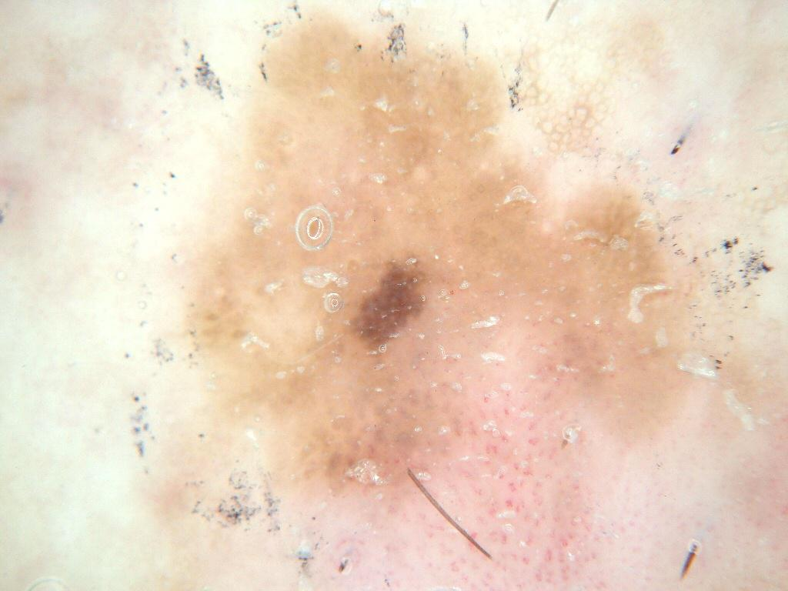

## 문제
55세 남자가 오른쪽 정강이의 갈색 반점이 신경 쓰여 피부과에 왔다. 반점은 수년 전부터 있었고 아주 천천히 커졌다. 가렵거나 피가 난 적은 없다. 젊을 때 야외 작업을 오래 했다. 피부암 가족력은 없다. 병변은 지름 약 1.5 cm 의 편평한 연갈색 반으로 만져지지 않으며 궤양은 없다. 몸의 다른 곳에도 비슷한 작은 갈색 반이 몇 개 있다. 병변의 더모스코피 사진은 그림과 같다. 가장 가능성이 높은 진단은?

- A. 색소성 기저세포암
- B. 흑자
- C. 악성흑색종
- D. 지루각화증
- E. 복합모반

_더모스코피(편광) 사진, 원본 그대로 크기 조정만 (ISIC Archive, CC-0 — 크롭·색 보정 없음)_

## 정답 및 해설
> 정답: B

- **정답 핵심**: 병변 전체가 고르게 연한 갈색이고 내부에 색소망·점·선조가 없는 구조 없는 색소반이며, 경계는 좀먹은 듯 불규칙하게 파였지만 뚜렷하다. 중앙에 작은 진갈색 얼룩이 있으나 비정형 색소망·불규칙 선조·청백색 베일·퇴행 구조가 없다. 면포양 개구·비립종양 낭이 없어 지루각화증과도 다르다. 햇빛 노출이 많은 노년층에서 수년간 천천히 커진 편평한 갈색 반 — 흑자(일광흑자)다(이 사진은 조직검사로 확정된 흑자이다).
- **원리**: <b>왜 흑자는 「구조가 없는」가</b>: 흑자는 표피 기저층의 멜라닌세포 수가 약간 늘고 기저 각질세포에 멜라닌이 많아진 병변이다. 멜라닌세포가 둥지(nest)를 만들지 않으므로 더모스코피에서 점·소구(globule)가 생기지 않고, 표피능선을 따라 색소가 고르게 퍼져 균일한 연갈색 바탕이나 가는 지문 모양 선으로 보인다. 경계가 좀먹은 듯(moth-eaten) 파이는 것은 이웃한 정상 피부와 경계가 들쭉날쭉하게 맞닿기 때문이다.  <b>왜 흑색종에서는 구조가 깨지는가</b>: 흑색종은 비정형 멜라닌세포가 표피 위쪽과 진피로 퍼지며 불규칙한 둥지를 만든다. 그래서 굵기가 다른 비정형 색소망, 가장자리의 불규칙 선조·위족, 진피 멜라닌과 각화가 겹친 청백색 베일, 면역반응으로 색이 빠진 퇴행 구조가 생긴다 — 「여러 색·여러 구조가 비대칭으로」 섞인다.  <b>지루각화증</b>은 각질세포가 증식한 병변이라 각질이 고인 면포양 개구와 비립종양 낭, 뇌회 모양 이랑이 보인다.
- **비교**: <table><thead><tr><th style="width:24%">더모스코피 소견</th><th style="width:38%">흑자(정답)</th><th>악성흑색종(가장 가까운 오답)</th></tr></thead><tbody> <tr><td>구조</td><td><b>균일한 연갈색, 구조 없음</b> 또는 지문 모양 선</td><td>비정형 색소망·불규칙 점·소구·선조</td></tr> <tr><td>색</td><td>1~2가지 갈색</td><td>3가지 이상(갈색·검정·청회색·흰색)</td></tr> <tr><td>특이 구조</td><td>좀먹은 듯한 경계</td><td>청백색 베일·퇴행 구조</td></tr> <tr><td>왜 그런가</td><td>멜라닌세포가 둥지 없이 기저층에만 고르게</td><td>비정형 세포가 둥지를 만들며 위·아래로 퍼짐</td></tr> <tr><td>이 환자</td><td>구조 없는 연갈색 · 편평 · 천천히 커짐 — 일치</td><td>청백색 베일·비정형 망 없음 — 불일치</td></tr> </tbody></table> 「색과 구조가 몇 가지인가」가 양성과 악성을 가르는 첫 질문이다 — 중앙의 작은 진한 얼룩 하나만으로 흑색종이라 하지 않지만, 새로 생기거나 변하면 생검한다.
- **오답 이유**:
  - ① 색소성 기저세포암은 진주 같은 광택과 함께 나뭇가지 모양 혈관·잎 모양 구조·청회색 난원형 덩어리가 보였다면 정답이 된다.
  - ③ 악성흑색종은 같은 자리에 비정형 색소망·불규칙 선조·청백색 베일이 보이거나 최근 빠르게 모양·색이 변했다면 정답이 된다.
  - ④ 지루각화증은 병변이 약간 솟아 있고 더모스코피에서 면포양 개구·비립종양 낭·뇌회 모양 이랑이 보였다면 정답이 된다.
  - ⑤ 복합모반은 젊은 환자의 약간 솟은 병변에서 규칙적인 소구·색소망이 대칭으로 보였다면 정답이 된다.
- **함정**: 갈색 반 중앙의 진한 얼룩 하나만 보고 흑색종을 고르는 것 — 구조의 종류와 색의 수를 먼저 센다.
- **학습목표**: 더모스코피에서 좀먹은 듯한 경계의 균일한 연갈색 구조 없는 색소반을 흑자로 판독하고, 비정형 색소망·청백색 베일이 있는 흑색종, 면포양 개구가 있는 지루각화증과 가른다
- **근거·출처**: Loscalzo J, Fauci AS, Kasper DL, et al., eds. Harrison's Principles of Internal Medicine, 22nd ed. McGraw Hill; 2025. Chapter 81: Cancer of the Skin · Loscalzo J, Fauci AS, Kasper DL, et al., eds. Harrison's Principles of Internal Medicine, 22nd ed. McGraw Hill; 2025. Chapter 59: Approach to the Patient with a Skin Disorder · ISIC Archive, International Skin Imaging Collaboration — histopathology-confirmed dermoscopic image (CC-0)

## 출처
- ISIC Archive ISIC_0009983 (CC-0) · CC0 1.0 Universal · https://creativecommons.org/publicdomain/zero/1.0/
