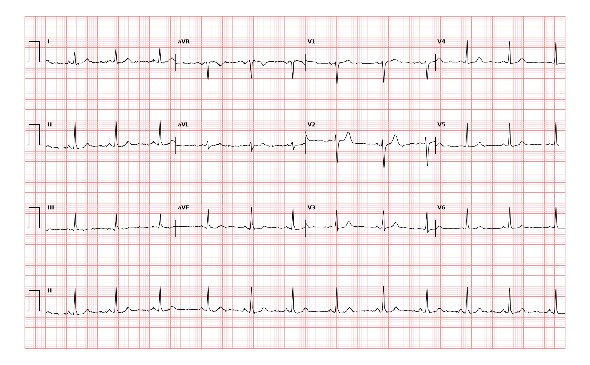

## 문제
A 40-year-old woman comes to the emergency department because of sharp left-sided chest pain for 3 days. The pain began after she helped a friend move furniture, worsens with deep breathing and twisting of the trunk, and does not change with sitting forward. She has no fever, dyspnea, leg swelling, or recent travel. She takes no medications. Her temperature is 36.7°C, pulse is 72/min, respirations are 16/min, and blood pressure is 118/74 mm Hg. Pressing on the left second to fourth costosternal junctions reproduces the pain exactly. Heart sounds are normal without a friction rub, and the lungs are clear. High-sensitivity troponin I concentration is below the reference limit. A 12-lead ECG is shown. Which of the following is the most likely diagnosis?

- A. Inferior ST-elevation myocardial infarction
- B. Pulmonary embolism
- C. Vasospastic angina
- D. Costochondritis
- E. Acute pericarditis

_12-lead ECG, 25 mm/s, 10 mm/mV, 3×4 + lead II rhythm strip (PTB-XL, PhysioNet, CC BY 4.0; raw signal, no filtering)_

## 정답 및 해설
> 정답: D

- **정답 핵심**: The ECG shows sinus rhythm at about 72/min with a normal axis, normal PR, QRS, and QT intervals, no ST elevation or depression, no PR-segment depression, and upright T waves — a normal ECG. Pain that started after lifting, worsens with trunk movement, and is reproduced exactly by pressing on the costosternal junctions, with a normal ECG and troponin, is costochondritis.
- **원리**: <b>Why the ECG is part of the diagnosis even when the answer is musculoskeletal</b>: Chest-wall tenderness lowers but does not exclude cardiac disease — a minority of patients with acute coronary syndrome also have reproducible tenderness. The ECG and troponin are what let you commit to a chest-wall cause. A normal ECG argues against the three dangerous conditions in the options because each leaves a characteristic electrical trace.  <b>Pericarditis</b> inflames the epicardium over the whole heart, so the current of injury produces <b>diffuse concave ST elevation with PR-segment depression</b> (atrial injury) in most leads, with reciprocal changes only in aVR and V1. <b>Transmural ischemia</b> produces ST elevation confined to one coronary territory with reciprocal depression. <b>Pulmonary embolism</b> often shows sinus tachycardia and right-heart strain (S1Q3T3, right precordial T inversion).  <b>Why costochondritis hurts with movement</b>: Inflammation of the costochondral and costosternal cartilage is loaded by trunk rotation and deep inspiration; pressure reproduces the pain exactly because the source is superficial.
- **비교**: <table><thead><tr><th style="width:24%">Feature</th><th style="width:38%">Costochondritis (answer)</th><th>Acute pericarditis (closest distractor)</th></tr></thead><tbody> <tr><td>Pain</td><td>Reproduced by palpation; worse with trunk movement</td><td>Pleuritic; <b>relieved by sitting forward</b></td></tr> <tr><td>ECG</td><td><b>Normal</b></td><td>Diffuse concave ST elevation with PR depression</td></tr> <tr><td>Why</td><td>The source is chest-wall cartilage, not myocardium</td><td>Inflamed epicardium creates a current of injury in all leads</td></tr> <tr><td>Examination</td><td>Focal costosternal tenderness</td><td>Friction rub, often fever</td></tr> <tr><td>This patient</td><td>Exact reproduction, normal ECG — consistent</td><td>No positional relief, no rub, no ST change — inconsistent</td></tr> </tbody></table> Pleuritic pain is shared; posture, palpation, and the ECG pattern separate them.
- **오답 이유**:
  - (A) Inferior ST-elevation myocardial infarction would be correct if leads II, III, and aVF showed ST elevation with reciprocal depression in I and aVL and troponin rose.
  - (B) Pulmonary embolism would be correct with dyspnea, tachycardia, hypoxemia, and a risk factor such as recent immobilization or estrogen use.
  - (C) Vasospastic angina would be correct for recurrent rest pain in the early morning with transient ST elevation that resolves with nitrates.
  - (E) Acute pericarditis would be correct if the pain eased on sitting forward and the ECG showed diffuse ST elevation with PR depression or a friction rub was heard.
- **함정**: Assuming any pleuritic chest pain is pericarditis — pericarditis needs its ECG pattern or a rub, and exact reproduction by palpation points to the chest wall.
- **학습목표**: Read a normal 12-lead ECG (sinus rhythm, normal axis and intervals, no ST elevation or PR depression) in a patient with chest pain reproduced by palpation and diagnose costochondritis rather than pericarditis or acute coronary syndrome
- **근거·출처**: Loscalzo J, Fauci AS, Kasper DL, et al., eds. Harrison's Principles of Internal Medicine, 22nd ed. McGraw Hill; 2025. Chapter 15: Chest Discomfort · Loscalzo J, Fauci AS, Kasper DL, et al., eds. Harrison's Principles of Internal Medicine, 22nd ed. McGraw Hill; 2025. Chapter 247: Electrocardiography · Wagner P, Strodthoff N, Bousseljot RD, et al. PTB-XL, a large publicly available electrocardiography dataset. Sci Data. 2020;7(1):154

## 출처
- PTB-XL ECG dataset v1.0.3 (PhysioNet, CC BY 4.0) · record 13522 · Creative Commons Attribution 4.0 International · https://physionet.org/content/ptb-xl/1.0.3/LICENSE.txt
