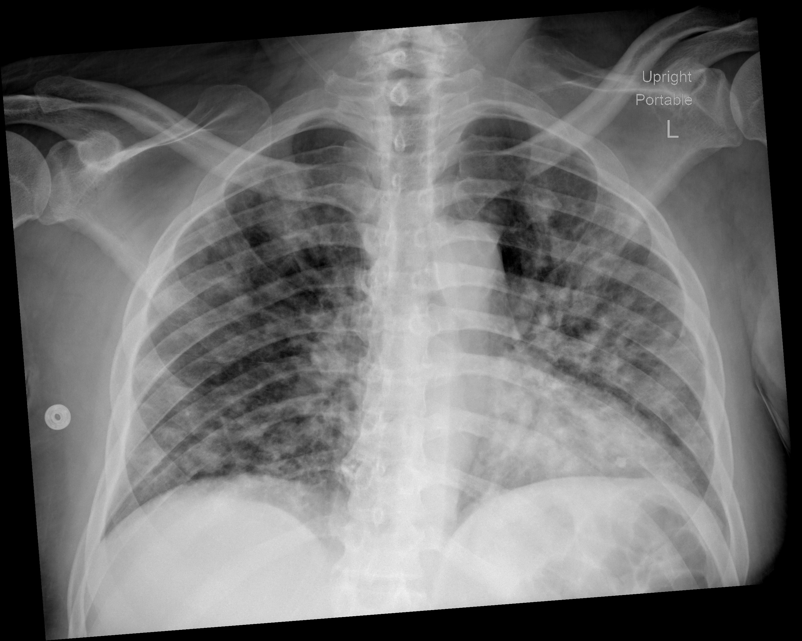

## 문제
55세 남자가 8일 전부터 열·근육통·마른기침이 있었고 3일 전부터 숨이 차서 응급실에 왔다. 증상이 시작되기 이틀 전 같이 사는 아내가 비슷한 증상을 앓았다. 냄새를 잘 맡지 못한다. 심장병 병력은 없다. 체온 38.4°C, 혈압 132/80 mmHg, 맥박 102회/분, 호흡 26회/분, 실내 공기에서 산소포화도 89 % 이다. 양쪽 아래 폐에서 미세 수포음이 들린다. 경정맥 확장과 다리 부종은 없다. 백혈구 5,200/mm³(림프구 9 %), C-반응단백 9.8 mg/dL 이다. 흉부 X선 사진은 그림과 같다. 가장 가능성이 높은 진단은?

- A. 폐렴구균 대엽성 폐렴
- B. 활동성 폐결핵
- C. 주폐포자충 폐렴
- D. 코로나바이러스감염증-19 폐렴
- E. 심인성 폐부종

_직립 이동형 흉부 전후면 X선, 글자·좌우 표지는 원본의 것, 크기 조정만 (The Cancer Imaging Archive, CC BY 4.0 — 크롭·창 조절 없음)_

## 정답 및 해설
> 정답: D

- **정답 핵심**: 흉부 X선에서 양쪽 폐의 중·하폐야에 말초(흉막 쪽)에 치우친 다발성 반점상·망상 음영과 경화가 있고, 심장 크기는 정상이며 흉수가 없다. 가족 접촉 뒤 발열·근육통·후각 저하가 먼저 오고 1주일쯤 지나 저산소증이 생긴 경과, 림프구 감소가 함께 있어 코로나바이러스감염증-19 폐렴이 가장 가능성이 높다. 확진은 비인두 검체의 핵산증폭검사로 한다.
- **원리**: <b>왜 말초·하폐야·양쪽인가</b>: SARS-CoV-2 는 폐포 상피(제2형 폐포세포)의 ACE2 수용체에 붙어 들어가 미만성 폐포 손상을 만든다. 폐포가 많은 흉막 아래 말초와 혈류·환기가 많은 하엽에서 먼저, 양쪽에 여러 군데 동시에 생겨 CT 에서는 말초 간유리음영, X선에서는 말초 우세의 반점상 음영으로 보인다.  <b>왜 1주일 뒤 숨이 차는가</b>: 초기 1주는 바이러스 증식기(발열·근육통·후각 저하), 그 뒤는 염증기다 — 숙주 면역 반응이 폐포 손상을 키워 저산소증이 이 시기에 나타난다. 그래서 산소가 필요한 시기에는 항염증 치료(덱사메타손)가 사망률을 낮춘다.  <b>림프구 감소</b>는 바이러스 폐렴, 특히 코로나바이러스감염증-19의 흔한 소견이고, 호중구 증가가 두드러진 세균 폐렴과 다르다.
- **비교**: <table><thead><tr><th style="width:24%">항목</th><th style="width:38%">코로나바이러스감염증-19 폐렴(정답)</th><th>심인성 폐부종(가장 가까운 오답)</th></tr></thead><tbody> <tr><td>음영 분포</td><td><b>말초·하폐야 우세</b>, 양쪽 다발성</td><td>폐문 주위 중심성(나비 모양)</td></tr> <tr><td>심장·흉수</td><td>심장 크기 정상, 흉수 드묾</td><td>심장 비대, 양쪽 흉수, Kerley B 선</td></tr> <tr><td>왜 그런가</td><td>폐포 상피 손상이 흉막 아래 폐포에서 시작</td><td>정수압이 높은 폐문 주위 간질부터 물이 찬다</td></tr> <tr><td>임상</td><td>발열·근육통·림프구 감소·접촉력</td><td>경정맥 확장·다리 부종·심장병</td></tr> <tr><td>이 환자</td><td>말초 음영 · 정상 심장 · 발열 — 일치</td><td>경정맥 확장·부종·흉수 없음 — 불일치</td></tr> </tbody></table> 양쪽 음영은 「어디에 몰렸는가(말초 대 중심)」와 「심장·흉수」로 가른다.
- **오답 이유**:
  - ① 폐렴구균 대엽성 폐렴은 갑작스러운 오한·화농성 가래와 함께 한 엽에 국한된 공기기관지조영 경화가 보였다면 정답이 된다.
  - ② 활동성 폐결핵은 수주 이상의 기침·체중 감소·야간 발한과 함께 위엽 첨부의 공동·결절이 보였다면 정답이 된다.
  - ③ 주폐포자충 폐렴은 HIV 감염이나 장기 스테로이드 같은 면역저하가 있고 폐문 주위 양쪽 간유리음영이 보였다면 정답이 된다.
  - ⑤ 심인성 폐부종은 심장 비대·양쪽 흉수·폐문 주위 음영과 함께 경정맥 확장·다리 부종이 있었다면 정답이 된다.
- **함정**: 양쪽 폐 음영을 모두 폐부종으로 읽는 것 — 말초 분포, 정상 심장, 발열·림프구 감소가 감염을 가리킨다.
- **학습목표**: 흉부 X선에서 양쪽 중·하폐야 말초 우세의 다발성 반점상 음영을 바이러스 폐렴(코로나바이러스감염증-19)으로 판독하고, 심인성 폐부종·대엽성 세균 폐렴과 가른다
- **근거·출처**: Loscalzo J, Fauci AS, Kasper DL, et al., eds. Harrison's Principles of Internal Medicine, 22nd ed. McGraw Hill; 2025. Chapter 205: SARS-CoV-2 and COVID-19 · Loscalzo J, Fauci AS, Kasper DL, et al., eds. Harrison's Principles of Internal Medicine, 22nd ed. McGraw Hill; 2025. Chapter 131: Pneumonia · Desai S, Baghal A, Wongsurawat T, et al. Chest imaging representing a COVID-19 positive rural U.S. population. Sci Data. 2020;7(1):414

## 출처
- COVID-19-AR, The Cancer Imaging Archive (CC BY 4.0) · series …07979850 · Creative Commons Attribution 4.0 International · https://www.cancerimagingarchive.net/data-usage-policies-and-restrictions/
