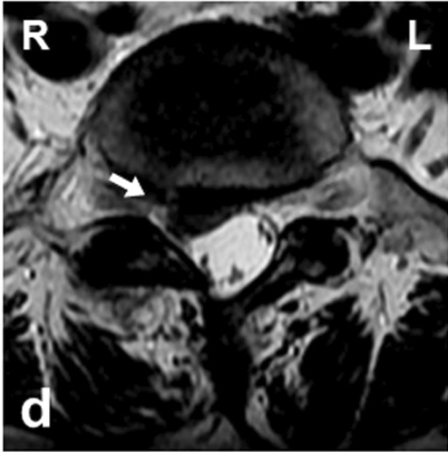

## 문제
A 55-year-old woman comes to the clinic because of low back pain radiating down the back of her right leg to the lateral foot for 3 months. The pain began after she lifted a heavy box and is worse with sitting and coughing. Six weeks of nonsteroidal anti-inflammatory drugs and physical therapy have not helped. She has no fever, weight loss, history of cancer, or urinary or bowel incontinence. Her temperature is 36.6°C. Straight-leg raising on the right reproduces the leg pain at 40 degrees. Muscle strength is normal, and perianal sensation is intact. An axial T2-weighted MRI of the lumbar spine is shown. Which of the following is the most likely cause of this patient's symptoms?

- A. Posterolateral herniation of the nucleus pulposus
- B. Lumbar spinal stenosis from ligamentum flavum hypertrophy
- C. Spinal epidural abscess
- D. Vertebral body metastasis
- E. Facet joint synovial cyst

_Axial T2-weighted MRI of the lumbar spine at the lowest disc level; one panel of a published case figure, the arrow and R/L markers are the authors' original markings (PMC Open Access Subset, CC BY — no adjustment)_

## 정답 및 해설
> 정답: A

- **정답 핵심**: The axial T2-weighted image shows low-signal disc material extending posteriorly from the right posterolateral margin of the disc (arrow), indenting the right anterior thecal sac and filling the right lateral recess, while the left side is normal. The vertebral body signal is preserved and there is no fluid collection. Radicular pain after lifting, worsened by sitting and coughing, with a positive straight-leg raise matches a posterolateral disc herniation compressing a nerve root.
- **원리**: <b>Why herniations go posterolateral</b>: The annulus fibrosus is thinnest posterolaterally, and the posterior longitudinal ligament is strongest in the midline. Nucleus pulposus therefore escapes beside the ligament into the lateral recess, where it compresses the <b>traversing</b> root (the root that exits one level below); a far-lateral herniation compresses the exiting root instead.  <b>Why sitting and coughing make it worse</b>: Sitting raises intradiscal pressure, and coughing raises epidural venous and intrathecal pressure — both push the herniated material harder against the root. Straight-leg raising tensions the L5 and S1 roots across the fragment, which is why it reproduces the pain between 30 and 70 degrees.  <b>Why low signal on T2</b>: Herniated disc material is dehydrated compared with cerebrospinal fluid, so it appears dark against the bright thecal sac. An epidural abscess is a T2-bright fluid collection with enhancement, and a metastasis replaces the marrow signal of the vertebral body.  <b>Why most patients still avoid surgery</b>: Extruded fragments often regress as macrophages resorb them; surgery is reserved for persistent disabling pain or progressive deficit, and is urgent only with cauda equina syndrome.
- **비교**: <table><thead><tr><th style="width:24%">Feature</th><th style="width:38%">Disc herniation (answer)</th><th>Spinal stenosis (closest distractor)</th></tr></thead><tbody> <tr><td>MRI</td><td><b>Focal</b> disc material in one lateral recess</td><td>Circumferential narrowing from ligamentum flavum, facet, and disc bulge</td></tr> <tr><td>Symptoms</td><td>Unilateral radicular pain, worse sitting and coughing</td><td>Bilateral neurogenic claudication, worse standing and walking</td></tr> <tr><td>Why</td><td>Sitting increases disc pressure</td><td>Lumbar flexion (sitting, leaning forward) widens the canal and relieves it</td></tr> <tr><td>Straight-leg raise</td><td>Often positive</td><td>Usually negative</td></tr> <tr><td>This patient</td><td>Focal right-sided lesion, worse sitting — consistent</td><td>No claudication, contralateral canal normal — inconsistent</td></tr> </tbody></table> Posture is the bedside clue in both directions: sitting hurts a herniation and relieves stenosis.
- **오답 이유**:
  - (B) Lumbar spinal stenosis would be correct in an older patient with bilateral leg pain on walking relieved by sitting and circumferential canal narrowing on MRI.
  - (C) Spinal epidural abscess would be correct with fever, injection drug use or bacteremia, focal spinal tenderness, and a T2-bright enhancing epidural collection.
  - (D) Vertebral body metastasis would be correct with a cancer history, night pain or weight loss, and replacement of normal vertebral marrow signal.
  - (E) A facet joint synovial cyst would be correct if a round fluid-signal lesion arose from a degenerated facet joint posterolateral to the thecal sac.
- **함정**: Picking spinal stenosis because the patient is middle-aged — stenosis is a circumferential, posture-relieved disease; this lesion is focal and worse with sitting.
- **학습목표**: Read an axial T2-weighted lumbar MRI showing low-signal disc material protruding posterolaterally into the right lateral recess and compressing the thecal sac as a herniated nucleus pulposus, and separate it from spinal stenosis, epidural abscess, and metastasis
- **근거·출처**: Loscalzo J, Fauci AS, Kasper DL, et al., eds. Harrison's Principles of Internal Medicine, 22nd ed. McGraw Hill; 2025. Chapter 18: Low Back Pain · Deyo RA, Mirza SK. Herniated lumbar intervertebral disk. N Engl J Med. 2016;374(18):1763-1772 · J Med Case Rep. 2023;17:82. doi:10.1186/s13256-022-03749-1 (PMC Open Access, CC BY) — source of the MRI

## 출처
- Conjoined nerve root in a patient with lumbar disc herniation accompanied by a lumbosacral spine anomaly: a case report. J Med Case Rep. 2023 Feb 24;17:82. doi: 10.1186/s13256-022-03749-1 (CC BY) — Fig. 3 · CC BY · https://creativecommons.org/licenses/
