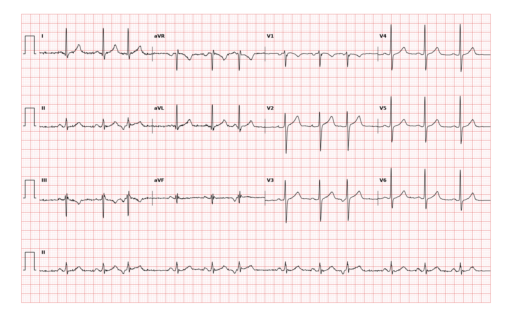

## 문제
63세 남자가 2주 전부터 맥이 규칙적으로 한 번씩 건너뛰는 느낌이 들어 외래에 왔다. 커피를 하루 4잔 마시고 최근 잠을 잘 자지 못했다. 가슴 통증·호흡곤란·실신은 없다. 혈압 132/82 mmHg, 맥박 72회/분으로 불규칙하다. 심잡음은 없다. 혈청 칼륨 4.2 mEq/L, 갑상샘자극호르몬은 정상이다. 12유도 심전도는 그림과 같다. 심전도 판독으로 가장 적절한 것은?

- A. 심방세동
- B. 동부정맥
- C. 심방조기수축 삼단맥
- D. 심실조기수축 삼단맥
- E. Mobitz I 형 2도 방실차단

_12유도 심전도, 25 mm/s · 10 mm/mV, 3×4 + II 리듬 스트립 (PTB-XL ECG dataset, PhysioNet, CC BY 4.0 — 원신호 그대로 작도)_

## 정답 및 해설
> 정답: C

- **정답 핵심**: 리듬 스트립(II)에서 두 번의 동박동 뒤 세 번째 박동이 예정보다 일찍 오고, 그 뒤에 조금 긴 쉼이 오는 묶음이 끝까지 반복된다 — 삼단맥이다. 조기 박동의 QRS 는 동박동과 같은 좁은 모양이어서 심실이 아니라 심방(상심실)에서 시작한 조기수축이다. 조기 박동 뒤의 쉼은 완전 보상휴지보다 짧다(동결절이 재설정됨). 심방조기수축 삼단맥이고, 카페인·수면 부족 같은 유발 요인을 줄이면 된다.
- **원리**: <b>왜 QRS 모양이 기원을 가르는가</b>: 심방에서 시작한 조기 흥분도 방실결절과 히스-푸르키네 계통을 그대로 타고 내려가므로 심실은 동박동과 똑같이 빠르게 탈분극한다 — QRS 가 좁고 같은 모양이다. 심실에서 시작한 흥분은 전도계를 거치지 않고 심근을 세포에서 세포로 느리게 퍼지므로 QRS 가 넓고(≥ 120 ms) 기괴하며 T파가 반대 방향이다.  <b>왜 쉼의 길이가 다른가</b>: 심방조기수축은 동결절까지 역행해 동결절 주기를 재설정하므로 조기 박동 앞뒤 RR 의 합이 동주기 두 배보다 짧다(불완전 보상휴지). 심실조기수축은 대개 동결절을 건드리지 않아 다음 동흥분이 제때 나오지만 심실이 불응기라 하나를 건너뛰어, 앞뒤 합이 정확히 두 배가 된다(완전 보상휴지).  <b>묶음 박동이 모두 차단은 아니다</b>: Mobitz I 형도 박동이 묶여 보이지만, 그것은 PR 이 점점 길어지다가 P파 하나가 QRS 없이 남는 것이다 — 일찍 오는 박동이 아니라 「빠지는」 박동이 묶음을 만든다.
- **비교**: <table><thead><tr><th style="width:24%">항목</th><th style="width:38%">심방조기수축 삼단맥(정답)</th><th>Mobitz I 형 방실차단(가장 가까운 오답)</th></tr></thead><tbody> <tr><td>묶음을 만드는 것</td><td><b>세 번째 박동이 일찍 온다</b></td><td>P파 하나가 전도되지 않고 빠진다</td></tr> <tr><td>PR 간격</td><td>동박동은 일정</td><td>박동마다 길어지다 탈락</td></tr> <tr><td>쉼 동안</td><td>전도되지 않은 P파 없음</td><td>QRS 없이 남은 P파가 보인다</td></tr> <tr><td>QRS</td><td>좁고 동박동과 같다</td><td>좁고 같다(결절 차단)</td></tr> <tr><td>이 환자</td><td>일찍 오는 좁은 박동 — 일치</td><td>PR 연장·탈락 P파 없음 — 불일치</td></tr> </tbody></table> 묶음 박동을 보면 「일찍 온 박동이 있는가, 빠진 박동이 있는가」를 먼저 묻는다.
- **오답 이유**:
  - ① 심방세동은 P파 없이 기저선이 불규칙하게 떨리고 RR 간격이 묶음 없이 완전히 불규칙하다면 정답이 된다.
  - ② 동부정맥은 젊은 사람에서 들숨에 RR 이 짧아지고 날숨에 길어지는 점진적 변화가 있고 모든 P파가 같은 모양이라면 정답이 된다.
  - ④ 심실조기수축 삼단맥은 세 번째마다 오는 조기 박동의 QRS 가 넓고(≥ 120 ms) 기괴하며 T파가 반대 방향이고 완전 보상휴지가 온다면 정답이 된다.
  - ⑤ Mobitz I 형 2도 방실차단은 PR 이 박동마다 길어지다가 QRS 없이 P파 하나가 남는 묶음이 반복된다면 정답이 된다.
- **함정**: 규칙적으로 건너뛰는 맥을 방실차단의 묶음 박동으로 읽는 것 — 조기 박동이 일찍 오는지, P파가 빠지는지를 본다.
- **학습목표**: 두 번의 동박동 뒤 세 번째마다 일찍 오는 좁은 QRS 박동을 심방조기수축 삼단맥으로 판독하고, 넓은 QRS 의 심실조기수축과 PR 이 길어지다 탈락하는 Mobitz I 형 방실차단의 묶음 박동과 가른다
- **근거·출처**: Loscalzo J, Fauci AS, Kasper DL, et al., eds. Harrison's Principles of Internal Medicine, 22nd ed. McGraw Hill; 2025. Chapter 253: Approach to Supraventricular Arrhythmias · Loscalzo J, Fauci AS, Kasper DL, et al., eds. Harrison's Principles of Internal Medicine, 22nd ed. McGraw Hill; 2025. Chapter 247: Electrocardiography · Wagner P, Strodthoff N, Bousseljot RD, et al. PTB-XL, a large publicly available electrocardiography dataset. Sci Data. 2020;7:154

## 출처
- PTB-XL ECG dataset v1.0.3 (PhysioNet, CC BY 4.0) · record 14885 · Creative Commons Attribution 4.0 International · https://physionet.org/content/ptb-xl/1.0.3/LICENSE.txt
