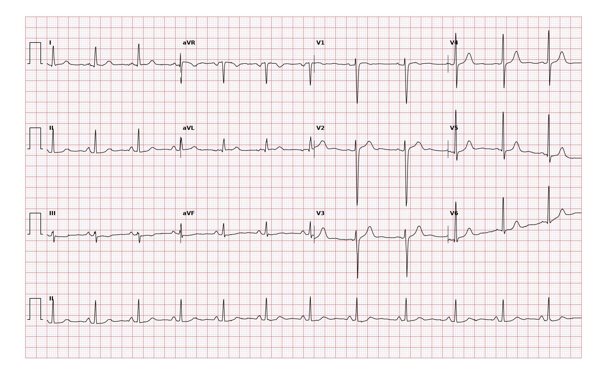

## 문제
41세 여자가 담석증으로 복강경 담낭절제술을 받기 전 시행한 심전도에서 이상 소견이 있다는 말을 듣고 마취과 외래에 왔다. 계단 두 층을 쉬지 않고 오르며 주 3회 달리기를 한다. 가슴 통증·호흡곤란·실신은 없다. 고혈압·당뇨병·심장병 병력이 없다. 키 162 cm, 몸무게 52 kg 이다. 혈압 114/72 mmHg, 맥박 74회/분이다. 심잡음은 없고 심첨박동은 정상 위치이다. 혈색소 13.1 g/dL, 크레아티닌 0.7 mg/dL 이다. 12유도 심전도는 그림과 같다. 가장 적절한 다음 처치는?

- A. 추가 심장 검사 없이 예정대로 수술
- B. 수술 전 경흉부 심장초음파
- C. 수술 전 운동부하 심전도
- D. 수술 전 관상동맥 CT 혈관조영
- E. 수술을 미루고 베타차단제 시작

_12유도 심전도, 25 mm/s · 10 mm/mV, 3×4 + II 리듬 스트립 (PTB-XL ECG dataset, PhysioNet, CC BY 4.0 — 원신호 그대로 작도)_

## 정답 및 해설
> 정답: A

- **정답 핵심**: 동리듬 약 75회/분, 축·간격은 정상이고, 흉부유도 전압이 커서(V1 S + V5 R 약 36 mm, V2 S 약 27 mm) Sokolow-Lyon 기준을 겨우 넘지만 ST 하강·비대칭 T파 역위 같은 긴장 형태가 없다. 흉벽이 얇은 마르고 젊은 여성에서 전압만 높은 것은 흔한 정상 변이다. 고혈압·심잡음·증상이 없고 활동 능력이 4 METs 이상이며 수술은 저위험 복강경 수술이므로 추가 심장 검사 없이 예정대로 수술한다.
- **원리**: <b>왜 전압만으로는 좌심실비대를 말하지 못하는가</b>: QRS 전압은 심근량뿐 아니라 전극과 심장 사이의 거리·조직에 좌우된다. 흉벽이 얇고 지방이 적은 젊은 사람, 운동선수는 전극이 심장에 가까워 정상 심장에서도 전압이 크다. 그래서 전압 기준은 젊은 사람에서 위양성이 많고, 반대로 비만·폐기종에서는 진짜 비대를 놓친다.  <b>무엇이 진짜 비대를 시사하는가</b>: 비대한 심근은 재분극이 비정상이라 V5·V6 의 하향 ST 하강과 비대칭 T파 역위(「긴장 형태」), 좌심방 확대(V1 의 깊은 음성 P), 좌축편위를 동반한다. 또 비대에는 원인 — 고혈압, 대동맥판 협착(심잡음), 비후성 심근병증(가족력·실신·심잡음) — 이 있다. 이 환자는 그 어느 것도 없다.  <b>왜 수술 전 검사가 필요 없는가</b>: 수술 전 심장 평가는 「결과가 처치를 바꿀 때」만 한다. 저위험 수술(주요 심장 사건 위험 &lt; 1 %)이고 활동 능력이 4 METs 이상이면, 어떤 추가 검사도 수술 결정이나 결과를 바꾸지 못하므로 지침은 검사 없이 수술을 권한다.
- **비교**: <table><thead><tr><th style="width:24%">항목</th><th style="width:38%">예정대로 수술(정답)</th><th>수술 전 심장초음파(가장 가까운 오답)</th></tr></thead><tbody> <tr><td>적응</td><td><b>저위험 수술 · 활동 능력 ≥ 4 METs · 증상 없음</b></td><td>원인 모를 호흡곤란, 심잡음, 심부전 의심·악화</td></tr> <tr><td>심전도</td><td>전압만 높고 ST-T 정상</td><td>긴장 형태·좌심방 확대·병적 Q파</td></tr> <tr><td>왜 그런가</td><td>결과가 수술 계획을 바꾸지 못한다</td><td>판막 질환·심근병증이 마취 계획을 바꾼다</td></tr> <tr><td>이 환자</td><td>마른 41세 · 무증상 · 정상 혈압 — 해당</td><td>심잡음·증상 없음 — 해당 없음</td></tr> </tbody></table> 「전압이 높다」보다 「왜 높을 수 있는가(체형)와 비대의 원인·재분극 이상이 있는가」를 먼저 본다.
- **오답 이유**:
  - ② 수술 전 경흉부 심장초음파는 같은 심전도에 수축기 심잡음이나 원인 모를 호흡곤란, 긴장 형태의 ST-T 변화가 있다면 정답이 된다.
  - ③ 수술 전 운동부하 심전도는 고위험 수술을 앞두고 활동 능력이 4 METs 미만이거나 알 수 없고 결과가 처치를 바꿀 때 고려된다.
  - ④ 관상동맥 CT 혈관조영은 협심증이 의심되는 중간 위험 환자의 진단 목적이라면 쓰이지만, 무증상 환자의 수술 전 선별로는 쓰지 않는다.
  - ⑤ 수술을 미루고 베타차단제를 시작하는 것은 수술 직전에 처음 시작하면 오히려 뇌졸중·사망을 늘려 권하지 않으며, 이미 복용 중인 환자는 계속한다.
- **함정**: 심전도 「이상」이라는 말에 검사를 더하는 것 — 마른 젊은 여성의 전압 증가만으로는 비대가 아니고, 저위험 수술 전 검사는 결과를 바꾸지 못한다.
- **학습목표**: 고혈압·심잡음·증상이 없는 마르고 젊은 여성의 수술 전 심전도에서 흉부유도 고전압만 있고 ST-T 긴장 형태가 없으면 정상 변이로 보고, 저위험 수술을 추가 심장 검사 없이 진행한다
- **근거·출처**: Loscalzo J, Fauci AS, Kasper DL, et al., eds. Harrison's Principles of Internal Medicine, 22nd ed. McGraw Hill; 2025. Chapter 247: Electrocardiography · Thompson A, Fleischmann KE, Smilowitz NR, et al. 2024 AHA/ACC/ACS/ASNC/HRS/SCA/SCCT/SCMR/SVM guideline for perioperative cardiovascular management for noncardiac surgery. Circulation. 2024;150(19):e351-e442 · Wagner P, Strodthoff N, Bousseljot RD, et al. PTB-XL, a large publicly available electrocardiography dataset. Sci Data. 2020;7:154

## 출처
- PTB-XL ECG dataset v1.0.3 (PhysioNet, CC BY 4.0) · record 16065 · Creative Commons Attribution 4.0 International · https://physionet.org/content/ptb-xl/1.0.3/LICENSE.txt
