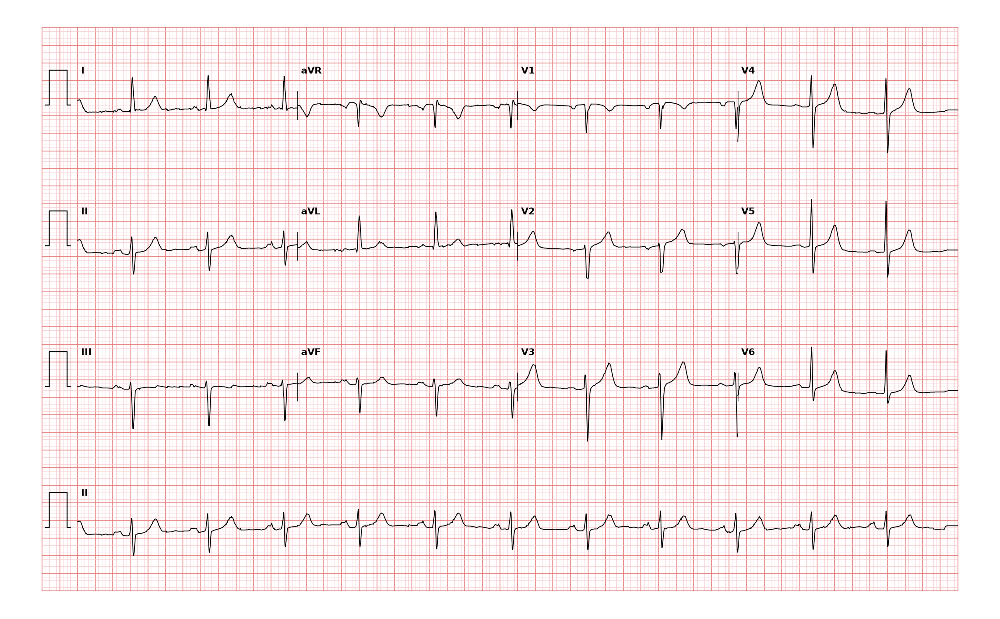

## 문제
A 66-year-old woman comes to the clinic because a screening ECG at a health fair was reported as having an abnormal axis. She has hypertension treated with amlodipine. She has no chest pain, dyspnea, palpitations, or syncope and has never had a myocardial infarction. Her blood pressure is 134/80 mm Hg and pulse is 70/min. Cardiac examination shows no murmurs or gallops. A 12-lead ECG is shown. Which of the following is the most likely interpretation of this ECG?

- A. Left ventricular hypertrophy with strain
- B. Left anterior fascicular block
- C. Left posterior fascicular block
- D. Left bundle branch block
- E. Old inferior myocardial infarction

_12-lead ECG, 25 mm/s, 10 mm/mV, 3×4 + lead II rhythm strip (PTB-XL, PhysioNet, CC BY 4.0; raw signal, no filtering)_

## 정답 및 해설
> 정답: B

- **정답 핵심**: The rhythm is sinus at about 70/min with a narrow QRS. Lead I is positive while II, III, and aVF are predominantly negative with an rS pattern (a small initial r followed by a deep S), giving left axis deviation beyond −45°; aVL shows a qR complex. Narrow QRS with marked left axis deviation, inferior rS, and lateral qR is left anterior fascicular block. The small initial r waves in the inferior leads exclude the Q waves of an old inferior infarction.
- **원리**: <b>Why blocking the anterior fascicle swings the axis up and left</b>: The left bundle divides into a thin anterior fascicle (to the anterosuperior wall) and a broad posterior fascicle (to the inferoposterior wall). When the anterior fascicle fails, the inferoposterior wall activates first — producing a small initial vector downward (small r in II, III, aVF; small q in I and aVL) — and then the anterosuperior wall activates late through the myocardium, so the dominant vector points up and to the left (deep S in the inferior leads, tall R in aVL). Because the main bundles still work, the QRS stays narrow or is only slightly widened.  <b>Why it is common and usually benign</b>: The anterior fascicle is long, thin, and supplied by a single artery, so fibrosis with age and hypertension often affects it. In isolation it rarely progresses to complete heart block.  <b>Why it can mimic an inferior infarction</b>: Both make the inferior leads look negative. An infarct removes the initial inferior forces, producing Q waves (QS or Qr) in II, III, and aVF; a fascicular block preserves them, so an initial r remains.
- **비교**: <table><thead><tr><th style="width:24%">Feature</th><th style="width:38%">Left anterior fascicular block (answer)</th><th>Old inferior MI (closest distractor)</th></tr></thead><tbody> <tr><td>II, III, aVF</td><td><b>rS</b> — small initial r, deep S</td><td>Q waves (QS or Qr)</td></tr> <tr><td>aVL</td><td>qR</td><td>Tall R, often reciprocal changes</td></tr> <tr><td>Why</td><td>Initial inferior forces preserved; late forces turn superior</td><td>Necrotic inferior wall removes initial inferior forces</td></tr> <tr><td>Axis</td><td>−45° to −90°</td><td>Can be leftward but from loss of inferior forces</td></tr> <tr><td>This patient</td><td>Inferior rS, no infarction history — consistent</td><td>No inferior Q waves — inconsistent</td></tr> </tbody></table> When the inferior leads are negative, look at the very first deflection: r means fascicular block, Q means infarction.
- **오답 이유**:
  - (A) Left ventricular hypertrophy with strain would be correct with very tall left precordial R waves plus downsloping ST depression and asymmetric T-wave inversion in V5 and V6.
  - (C) Left posterior fascicular block would be correct with right axis deviation (+90° to +180°), rS in I and aVL, and qR in II, III, and aVF, after excluding right ventricular hypertrophy.
  - (D) Left bundle branch block would be correct if the QRS were ≥ 120 ms with broad notched R waves in I, aVL, V5, and V6 and no septal q waves.
  - (E) Old inferior myocardial infarction would be correct if II, III, and aVF began with pathologic Q waves (QS or Qr) instead of a small r wave.
- **함정**: Calling negative inferior complexes an old inferior infarction — the small initial r wave in II, III, and aVF marks a fascicular block.
- **학습목표**: Read a narrow-QRS ECG with left axis deviation, rS complexes in II, III, and aVF, and qR in aVL as left anterior fascicular block, and distinguish it from an old inferior infarction, which produces Q waves in the inferior leads
- **근거·출처**: Loscalzo J, Fauci AS, Kasper DL, et al., eds. Harrison's Principles of Internal Medicine, 22nd ed. McGraw Hill; 2025. Chapter 247: Electrocardiography · Surawicz B, Childers R, Deal BJ, Gettes LS. AHA/ACCF/HRS recommendations for the standardization and interpretation of the electrocardiogram: part III: intraventricular conduction disturbances. J Am Coll Cardiol. 2009;53(11):976-981 · Wagner P, Strodthoff N, Bousseljot RD, et al. PTB-XL, a large publicly available electrocardiography dataset. Sci Data. 2020;7:154

## 출처
- PTB-XL ECG dataset v1.0.3 (PhysioNet, CC BY 4.0) · record 1766 · Creative Commons Attribution 4.0 International · https://physionet.org/content/ptb-xl/1.0.3/LICENSE.txt
