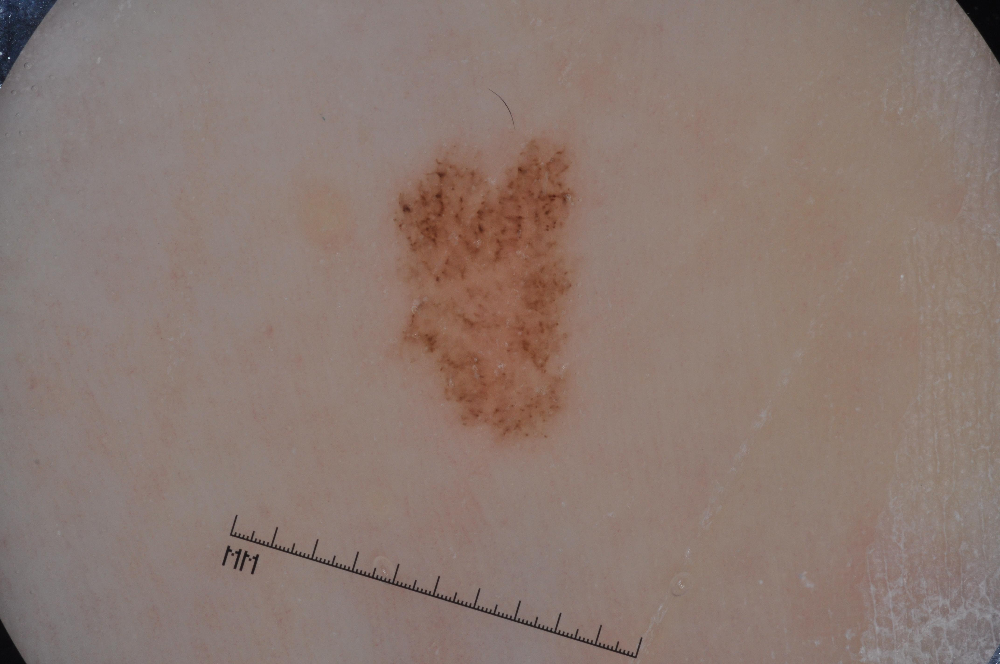

## 문제
45세 남자가 발에 있는 갈색 반점이 최근 1년 사이 커진 것 같아 피부과에 왔다. 가렵거나 피가 난 적은 없다. 피부암 가족력은 없고, 몸의 다른 부위에 작은 점이 10개 정도 있다. 병변은 지름 약 1.5 cm 의 편평한 연갈색 반으로 윤곽이 비대칭이고 경계가 들쭉날쭉하며, 만져지는 결절이나 궤양은 없다. 사타구니 림프절은 만져지지 않는다. 병변의 더모스코피 사진은 그림과 같다. 다음 처치로 가장 적절한 것은?

- A. 1~3 mm 경계의 전층 절제생검
- B. 3개월 뒤 더모스코피 사진 비교 관찰
- C. 면도 절제
- D. 액화질소 냉동치료
- E. 색소 레이저 제거

_더모스코피(편광) 사진, 원본 그대로 크기 조정만 — 눈금자는 원본의 것 (ISIC Archive, CC-0 — 크롭·색 보정 없음)_

## 정답 및 해설
> 정답: A

- **정답 핵심**: 더모스코피에서 병변 윤곽이 비대칭이고 가는 갈색 색소망과 점이 고르지 않게 흩어져 있다. 청백색 베일·퇴행 구조는 없어 전형적 흑색종 소견은 아니지만, 비대칭·불규칙 경계·지름 6 mm 초과에 더해 환자가 「최근 커졌다」고 말하는 변화(evolution)가 있다. 변하는 비정형 색소 병변은 흑색종을 배제할 조직 진단이 필요하고, 그 방법은 병변 전체를 1~3 mm 경계로 피하지방까지 떼는 전층 절제생검이다(이 병변은 조직검사로 이형성 모반이 확정되었다).
- **원리**: <b>왜 「전체를, 깊이까지」 떼는가</b>: 흑색종의 병기와 치료(재절제 경계·감시림프절 생검)는 <b>Breslow 두께</b> — 표피 과립층에서 가장 깊은 종양세포까지의 깊이 — 로 정해진다. 병변의 일부만 떼거나(부분 생검) 얕게 깎으면(면도) 가장 깊은 부분이 남아 두께를 과소평가하고, 병변의 가장 비정형적인 부분을 놓칠 수 있다. 그래서 진단 목적의 첫 생검은 병변 전체를 좁은 경계(1~3 mm)로 피하지방까지 떼어 병리의사가 전체 구조와 깊이를 보게 한다.  <b>왜 경계는 좁게 하는가</b>: 아직 진단 전이므로 넓은 경계(1~2 cm)로 떼면 림프 흐름이 바뀌어 나중에 감시림프절 생검이 부정확해진다. 넓은 절제는 조직으로 흑색종과 두께가 확인된 뒤에 한다.  <b>왜 파괴적 치료는 금기인가</b>: 냉동·레이저는 조직을 남기지 않아 진단을 영원히 잃는다. 색소 병변을 없애는 치료는 양성이 확실할 때만 쓴다.
- **비교**: <table><thead><tr><th style="width:24%">항목</th><th style="width:38%">전층 절제생검(정답)</th><th>단기 사진 비교 관찰(가장 가까운 오답)</th></tr></thead><tbody> <tr><td>대상</td><td><b>환자가 변화를 말하거나</b> 비정형 구조가 뚜렷한 병변</td><td>편평하고 변화 이력이 없는 경도 비정형 병변</td></tr> <tr><td>목적</td><td>지금 흑색종을 배제·병기 결정</td><td>3개월 사이 변화가 생기는지 확인</td></tr> <tr><td>왜</td><td>이미 변했으므로 관찰로 얻을 정보가 없다</td><td>변화가 없으면 불필요한 절제를 피한다</td></tr> <tr><td>이 환자</td><td>최근 1년 사이 커짐·비대칭·1.5 cm — 일치</td><td>변화 이력이 있어 해당하지 않는다</td></tr> </tbody></table> 「이미 변했는가」가 관찰과 생검을 가른다 — 변화가 있으면 관찰 기간을 둘 이유가 없다.
- **오답 이유**:
  - ② 3개월 뒤 사진 비교 관찰은 변화 이력이 없는 편평한 경도 비정형 병변으로, 환자가 커졌다고 느끼지 않았다면 고려할 수 있다.
  - ③ 면도 절제는 표피에 국한된 양성 융기 병변(지루각화증 등)에 쓰며, 깊이를 재야 하는 흑색종 의심 병변에서는 Breslow 두께를 놓친다.
  - ④ 액화질소 냉동치료는 일광각화증·사마귀처럼 임상적으로 진단이 확실한 표재 병변이라면 정답이 되지만 조직이 남지 않는다.
  - ⑤ 색소 레이저 제거는 조직검사로 양성이 확인된 미용 목적의 흑자라면 고려할 수 있으나 진단 전 색소 병변에는 쓰지 않는다.
- **함정**: 흑색종의 전형 구조(청백색 베일)가 없다는 이유로 관찰을 고르는 것 — 환자가 말한 「커졌다」는 변화가 생검의 이유다.
- **학습목표**: 더모스코피에서 비대칭 윤곽과 고르지 않은 색소망을 보이며 최근 변한 색소 병변은 단기 관찰이 아니라 좁은 경계의 전층 절제생검으로 조직 진단을 한다
- **근거·출처**: Loscalzo J, Fauci AS, Kasper DL, et al., eds. Harrison's Principles of Internal Medicine, 22nd ed. McGraw Hill; 2025. Chapter 81: Cancer of the Skin · Swetter SM, Tsao H, Bichakjian CK, et al. Guidelines of care for the management of primary cutaneous melanoma. J Am Acad Dermatol. 2019;80(1):208-250 · ISIC Archive, International Skin Imaging Collaboration — histopathology-confirmed dermoscopic image (CC-0)

## 출처
- ISIC Archive ISIC_0001122 (CC-0) · CC0 1.0 Universal · https://creativecommons.org/publicdomain/zero/1.0/
