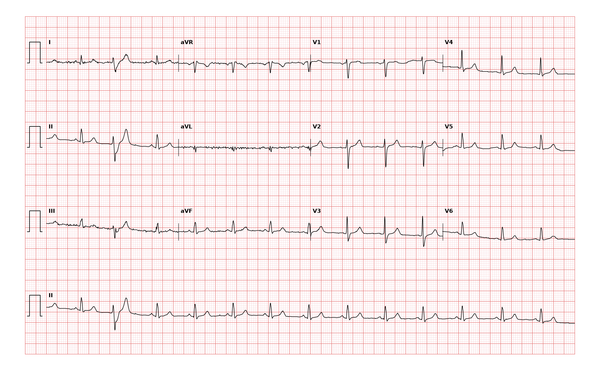

## 문제
65세 여자가 2개월 전부터 가끔 심장이 한 번 건너뛰고 쿵 하고 세게 뛰는 느낌이 들어 외래에 왔다. 증상은 1초 정도로 하루 몇 차례, 주로 쉴 때 생긴다. 가슴 통증·호흡곤란·실신은 없다. 복용하는 약은 없고 커피를 하루 2잔 마신다. 맥박 70회/분으로 가끔 불규칙하고 혈압 128/78 mmHg 이다. 심잡음은 없다. 혈청 칼륨·마그네슘과 갑상샘 기능은 정상이다. 증상이 있을 때 찍은 12유도 심전도는 그림과 같다. 증상의 원인으로 가장 적절한 것은?

- A. 심실조기수축
- B. 심방조기수축
- C. Mobitz II 형 2도 방실차단
- D. 간헐적 좌각차단
- E. 비지속 심실빈맥

_12유도 심전도, 25 mm/s · 10 mm/mV, 3×4 + II 리듬 스트립 (PTB-XL ECG dataset, PhysioNet, CC BY 4.0 — 원신호 그대로 작도)_

## 정답 및 해설
> 정답: A

- **정답 핵심**: 기본 리듬은 약 70회/분의 동리듬이다. 리듬 스트립(II)의 두 번째 박동이 일찍 오는데, 그 앞에 조기 P파가 없고 QRS 가 넓고 기괴하며 T파가 QRS 주된 방향과 반대다. 뒤따르는 쉼까지 합친 간격이 동주기의 정확히 두 배다(완전 보상휴지). 단발 심실조기수축이며, 「쿵」 하는 느낌은 긴 쉼 뒤에 오는 강한 박동이다.
- **원리**: <b>왜 심실에서 시작한 박동은 넓은가</b>: 심실 근육에서 시작한 흥분은 히스-푸르키네 계통을 쓰지 못하고 심근을 세포에서 세포로 느리게 퍼진다. 그래서 QRS 가 120 ms 이상으로 넓고 모양이 기괴하다. 재분극도 비정상 경로를 따라가므로 T파가 QRS 와 반대 방향이 된다.  <b>왜 보상휴지가 「완전」한가</b>: 심실 흥분은 대개 동결절까지 거슬러 올라가지 못해 동결절은 제 주기를 그대로 유지한다. 다음 동흥분 P파는 제때 오지만 심실이 불응기라 전도되지 않고, 그다음 P파가 전도된다. 그래서 조기 박동을 사이에 둔 RR 간격이 동주기의 정확히 두 배다. 심방조기수축은 동결절을 재설정하므로 쉼이 보통 두 배보다 짧다(불완전 보상휴지).  <b>왜 「쿵」 하고 느끼는가</b>: 긴 쉼 동안 심실이 더 많이 채워지고 기외수축 뒤 수축력 증강이 겹쳐 다음 동박동이 세게 뛴다 — 단발 기외수축의 전형 증상이다.
- **비교**: <table><thead><tr><th style="width:24%">항목</th><th style="width:38%">심실조기수축(정답)</th><th>변행전도된 심방조기수축(가장 가까운 오답)</th></tr></thead><tbody> <tr><td>조기 P파</td><td><b>없다</b></td><td>모양이 다른 조기 P파(앞 T파에 숨기도 함)</td></tr> <tr><td>QRS</td><td>넓고 기괴, T파 반대 방향</td><td>대개 좁다 — 변행전도 때만 넓다(흔히 우각차단 모양)</td></tr> <tr><td>쉼</td><td><b>완전 보상휴지</b>(동결절 재설정 없음)</td><td>불완전 보상휴지(동결절 재설정)</td></tr> <tr><td>이 환자</td><td>조기 P파 없음 · 넓은 QRS · 완전 휴지 — 일치</td><td>조기 P파가 보이지 않음 — 불일치</td></tr> </tbody></table> 먼저 조기 P파를 찾고, 없으면서 보상휴지가 완전하면 심실 기원이다.
- **오답 이유**:
  - ② 심방조기수축은 일찍 오는 박동 앞에 모양이 다른 조기 P파가 있고 QRS 가 좁으며 쉼이 동주기 두 배보다 짧았다면 정답이 된다.
  - ③ Mobitz II 형 2도 방실차단은 제때 온 동 P파 뒤에 QRS 가 갑자기 빠지고 그 앞뒤 PR 간격이 일정했다면 정답이 된다.
  - ④ 간헐적 좌각차단은 넓은 박동이 일찍 오지 않고 정상 동주기에 정상 P파를 앞세워 나타났다면 정답이 된다.
  - ⑤ 비지속 심실빈맥은 넓은 박동이 3개 이상 100회/분 넘는 속도로 이어지고 30초 안에 멈췄다면 정답이 된다.
- **함정**: 넓은 박동을 모두 각차단으로 읽는 것 — 일찍 오고 앞에 P파가 없으면 심실 기외수축이다.
- **학습목표**: 앞선 조기 P파 없이 일찍 오는 넓고 기괴한 QRS 와 반대 방향 T파, 완전 보상휴지를 심실조기수축으로 판독하고, 변행전도된 심방조기수축과 가른다
- **근거·출처**: Loscalzo J, Fauci AS, Kasper DL, et al., eds. Harrison's Principles of Internal Medicine, 22nd ed. McGraw Hill; 2025. Chapter 260: Premature Ventricular Contractions, Nonsustained Ventricular Tachycardia, and Accelerated Idioventricular Rhythm · Loscalzo J, Fauci AS, Kasper DL, et al., eds. Harrison's Principles of Internal Medicine, 22nd ed. McGraw Hill; 2025. Chapter 247: Electrocardiography · Wagner P, Strodthoff N, Bousseljot RD, et al. PTB-XL, a large publicly available electrocardiography dataset. Sci Data. 2020;7(1):154

## 출처
- PTB-XL ECG dataset v1.0.3 (PhysioNet, CC BY 4.0) · record 16539 · Creative Commons Attribution 4.0 International · https://physionet.org/content/ptb-xl/1.0.3/LICENSE.txt
