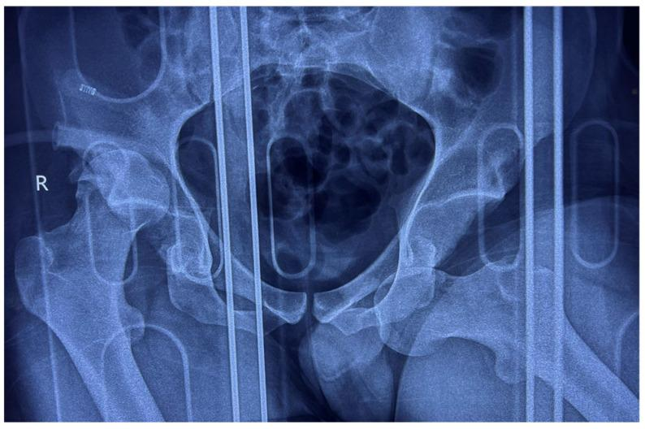

## 문제
A 22-year-old man is brought to the emergency department 40 minutes after a high-speed motor vehicle collision in which he was the front-seat passenger. Both knees struck the dashboard. He reports severe pain in both hips and cannot move either leg. His pulse is 112/min, and blood pressure is 118/72 mm Hg. Both lower limbs are deformed, and the distal pulses are palpable bilaterally. An anteroposterior radiograph of the pelvis is shown. Injury to which of the following nerves is most likely to be associated with the dislocation of the right hip?

- A. Superior gluteal nerve
- B. Lateral femoral cutaneous nerve
- C. Sciatic nerve
- D. Femoral nerve
- E. Obturator nerve

_Anteroposterior radiograph of the pelvis taken on a spine board; the R marker is the original, resized only (PMC Open Access Subset, CC BY — no crop or adjustment)_

## 정답 및 해설
> 정답: C

- **정답 핵심**: On the radiograph the right acetabulum is empty and the right femoral head lies superior and lateral to it with the femur adducted — a posterior dislocation, the typical dashboard injury (axial load on a flexed, adducted hip). The left femoral head lies inferomedially over the obturator foramen with the femur abducted — an anterior (obturator-type) dislocation. The sciatic nerve runs directly behind the hip joint, so a posteriorly displaced femoral head (and posterior wall fragment) stretches or compresses it; it is injured in roughly 10–20 % of posterior dislocations, usually the peroneal division.
- **원리**: <b>Why the direction is set by hip position at impact</b>: When force travels up the femoral shaft with the hip flexed and adducted (knee hitting the dashboard), the femoral head is driven out of the back of the acetabulum — a posterior dislocation, often with a posterior wall fracture. If the hip is abducted and externally rotated at impact, the head levers out anteriorly; with flexion it lodges over the obturator foramen.  <b>Why the sciatic nerve</b>: The sciatic nerve exits the pelvis through the greater sciatic foramen below the piriformis and descends directly behind the posterior capsule and acetabular wall. A posteriorly displaced head lies against it. The peroneal division is more often affected because it is more lateral, tethered at the fibular neck, and has less connective tissue protection — so foot drop and loss of dorsal foot sensation are the typical deficits.  <b>Why reduction is urgent</b>: The dislocated head kinks the retinacular vessels from the medial circumflex femoral artery; the risk of osteonecrosis rises sharply when reduction is delayed beyond about 6 hours, and prompt reduction also relieves the nerve.
- **비교**: <table><thead><tr><th style="width:24%">Feature</th><th style="width:38%">Right hip: posterior dislocation (answer)</th><th>Left hip: anterior obturator dislocation (closest distractor)</th></tr></thead><tbody> <tr><td>Femoral head on AP film</td><td><b>Superolateral</b> to the empty acetabulum, often looks smaller</td><td><b>Inferomedial</b>, over the obturator foramen, often looks larger</td></tr> <tr><td>Limb position</td><td>Shortened, flexed, adducted, internally rotated</td><td>Abducted, externally rotated, flexed</td></tr> <tr><td>Nerve at risk</td><td><b>Sciatic</b> (peroneal division)</td><td>Obturator or femoral nerve; femoral vessels</td></tr> <tr><td>Why</td><td>Nerve lies behind the posterior wall</td><td>Head moves toward the obturator canal and femoral triangle</td></tr> </tbody></table> Read each hip separately: the nerve at risk follows the direction in which the femoral head left the acetabulum.
- **오답 이유**:
  - (A) Superior gluteal nerve injury would be expected after a misplaced intramuscular injection or a lateral surgical approach to the hip, causing a Trendelenburg gait.
  - (B) Lateral femoral cutaneous nerve injury would be correct for compression at the anterior superior iliac spine (meralgia paresthetica), such as from a tight belt or positioning.
  - (D) Femoral nerve injury would be the best answer for an anterior dislocation with the femoral head displaced toward the femoral triangle in the groin.
  - (E) Obturator nerve injury would be correct if the question asked about the left hip, whose femoral head lies over the obturator foramen.
- **함정**: Answering for the wrong side — the two hips dislocated in opposite directions, and the question asks about the right hip.
- **학습목표**: Read a pelvic radiograph in which the right femoral head lies superolateral to an empty acetabulum (posterior dislocation) and the left femoral head lies over the obturator foramen (anterior dislocation), and link posterior hip dislocation to sciatic nerve injury
- **근거·출처**: Traumatic Bilateral Asymmetrical Hip Dislocation with Acetabular Fracture: A Case Report and Review of Current Evidence. Life (Basel). 2025;15(4):532. doi:10.3390/life15040532 · Foulk DM, Mullis BH. Hip dislocation: evaluation and management. J Am Acad Orthop Surg. 2010;18(4):199-209

## 출처
- Traumatic Bilateral Asymmetrical Hip Dislocation with Acetabular Fracture: A Case Report and Review of Current Evidence. Life (Basel). 2025 Mar 24;15(4):532. doi: 10.3390/life15040532 (CC BY) — Figure 1 · CC BY · https://creativecommons.org/licenses/
