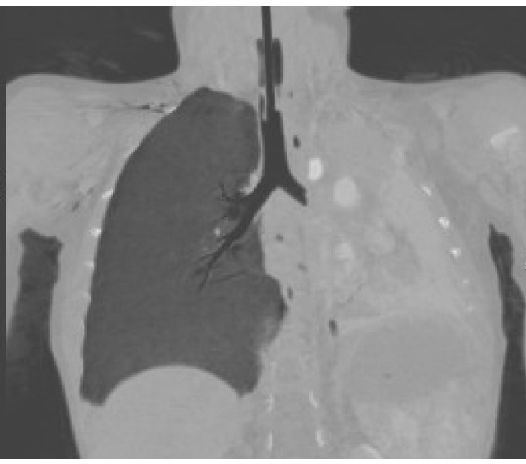

## 문제
A 19-month-old boy is brought to the emergency department after he fell from a chair and struck his head. He cried immediately and has had no vomiting. His parents report no known episode of choking, but he has had a mild cough for 2 days without fever. Over the next hour in the emergency department he develops increasing respiratory distress with subcostal retractions, and oxygen saturation decreases to 85% on a non-rebreather mask; he is intubated. Breath sounds are markedly decreased over the left chest. His temperature is 37.2°C and pulse is 150/min. Head CT shows no intracranial injury. A coronal reconstruction of a chest CT scan is shown. Which of the following is the most appropriate next step in management?

- A. Intravenous broad-spectrum antibiotics and repeat imaging in 48 hours
- B. Chest physiotherapy with postural drainage
- C. Nebulized albuterol every 20 minutes
- D. Rigid bronchoscopy
- E. Left-sided chest tube insertion

_Coronal reconstruction of a chest CT scan; one panel of a published case figure, side markers and scale text cropped at the edges, no other adjustment (PMC Open Access Subset, CC BY)_

## 정답 및 해설
> 정답: D

- **정답 핵심**: The CT shows air in the trachea and right bronchial tree, but the left main bronchus stops abruptly just below the carina, and the entire left lung is airless and opaque. The mediastinum is pulled toward the opaque left side and the right lung is hyperexpanded — volume loss (complete atelectasis), not a space-occupying effusion or hemothorax. Abrupt bronchial cutoff with lobar or whole-lung collapse in a toddler indicates an endobronchial foreign body until proved otherwise, even without a witnessed choking episode. The diagnostic and therapeutic procedure of choice is rigid bronchoscopy under general anesthesia.
- **원리**: <b>Why the mediastinum moves toward the white lung</b>: When a bronchus is completely obstructed, the air distal to it is absorbed into the blood over hours; the lung collapses and its volume shrinks, so the mediastinum and diaphragm are pulled toward that side. A large pleural effusion or hemothorax adds volume to the hemithorax and pushes the mediastinum away. The direction of shift therefore tells you whether a white hemithorax needs a bronchoscope or a chest tube.  <b>Why toddlers</b>: Children 1–3 years old explore by mouth, lack molars to grind food such as nuts, and have immature airway protection; most aspirations are not witnessed or are forgotten. A partial obstruction can act as a check valve (air trapping and hyperinflation), whereas a complete one produces atelectasis, as here. Although the right main bronchus is more vertical in adults, in young children the angles are more similar, and left-sided foreign bodies are common.  <b>Why rigid bronchoscopy</b>: The rigid scope secures the airway, allows ventilation through the instrument, and accommodates large forceps to grasp and remove the object; flexible bronchoscopy can confirm the diagnosis but is less reliable for extraction in small children.
- **비교**: <table><thead><tr><th style="width:24%">Feature</th><th style="width:38%">Endobronchial obstruction → rigid bronchoscopy (answer)</th><th>Hemothorax or effusion → chest tube (closest distractor)</th></tr></thead><tbody> <tr><td>Mediastinal shift</td><td><b>Toward</b> the opaque side (volume loss)</td><td><b>Away from</b> the opaque side (mass effect)</td></tr> <tr><td>Main bronchus</td><td>Abrupt cutoff</td><td>Patent air bronchogram to the periphery</td></tr> <tr><td>Why</td><td>Distal air is absorbed behind a complete obstruction</td><td>Fluid fills the pleural space and compresses the lung</td></tr> <tr><td>This patient</td><td>Left bronchus ends below the carina, mediastinum pulled left — consistent</td><td>No shift away, no pleural fluid — inconsistent</td></tr> </tbody></table> A white hemithorax after trauma is not automatically blood: check which way the mediastinum moved.
- **오답 이유**:
  - (A) Antibiotics with repeat imaging would suit lobar pneumonia with fever and air bronchograms, but they leave an obstructing object in place and delay removal.
  - (B) Chest physiotherapy with postural drainage may help mucus-plug atelectasis in a ventilated patient, but it cannot dislodge a solid endobronchial object and may move it.
  - (C) Nebulized albuterol would be appropriate for diffuse bronchospasm with bilateral wheezing, not for a single bronchus that stops abruptly.
  - (E) Left-sided chest tube insertion would be correct if the opaque hemithorax were a hemothorax or large effusion pushing the mediastinum to the right.
- **함정**: Assuming a white hemithorax after a fall is a hemothorax — the mediastinum shifted toward it, which means collapse, not fluid.
- **학습목표**: On a pediatric chest CT, recognize abrupt cutoff of the left main bronchus with complete left lung collapse and mediastinal shift toward the opaque side, infer an endobronchial obstruction rather than pleural fluid, and choose rigid bronchoscopy
- **근거·출처**: Loscalzo J, Fauci AS, Kasper DL, et al., eds. Harrison's Principles of Internal Medicine, 22nd ed. McGraw Hill; 2025. Chapter 297: Diagnostic Procedures in Respiratory Disease · Foreign Body Aspiration in Children—Diagnostic Clues through a Clinical Case. Pediatr Rep. 2022;14(1):81-85. doi:10.3390/pediatric14010012

## 출처
- Foreign Body Aspiration in Children—Diagnostic Clues through a Clinical Case. Pediatr Rep. 2022 Feb 10;14(1):81–5. doi: 10.3390/pediatric14010012 (CC BY) — Figure 2 · CC BY · https://creativecommons.org/licenses/
