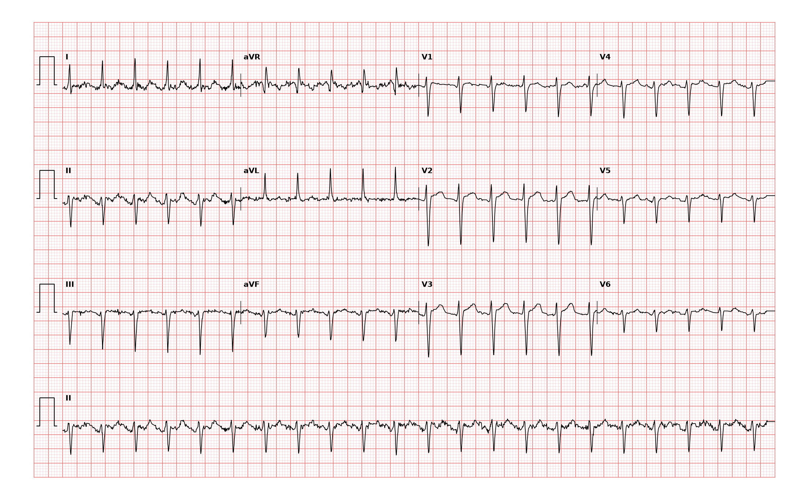

## 문제
82세 여자가 1시간 전 텔레비전을 보다가 갑자기 시작된 빠르고 규칙적인 두근거림으로 응급실에 왔다. 가벼운 어지러움이 있으나 가슴 통증과 실신은 없다. 고혈압약을 복용하고 있다. 혈압 112/70 mmHg, 맥박 152회/분으로 규칙적이며, 호흡 18회/분, 체온 36.6°C 이다. 의식은 명료하고 폐음은 깨끗하다. 혈청 칼륨 4.1 mEq/L 이다. 12유도 심전도는 그림과 같다. 심전도 판독으로 가장 적절한 것은?

- A. 다소성 심방빈맥
- B. 발작성 상심실성 빈맥
- C. 동빈맥
- D. 심방세동
- E. 심실빈맥

_12유도 심전도, 25 mm/s · 10 mm/mV, 3×4 + II 리듬 스트립 (PTB-XL ECG dataset, PhysioNet, CC BY 4.0 — 원신호 그대로 작도)_

## 정답 및 해설
> 정답: B

- **정답 핵심**: 리듬 스트립(II)에서 RR 간격이 일정한 약 150회/분의 빈맥이고 QRS 는 좁다(< 120 ms). QRS 앞에 P파가 보이지 않아 동빈맥이 아니다. RR 이 일정해 심방세동·다소성 심방빈맥이 아니며, QRS 가 좁아 심실빈맥이 아니다. 갑자기 시작한 규칙적인 좁은 QRS 빈맥 — 발작성 상심실성 빈맥이다. I 양성·II·III·aVF 음성의 좌축편위는 빈맥과 별개로 있는 전도 소견이다.
- **원리**: <b>왜 QRS 가 좁은가</b>: 빈맥 회로가 히스속 위(방실결절 안, 또는 심방-방실결절-부전도로)에 있으면 심실은 정상 전도계를 따라 탈분극하므로 QRS 가 좁다. 가장 흔한 형태인 방실결절 재진입 빈맥은 결절 안의 빠른 길과 느린 길이 회로를 이룬다 — 느린 길로 내려가고 빠른 길로 거의 동시에 올라가므로 역행 P파가 QRS 안에 묻히거나 QRS 끝에 작은 굴곡(V1 의 가성 r′)으로만 보인다. 그래서 「P파가 안 보인다」가 핵심 소견이 된다.  <b>왜 갑자기 시작하고 갑자기 멈추는가</b>: 조기 박동이 한쪽 길의 불응기에 걸려 일방향 차단이 생기는 순간 회로가 열리고, 회로의 한 부분이 차단되는 순간 끝난다. 동빈맥은 자율신경 자극에 따라 서서히 빨라지고 서서히 느려진다.  <b>150회/분이면 늘 의심할 것</b>: 2:1 전도 심방조동도 심실 박동수가 정확히 약 150회/분이다. 미주신경 자극이나 아데노신으로 방실 전도를 잠시 막으면 상심실성 빈맥은 끝나고, 조동은 톱니 모양 F파가 드러난다.
- **비교**: <table><thead><tr><th style="width:24%">항목</th><th style="width:38%">발작성 상심실성 빈맥(정답)</th><th>동빈맥(가장 가까운 오답)</th></tr></thead><tbody> <tr><td>시작</td><td><b>갑자기</b>(스위치를 켠 듯)</td><td>서서히(발열·통증·탈수·빈혈에 반응)</td></tr> <tr><td>P파</td><td><b>보이지 않음</b> 또는 QRS 바로 뒤 역행 P</td><td>모든 QRS 앞에 정상 축의 P파(II 양성)</td></tr> <tr><td>박동수</td><td>150~250회/분, 거의 고정</td><td>대개 100~150회/분, 변동</td></tr> <tr><td>미주신경 자극</td><td>갑자기 멈추거나 변화 없음</td><td>서서히 느려졌다 다시 빨라짐</td></tr> <tr><td>이 환자</td><td>갑자기 시작 · P파 없음 · 152회/분 — 일치</td><td>유발 요인 없음 · P파 없음 — 불일치</td></tr> </tbody></table> 좁고 규칙적인 빈맥은 「QRS 앞 P파가 있는가」로 먼저 가른다.
- **오답 이유**:
  - ① 다소성 심방빈맥은 모양이 다른 P파가 3가지 이상 보이고 RR·PR 간격이 불규칙하며 주로 중증 폐질환 환자라면 정답이 된다.
  - ③ 동빈맥은 발열·통증·탈수 같은 원인이 있고 모든 QRS 앞에 II 에서 양성인 정상 P파가 보이며 박동수가 서서히 변했다면 정답이 된다.
  - ④ 심방세동은 RR 간격이 불규칙하게 불규칙하고 P파 대신 기저선이 잔물결처럼 흔들린다면 정답이 된다.
  - ⑤ 심실빈맥은 QRS 가 120 ms 이상으로 넓고 방실 해리·포착 박동·융합 박동이 보였다면 정답이 된다.
- **함정**: 빈맥이면 일단 동빈맥으로 읽는 것 — QRS 앞에 P파가 없고 갑자기 시작했다면 재진입 빈맥이다.
- **학습목표**: 갑자기 시작한 약 150회/분의 규칙적인 좁은 QRS 빈맥에서 QRS 앞 P파가 보이지 않으면 발작성 상심실성 빈맥으로 판독하고, 동빈맥·심방세동·심실빈맥과 가른다
- **근거·출처**: Loscalzo J, Fauci AS, Kasper DL, et al., eds. Harrison's Principles of Internal Medicine, 22nd ed. McGraw Hill; 2025. Chapter 256: Paroxysmal Supraventricular Tachycardias · Loscalzo J, Fauci AS, Kasper DL, et al., eds. Harrison's Principles of Internal Medicine, 22nd ed. McGraw Hill; 2025. Chapter 247: Electrocardiography · Wagner P, Strodthoff N, Bousseljot RD, et al. PTB-XL, a large publicly available electrocardiography dataset. Sci Data. 2020;7:154

## 출처
- PTB-XL ECG dataset v1.0.3 (PhysioNet, CC BY 4.0) · record 12346 · Creative Commons Attribution 4.0 International · https://physionet.org/content/ptb-xl/1.0.3/LICENSE.txt
