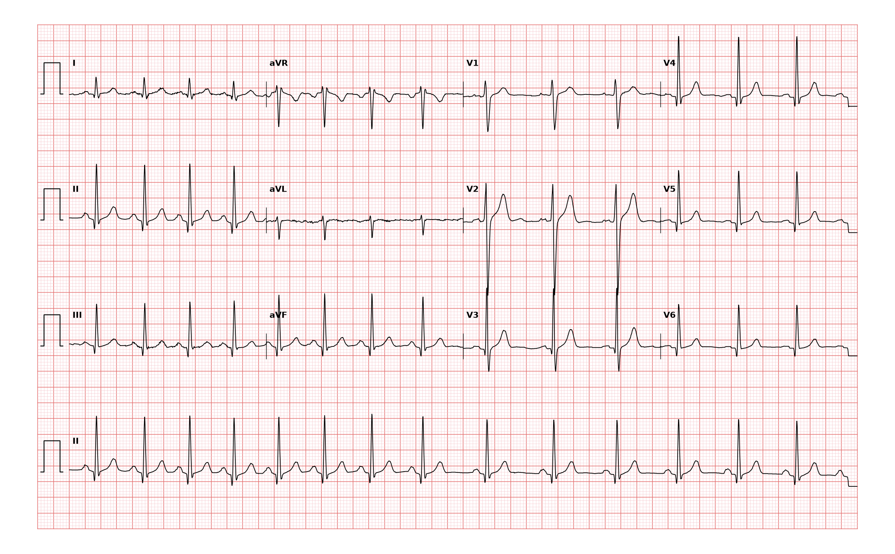

## 문제
38세 남자가 회사 건강검진 심전도에서 「맥이 불규칙하다」는 말을 듣고 외래에 왔다. 두근거림·어지러움·실신·가슴 통증은 없고 일주일에 세 번 달리기를 한다. 가족 중 젊은 나이에 갑자기 사망한 사람은 없다. 혈압 118/72 mmHg, 맥박 64~80회/분이다. 진찰에서 맥박은 숨을 들이쉴 때 빨라지고 내쉴 때 느려지며, 심잡음은 없다. 혈청 칼륨과 갑상샘 기능은 정상이다. 외래에서 다시 찍은 12유도 심전도는 그림과 같다. 다음 처치로 가장 적절한 것은?

- A. 추가 검사나 치료 없이 정상 변이임을 설명한다
- B. 24시간 활동 중 심전도(홀터) 감시를 한다
- C. 베타차단제를 시작한다
- D. 경흉부 심장초음파를 시행한다
- E. 전기생리검사를 의뢰한다

_12유도 심전도, 25 mm/s · 10 mm/mV, 3×4 + II 리듬 스트립 (PTB-XL ECG dataset, PhysioNet, CC BY 4.0 — 원신호 그대로 작도)_

## 정답 및 해설
> 정답: A

- **정답 핵심**: 모든 QRS 앞에 II 에서 양성인 같은 모양의 P파가 있고 PR 간격이 일정하다 — 동리듬이다. RR 간격만 약 0.75~0.95초 사이로 서서히 길어졌다 짧아지기를 되풀이하고, 진찰에서 들숨에 빨라지고 날숨에 느려진다. 호흡성 동부정맥이며 QRS·ST-T 도 정상이다. 증상·가족력·구조적 심질환 단서가 없는 젊은 성인의 정상 변이이므로 추가 검사나 치료 없이 설명하고 안심시킨다.
- **원리**: <b>왜 들숨에 빨라지는가</b>: 들숨에 흉강 음압이 커지면 정맥환류가 늘고 폐 신장수용체·심방 수용체의 신호가 미주신경 중추를 억제한다. 동결절에 대한 미주신경 긴장이 줄어 박동이 빨라지고, 날숨에는 반대로 미주신경 긴장이 돌아와 느려진다. 그래서 RR 간격이 호흡 주기에 맞춰 「서서히」 변한다 — 갑자기 끼어드는 박동이 없다.  <b>왜 건강의 표지인가</b>: 미주신경 반응이 활발한 젊은 사람·운동선수에서 뚜렷하고, 나이가 들거나 당뇨 자율신경병증·심부전이 있으면 줄어든다. 이 변동이 심박변이도의 가장 큰 부분이다.  <b>다른 불규칙 리듬과 가르는 법</b>: P파 모양이 같고 PR 이 일정하며 변화가 점진적이면 동결절 자체의 속도 변화다. 일찍 끼어드는 박동(기외수축), 모양이 바뀌는 P파(이소성 심방 리듬·다소성 심방빈맥), P파 없는 불규칙(심방세동)과 다르다. 비호흡성 동부정맥(호흡과 무관)은 고령·디곡신 독성에서 볼 수 있어 그때는 원인을 찾는다.
- **비교**: <table><thead><tr><th style="width:24%">항목</th><th style="width:38%">설명·안심(정답)</th><th>24시간 홀터 감시(가장 가까운 오답)</th></tr></thead><tbody> <tr><td>대상</td><td>심전도에서 진단이 끝난 <b>무증상</b> 정상 변이</td><td>간헐적 두근거림·실신처럼 <b>증상과 리듬의 관계</b>를 밝혀야 할 때</td></tr> <tr><td>얻는 정보</td><td>추가로 필요한 정보 없음</td><td>증상 시점의 리듬·기외수축 부담·숨은 빈맥/서맥</td></tr> <tr><td>왜</td><td>P파·PR 일정, 호흡 연동 — 이미 진단됨</td><td>표준 심전도 10초에 안 잡히는 간헐 부정맥 때문</td></tr> <tr><td>이 환자</td><td>증상 없음 · 호흡 연동 — 일치</td><td>설명할 증상이 없다 — 이득 없음</td></tr> </tbody></table> 검사는 답할 질문이 있을 때 한다 — 무증상의 호흡성 동부정맥에는 답할 질문이 남아 있지 않다.
- **오답 이유**:
  - ② 24시간 홀터 감시는 간헐적 두근거림·어지러움·실신이 있어 증상 시점의 리듬을 확인해야 하거나 기외수축 부담을 재야 한다면 정답이 된다.
  - ③ 베타차단제는 증상이 있는 동빈맥·기외수축이나 부적절 동빈맥이라면 고려하지만, 정상 변이에 쓰면 피로·서맥만 남긴다.
  - ④ 경흉부 심장초음파는 심잡음·심부전 증상·병적 Q파나 비대 소견처럼 구조적 심질환 단서가 있었다면 정답이 된다.
  - ⑤ 전기생리검사는 원인 모를 실신·지속 심실빈맥·조기흥분 증후군처럼 급사 위험을 평가해야 할 때라면 정답이 된다.
- **함정**: 「불규칙하다」는 말만 듣고 홀터를 고르는 것 — P파·PR 이 일정하고 호흡에 연동되면 동결절의 정상 변이다.
- **학습목표**: 젊은 무증상 성인에서 모든 QRS 앞에 같은 모양의 P파가 있고 PR 이 일정하며 RR 만 호흡에 따라 서서히 변하는 동부정맥은 생리적 변이이므로 추가 검사·치료 없이 설명한다
- **근거·출처**: Loscalzo J, Fauci AS, Kasper DL, et al., eds. Harrison's Principles of Internal Medicine, 22nd ed. McGraw Hill; 2025. Chapter 247: Electrocardiography · Loscalzo J, Fauci AS, Kasper DL, et al., eds. Harrison's Principles of Internal Medicine, 22nd ed. McGraw Hill; 2025. Chapter 45: Palpitations · Wagner P, Strodthoff N, Bousseljot RD, et al. PTB-XL, a large publicly available electrocardiography dataset. Sci Data. 2020;7:154

## 출처
- PTB-XL ECG dataset v1.0.3 (PhysioNet, CC BY 4.0) · record 2499 · Creative Commons Attribution 4.0 International · https://physionet.org/content/ptb-xl/1.0.3/LICENSE.txt
