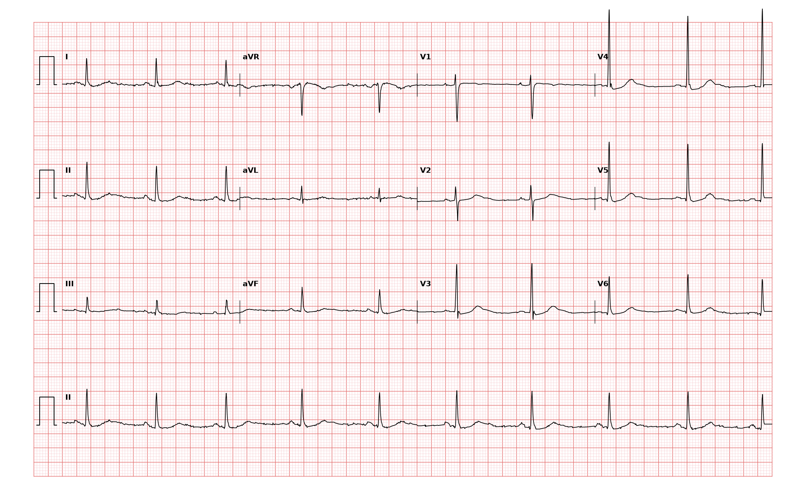

## 문제
57세 남자가 회사 건강검진에서 맥박이 느리다는 말을 듣고 외래에 왔다. 어지러움·실신·호흡곤란·운동 시 피로는 없고, 주 3회 1시간씩 달리기를 한다. 복용하는 약은 없다. 혈압 124/76 mmHg, 맥박 58회/분으로 규칙적이며, 심음은 정상이고 심잡음은 없다. 갑상샘 기능과 혈청 칼륨은 정상이다. 12유도 심전도는 그림과 같다. 다음 처치로 가장 적절한 것은?

- A. 이소프로테레놀 정맥 주입
- B. 추가 처치 없이 경과 관찰
- C. 아트로핀 정맥주사
- D. 영구 심박조율기 삽입
- E. 전기생리검사

_12유도 심전도, 25 mm/s · 10 mm/mV, 3×4 + II 리듬 스트립 (PTB-XL ECG dataset, PhysioNet, CC BY 4.0 — 원신호 그대로 작도)_

## 정답 및 해설
> 정답: B

- **정답 핵심**: 리듬 스트립(II)에서 모든 QRS 앞에 같은 모양의 양성 P파가 있고 PR 간격이 약 0.16초로 일정하며, RR 간격이 약 1.0초로 일정하다 — 약 58회/분의 동서맥이다. QRS 는 좁고 ST-T 는 정상이며 방실차단의 증거(PR 연장·QRS 탈락)가 없다. 증상이 없고 운동을 규칙적으로 하는 사람의 가벼운 동서맥은 미주신경 긴장이 높아 생기는 생리적 소견이므로 치료가 필요 없다.
- **원리**: <b>왜 동서맥은 대개 치료하지 않는가</b>: 동결절의 발화 속도는 자율신경이 정한다. 규칙적으로 운동하는 사람은 1회 박출량이 커져 같은 심박출량을 더 적은 박동으로 만들 수 있고, 휴식 시 미주신경 긴장이 높아 심박수가 50~60회/분 아래로 내려간다. 심박출량이 충분하면 증상이 없고, 증상이 없는 서맥은 수명·사건 위험을 늘리지 않는다.  <b>왜 「증상과의 연관」이 기준인가</b>: 동결절 기능장애(sick sinus syndrome)의 치료 적응증은 박동수 숫자가 아니라 <b>서맥 때문에 생기는 증상</b>(어지러움·실신·운동 능력 저하)이다. 그래서 진단의 핵심은 증상이 서맥과 같은 시점에 생기는지를 홀터·사건 기록기로 확인하는 일이다.  <b>왜 응급 약물은 맞지 않는가</b>: 아트로핀·이소프로테레놀은 저혈압·쇼크·의식 변화를 동반한 <b>불안정 서맥</b>에서 심박수를 일시적으로 올리는 약이다. 안정한 무증상 환자에게는 이득 없이 빈맥·허혈만 일으킨다.
- **비교**: <table><thead><tr><th style="width:24%">항목</th><th style="width:38%">경과 관찰(정답)</th><th>영구 심박조율기(가장 가까운 오답)</th></tr></thead><tbody> <tr><td>대상</td><td>증상 없는 동서맥, 운동선수·수면 중 서맥</td><td><b>증상과 연관된</b> 동결절 기능장애, 고도 방실차단</td></tr> <tr><td>심전도</td><td>정상 P-QRS, PR 일정, 약 50~60회/분</td><td>동정지·동방차단·빈맥-서맥 교대, Mobitz II·3도 방실차단</td></tr> <tr><td>왜</td><td>심박출량이 충분해 위험이 늘지 않는다</td><td>증상·실신·급사 위험을 줄인다</td></tr> <tr><td>이 환자</td><td>증상 없음 · 운동 · 58회/분 — 일치</td><td>증상·전도 장애 없음 — 불일치</td></tr> </tbody></table> 서맥은 숫자가 아니라 「증상이 서맥과 함께 오는가」와 「방실 전도가 정상인가」로 치료를 정한다.
- **오답 이유**:
  - ① 이소프로테레놀 정맥 주입은 아트로핀에 반응하지 않는 불안정 서맥에서 경피 심박조율을 준비하는 동안이라면 쓸 수 있다.
  - ③ 아트로핀 정맥주사는 서맥과 함께 저혈압·의식 저하·쇼크 같은 불안정 징후가 있는 응급 상황이라면 첫 약물로 정답이 된다.
  - ④ 영구 심박조율기 삽입은 어지러움·실신이 서맥과 같은 시점에 기록된 동결절 기능장애나 Mobitz II·3도 방실차단이라면 정답이 된다.
  - ⑤ 전기생리검사는 원인 모를 실신이 반복되는데 비침습 검사로 서맥·빈맥과의 연관을 밝히지 못했을 때라면 고려할 수 있다.
- **함정**: 심박수 60회/분 미만이라는 숫자만 보고 치료를 고르는 것 — 증상이 없으면 동서맥은 치료 대상이 아니다.
- **학습목표**: 증상이 없는 약 58회/분의 동서맥은 생리적 변이로 보고 추가 처치 없이 경과 관찰하며, 심박조율기는 증상과 연관된 서맥에만 쓴다
- **근거·출처**: Loscalzo J, Fauci AS, Kasper DL, et al., eds. Harrison's Principles of Internal Medicine, 22nd ed. McGraw Hill; 2025. Chapter 251: The Bradyarrhythmias: Disorders of the Sinoatrial Node · Loscalzo J, Fauci AS, Kasper DL, et al., eds. Harrison's Principles of Internal Medicine, 22nd ed. McGraw Hill; 2025. Chapter 247: Electrocardiography · Wagner P, Strodthoff N, Bousseljot RD, et al. PTB-XL, a large publicly available electrocardiography dataset. Sci Data. 2020;7(1):154

## 출처
- PTB-XL ECG dataset v1.0.3 (PhysioNet, CC BY 4.0) · record 4808 · Creative Commons Attribution 4.0 International · https://physionet.org/content/ptb-xl/1.0.3/LICENSE.txt
