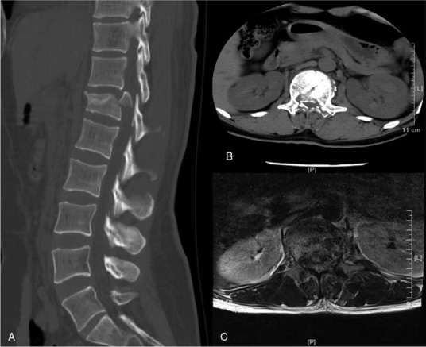

## 문제
A 46-year-old woman is brought to the emergency department after a high-speed motor vehicle collision. She is alert and reports back pain and inability to move her legs. Blood pressure is 118/72 mm Hg and pulse is 96/min. Breath sounds are equal bilaterally, and FAST examination is negative. There is no movement or sensation below the groin, and rectal tone is absent. The upper extremities are normal. Sagittal and axial CT and an axial T2-weighted MRI of the thoracic and lumbar spine are shown. Which of the following is the most appropriate next step in management?

- A. Bed rest with analgesia and repeat CT in 6 weeks
- B. Percutaneous vertebroplasty of the fractured body
- C. Early surgical decompression and posterior stabilization
- D. Thoracolumbar orthosis with early mobilization
- E. High-dose intravenous methylprednisolone infusion

_A: sagittal CT (bone window) of the thoracolumbar spine; B: axial CT at the injured level; C: axial T2-weighted MRI at the same level. Panels A–C of a published case figure, panel D cropped, original panel letters and orientation markers kept (PMC Open Access Subset, CC BY)_

## 정답 및 해설
> 정답: C

- **정답 핵심**: Sagittal CT shows loss of height of an upper lumbar vertebral body with a posterosuperior fragment retropulsed into the spinal canal; the axial CT shows a comminuted body with bone occupying the anterior canal, and the axial T2 MRI shows the thecal sac compressed at the same level. This is a burst fracture with failure of the anterior and middle columns and severe canal compromise. The patient has a complete motor and sensory deficit below the injury. A burst fracture with a neurologic deficit is unstable and requires early surgical decompression of the canal and instrumented stabilization.
- **원리**: <b>Why the middle column matters</b>: in the three-column model, the anterior column is the front two-thirds of the vertebral body, the middle column is the posterior third of the body with the posterior longitudinal ligament, and the posterior column is the arch and ligaments. A compression (wedge) fracture fails only the anterior column, and the canal is untouched. A <b>burst</b> fracture is an axial load that also breaks the posterior wall of the body, so fragments are driven backward into the canal — exactly where the cord or conus lies.  <b>Why a deficit changes the plan</b>: a neurologically intact patient with a stable burst fracture can often be treated with a brace. Once the fragment has compressed the neural elements and there is a deficit, the goal is to remove ongoing compression and prevent further collapse; early decompression (within about 24 hours) is associated with better neurologic recovery in spinal cord injury.  <b>Why not steroids</b>: high-dose methylprednisolone (NASCIS protocol) did not show a convincing benefit and increases infection and gastrointestinal bleeding; current guidelines do not recommend it routinely.
- **비교**: <table><thead><tr><th style="width:24%">Feature</th><th style="width:38%">Burst fracture with deficit (answer)</th><th>Stable burst/wedge fracture, intact (brace)</th></tr></thead><tbody> <tr><td>Columns</td><td>Anterior + <b>middle</b> (posterior wall)</td><td>Anterior only, or middle without displacement</td></tr> <tr><td>Canal</td><td>Retropulsed fragment, severe compromise</td><td>Little or no canal compromise</td></tr> <tr><td>Neurology</td><td><b>Deficit</b> (here complete below groin)</td><td>Intact</td></tr> <tr><td>Treatment</td><td>Early decompression + stabilization</td><td>Orthosis, early mobilization</td></tr> </tbody></table> The fracture pattern and the neurologic examination together decide surgery — the image alone does not.
- **오답 이유**:
  - (A) Bed rest with repeat imaging is a nonoperative approach suited to a stable injury in an intact patient; it leaves the compressed neural elements untreated here.
  - (B) Vertebroplasty treats painful osteoporotic compression fractures with an intact posterior wall; cement could leak into a canal already breached by fragments.
  - (D) A thoracolumbar orthosis with early mobilization would be appropriate for a neurologically intact patient with a stable burst or wedge fracture without canal compromise.
  - (E) High-dose methylprednisolone was once given within 8 hours of spinal cord injury, but trials showed no clear benefit and more complications, so it is not routine.
- **함정**: Treating every vertebral body fracture as a compression fracture — retropulsion into the canal and a neurologic deficit make it an unstable burst fracture.
- **학습목표**: Recognize a thoracolumbar burst fracture with retropulsed fragments and canal compromise on CT and MRI, and choose early surgical decompression and stabilization when there is a neurologic deficit
- **근거·출처**: Loscalzo J, Fauci AS, Kasper DL, et al., eds. Harrison's Principles of Internal Medicine, 22nd ed. McGraw Hill; 2025. Chapter 453: Diseases of the Spinal Cord · Loscalzo J, Fauci AS, Kasper DL, et al., eds. Harrison's Principles of Internal Medicine, 22nd ed. McGraw Hill; 2025. Chapter 18: Low Back Pain · Fehlings MG, Tetreault LA, Wilson JR, et al. A clinical practice guideline for the management of acute spinal cord injury. Global Spine J. 2017;7(3 Suppl):84S-94S

## 출처
- Percutaneous pedicle screw fixation combined with transforaminal endoscopic spinal canal decompression for the treatment of thoracolumbar burst fracture with severe neurologic deficit: A case report. Medicine (Baltimore). 2020 May 22;99(21):e20276. doi: 10.1097/MD.0000000000020276 (CC BY) — Figure 1 · CC BY · https://creativecommons.org/licenses/
