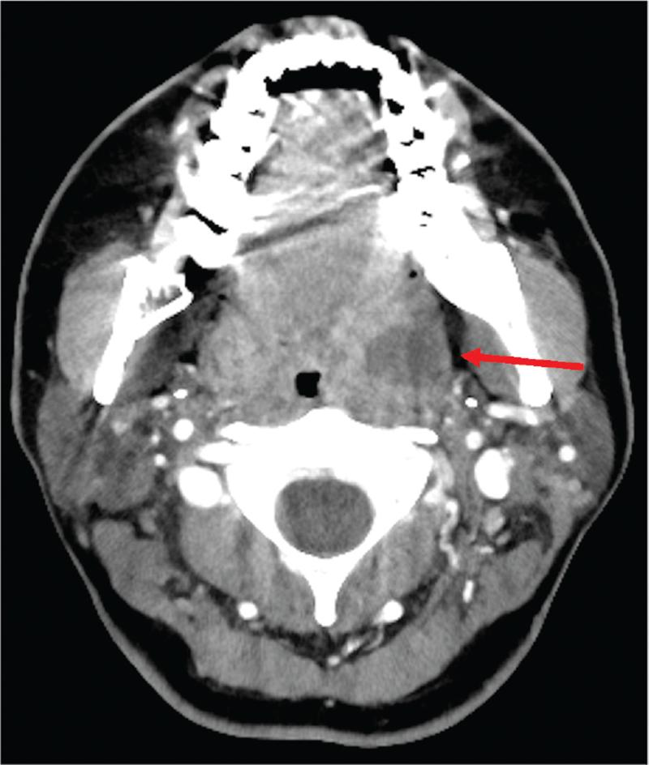

## 문제
A 32-year-old woman comes to the clinic because of a sore throat that has worsened over 5 days despite rest and fluids. She now has difficulty opening her mouth and pain on swallowing, and her voice sounds muffled. Temperature is 38.4°C, pulse is 100/min, and oxygen saturation is 98% on room air. She is not drooling and has no stridor. Tender cervical lymphadenopathy is present on the left. A contrast-enhanced CT scan of the neck is shown. Which of the following is the most appropriate next step in management?

- A. Intravenous antibiotics alone with reassessment in 48 hours
- B. Oral amoxicillin for 10 days and outpatient follow-up
- C. Oral corticosteroids alone for symptom relief
- D. Emergency tracheostomy under local anesthesia
- E. Needle aspiration or incision and drainage plus antibiotics

_Contrast-enhanced axial CT of the neck at the level of the oropharynx; the arrow is from the original figure, dental hardware artifact present, resized only (PMC Open Access Subset, CC BY)_

## 정답 및 해설
> 정답: E

- **정답 핵심**: The CT shows a low-attenuation fluid collection with an enhancing rim lateral to the left palatine tonsil (arrow), bulging the lateral pharyngeal wall medially and narrowing the oropharyngeal airway toward the right. Together with trismus, odynophagia, and a muffled 'hot potato' voice, this is a peritonsillar abscess. A formed abscess is treated by draining the pus (needle aspiration or incision and drainage) together with antibiotics covering streptococci and oral anaerobes.
- **원리**: <b>Why the location is lateral to the tonsil</b>: the palatine tonsil sits in a fossa bounded laterally by the superior constrictor muscle. Infection spreads from the tonsil through its capsule into the loose peritonsillar space between the capsule and the constrictor. Pus collecting there pushes the tonsil and soft palate medially (uvula deviation to the opposite side) and irritates the medial pterygoid muscle just lateral to it — that irritation is the cause of <b>trismus</b>.  <b>Why drainage and not antibiotics alone</b>: antibiotics penetrate poorly into a walled-off collection of pus. A rim-enhancing collection on CT means an abscess has formed, so the pus must be removed; antibiotics then treat the surrounding cellulitis. Peritonsillar cellulitis without a collection (phlegmon) is the situation in which antibiotics alone are tried.  <b>Why airway danger is assessed first</b>: drooling, stridor, or inability to handle secretions signal airway compromise or deeper spread (parapharyngeal or retropharyngeal space), which changes the urgency and setting of treatment.
- **비교**: <table><thead><tr><th style="width:24%">Feature</th><th style="width:38%">Peritonsillar abscess (answer)</th><th>Peritonsillar cellulitis (closest distractor)</th></tr></thead><tbody> <tr><td>CT</td><td><b>Rim-enhancing low-attenuation collection</b></td><td>Diffuse swelling and enhancement, no fluid</td></tr> <tr><td>Trismus</td><td>Common (medial pterygoid irritation)</td><td>Mild or absent</td></tr> <tr><td>Treatment</td><td>Drainage + antibiotics</td><td>Antibiotics, reassess in 24–48 h</td></tr> <tr><td>This patient</td><td>Collection lateral to left tonsil · trismus — match</td><td>A collection is present — mismatch</td></tr> </tbody></table> The presence of a drainable fluid collection, not the severity of pain, separates the two.
- **오답 이유**:
  - (A) Intravenous antibiotics alone would be appropriate for peritonsillar cellulitis, when CT shows diffuse swelling without a rim-enhancing fluid collection.
  - (B) Oral amoxicillin with outpatient follow-up suits uncomplicated streptococcal pharyngitis without trismus, muffled voice, or a collection on imaging.
  - (C) Corticosteroids can be added to reduce swelling and pain, but used alone they leave the pus undrained and would not be the main treatment.
  - (D) Emergency tracheostomy would be needed if the patient had stridor, drooling, or impending airway obstruction that could not be managed by intubation.
- **함정**: Choosing antibiotics alone because she is young and stable — a rim-enhancing collection on CT means pus that must be drained.
- **학습목표**: Identify a rim-enhancing fluid collection lateral to the palatine tonsil on neck CT as a peritonsillar abscess and treat it with drainage plus antibiotics
- **근거·출처**: Loscalzo J, Fauci AS, Kasper DL, et al., eds. Harrison's Principles of Internal Medicine, 22nd ed. McGraw Hill; 2025. Chapter 37: Upper Respiratory Symptoms, Including Earache, Sinus Symptoms, and Sore Throat · Galioto NJ. Peritonsillar abscess. Am Fam Physician. 2017;95(8):501-506

## 출처
- Peritonsillar abscess caused by Prevotella bivia during home quarantine for coronavirus disease 2019: Case report. Medicine (Baltimore). 2022 May 27;101(21):e29469. doi: 10.1097/MD.0000000000029469 (CC BY) — Figure 1 · CC BY · https://creativecommons.org/licenses/
