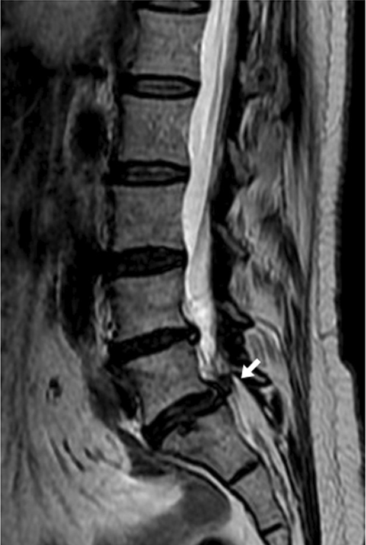

## 문제
55세 여자가 3주 전 무거운 화분을 든 뒤 허리 통증과 함께 오른쪽 다리로 뻗치는 통증이 생겨 왔다. 기침할 때 통증이 심해지고, 앉아 있을 때보다 서 있을 때 조금 낫다. 대소변 장애는 없다. 오른쪽 하지 직거상 검사는 40°에서 다리로 뻗치는 통증을 재현한다. 요추 MRI 는 그림과 같다. 이 환자의 신경학적 진찰에서 나타날 가능성이 가장 높은 소견은?

- A. 오른쪽 엉덩관절 굴곡 약화
- B. 회음부 감각 소실
- C. 오른쪽 발목 반사 감소
- D. 오른쪽 무릎 반사 감소
- E. 오른쪽 엄지발가락 신전 약화

_요추 시상면 T2 강조 MRI(정중선 오른쪽), 화살표는 원 그림의 것 — 아래 패널 문자를 잘라냄 (PMC Open Access Subset, CC BY)_

## 정답 및 해설
> 정답: C

- **정답 핵심**: 시상면 T2 MRI 에서 가장 아래 요추 추간판(L5/S1)의 신호가 낮고 추간판 조직이 뒤로 돌출해(화살표) 경막낭 앞을 누른다. 위 분절 추간판의 뒤쪽 윤곽은 유지되어 있다. L5/S1 의 방정중 탈출은 그 높이에서 척추관을 지나 아래로 내려가는 S1 신경근을 누른다. S1 신경근이 담당하는 반사는 발목(아킬레스) 반사이므로 발목 반사 감소가 가장 가능성 높은 소견이다.
- **원리**: <b>왜 L5/S1 탈출이 S1 을 누르는가</b>: 요추에서 신경근은 같은 번호 척추뼈 아래의 추간공으로 나간다 — L5 신경근은 L5/S1 추간공으로 나간다. 그런데 L5 신경근은 이미 그 위 높이(L4/5)에서 경막낭을 떠나 추간공 위쪽, 즉 추간판보다 높은 곳을 지나므로 L5/S1 추간판의 <b>방정중</b> 탈출에 닿지 않는다. 이 높이의 척추관 옆을 지나며 아래로 내려가는(traversing) 신경근이 S1 이고, 방정중 탈출은 바로 이 신경근을 누른다.  <b>예외 — 바깥쪽 탈출</b>: 탈출이 추간공 안이나 바깥(외측)으로 가면 그 높이에서 나가는(exiting) 신경근, 즉 L5 를 누른다. 그래서 MRI 에서는 높이와 함께 <b>탈출의 위치(정중·방정중·추간공)</b>를 같이 읽는다.  <b>신경근별 소견</b>: L4 — 무릎 반사 · 발목 배측굴곡, L5 — 엄지발가락 신전 · 발등 감각(반사 없음), S1 — 발목 반사 · 발바닥 굴곡 · 발바깥 감각.
- **비교**: <table><thead><tr><th style="width:24%">항목</th><th style="width:38%">S1 신경근 압박(정답)</th><th>L5 신경근 압박(가장 가까운 오답)</th></tr></thead><tbody> <tr><td>흔한 원인</td><td>L5/S1 <b>방정중</b> 탈출</td><td>L4/5 방정중 탈출, 또는 L5/S1 추간공 탈출</td></tr> <tr><td>근력</td><td>발바닥 굴곡(까치발)</td><td>엄지발가락 신전 · 발등 굽힘</td></tr> <tr><td>반사</td><td><b>발목 반사 감소</b></td><td>뚜렷한 표준 반사 없음</td></tr> <tr><td>감각</td><td>발바깥 · 발바닥</td><td>발등 · 엄지와 둘째 발가락 사이</td></tr> <tr><td>이 환자</td><td>L5/S1 방정중 돌출 — 일치</td><td>L4/5 윤곽 유지 · 추간공 침범 없음 — 불일치</td></tr> </tbody></table> 「어느 높이」와 「정중에 가까운가, 추간공 쪽인가」를 함께 읽어야 신경근이 정해진다.
- **오답 이유**:
  - ① 엉덩관절 굴곡 약화는 L2·L3 신경근이나 허리근 문제로, 상부 요추(L1/2·L2/3) 탈출이었다면 정답이 된다.
  - ② 회음부 감각 소실은 큰 정중 탈출이 마미를 눌러 대소변 장애와 안장 마취가 함께 있는 마미 증후군이라면 정답이 된다.
  - ④ 무릎 반사 감소는 L4 신경근 소견으로, L3/4 방정중 탈출이나 L4/5 추간공 탈출이 MRI 에 보였다면 정답이 된다.
  - ⑤ 엄지발가락 신전 약화는 L5 신경근 소견으로, 탈출이 L4/5 방정중이거나 L5/S1 추간공 쪽이었다면 정답이 된다.
- **함정**: L5/S1 의 「L5」를 보고 L5 신경근을 고르는 것 — 방정중 탈출은 그 높이를 지나 내려가는 S1 을 누른다.
- **학습목표**: 요추 MRI 에서 L5/S1 방정중 추간판 탈출을 찾고, 그 높이에서 눌리는 신경근(S1)과 기대되는 신경학적 소견(발목 반사 감소)을 연결한다
- **근거·출처**: Loscalzo J, Fauci AS, Kasper DL, et al., eds. Harrison's Principles of Internal Medicine, 22nd ed. McGraw Hill; 2025. Chapter 18: Low Back Pain · Jensen RK, Kongsted A, Kjaer P, Koes B. Diagnosis and treatment of sciatica. BMJ. 2019;367:l6273

## 출처
- Conjoined nerve root in a patient with lumbar disc herniation accompanied by a lumbosacral spine anomaly: a case report. J Med Case Rep. 2023 Feb 24;17:82. doi: 10.1186/s13256-022-03749-1 (CC BY) — Fig. 3 · CC BY · https://creativecommons.org/licenses/
