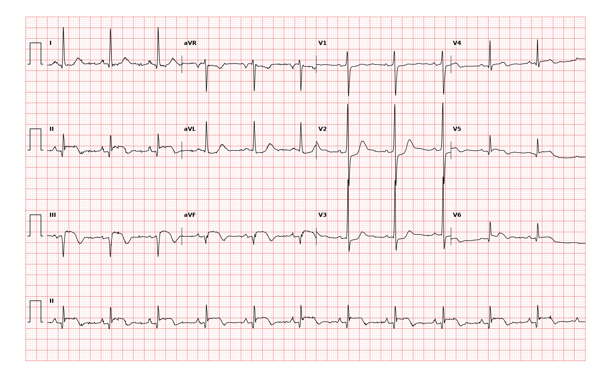

## 문제
81세 여자가 백내장 수술 전 검사로 심전도를 찍었다. 3년 전 갑자기 시작된 심한 가슴 통증으로 다른 병원에 며칠 입원한 적이 있으나 자세한 기록은 없다. 지금은 가슴 통증과 호흡곤란이 없고 평지를 걷는 데 지장이 없다. 혈압 134/78 mmHg, 맥박 70회/분, 산소포화도 97% 이다. 심음은 정상이고 폐음은 깨끗하다. 12유도 심전도는 그림과 같다. 심전도 판독으로 가장 적절한 것은?

- A. 급성 심낭염
- B. 하벽·후벽 심근경색
- C. 전중격 심근경색
- D. 우심실비대
- E. 완전 우각차단

_12유도 심전도, 25 mm/s · 10 mm/mV, 3×4 + II 리듬 스트립 (PTB-XL ECG dataset, PhysioNet, CC BY 4.0 — 원신호 그대로 작도)_

## 정답 및 해설
> 정답: B

- **정답 핵심**: III·aVF 에 폭이 넓고(≥ 0.04초) 깊은 Q파가 있고 T파가 역위되어 있으며 II 에도 q파가 있다 — 하벽(우관상동맥 또는 좌회선지 영역)의 경색 흔적이다. 동시에 V2·V3 에서 R파가 S파보다 커(R/S > 1) 후벽 경색의 거울상 소견이다. QRS 폭이 좁아 우각차단이 아니고, 우축편위·우심실 긴장형 ST-T 가 없어 우심실비대도 아니다. ST 상승이 없고 3년 전 흉통 병력이 있어 오래된 하벽·후벽 심근경색으로 판독한다.
- **원리**: <b>왜 Q파가 경색의 흔적인가</b>: 괴사한 심근은 전기적으로 비활성 「창」이 된다. 그 위에 놓인 전극은 창을 통해 반대쪽 심실벽이 멀어지는 흥분을 보게 되어 처음부터 음성인 넓은 Q파를 그린다. 그래서 병적 Q파는 경색 부위를 바라보는 유도에 남고, 몇 달·몇 년이 지나도 사라지지 않는 경우가 많다.  <b>왜 후벽은 V2·V3 의 큰 R파로 보이는가</b>: 표준 12유도에는 좌심실 후벽을 직접 보는 전극이 없다. 후벽에서 Q파가 생기면 그 거울상이 앞쪽 유도 V1~V3 에서 <b>큰 R파</b>로, 후벽의 ST 상승은 V1~V3 의 ST 하강으로 나타난다. 하벽 경색과 후벽 경색이 함께 오는 것은 우세 우관상동맥이나 좌회선지가 두 영역을 함께 공급하기 때문이다.  <b>큰 R파의 다른 원인</b>: V1~V2 의 R 우세는 우각차단(QRS 넓음)·우심실비대(우축편위·우심실 긴장)·WPW(델타파·짧은 PR)에서도 보인다. QRS 폭·축·PR 을 같이 확인해야 후벽 경색으로 확정할 수 있다.
- **비교**: <table><thead><tr><th style="width:24%">항목</th><th style="width:38%">하벽·후벽 심근경색(정답)</th><th>우심실비대(가장 가까운 오답)</th></tr></thead><tbody> <tr><td>V1~V3 큰 R파</td><td>있음(후벽 Q파의 거울상)</td><td>있음(우심실 전기력 증가)</td></tr> <tr><td>하벽 유도</td><td><b>II·III·aVF 병적 Q파</b></td><td>Q파 없음</td></tr> <tr><td>축</td><td>정상~좌축</td><td><b>우축편위</b></td></tr> <tr><td>ST-T</td><td>오래되면 정상 또는 T 역위(하벽)</td><td>V1~V3 의 우심실 긴장형 ST 하강·T 역위</td></tr> <tr><td>이 환자</td><td>III·aVF Q파 · 축 정상 — 일치</td><td>우축편위 없음 — 불일치</td></tr> </tbody></table> 앞쪽 유도의 큰 R파는 「하벽 Q파가 같이 있는가」와 「축」으로 원인을 가른다.
- **오답 이유**:
  - ① 급성 심낭염은 흉통과 함께 여러 유도에 오목한 ST 상승과 PR 하강이 퍼져 있고 Q파가 없었다면 정답이 된다.
  - ③ 전중격 심근경색은 V1~V3 에 QS 파나 병적 Q파가 있고 R파 진행이 사라졌다면 정답이 되지만, 이 기록은 그 유도에서 R파가 오히려 크다.
  - ④ 우심실비대는 V1 의 큰 R파와 함께 우축편위·우심방확대·V1~V3 의 우심실 긴장형 ST-T 가 있었다면 정답이 된다.
  - ⑤ 완전 우각차단은 QRS 가 0.12초 이상으로 넓고 V1 에 rsR′, I·V6 에 넓은 S파가 있었다면 정답이 된다.
- **함정**: V2·V3 의 큰 R파를 정상 변이나 우심실비대로 넘기는 것 — 하벽 Q파와 함께 있으면 후벽 경색의 거울상이다.
- **학습목표**: II·III·aVF 의 병적 Q파와 V2·V3 의 큰 R파(R/S > 1)를 하벽과 후벽의 오래된 심근경색으로 판독하고, 우심실비대·우각차단과 가른다
- **근거·출처**: Loscalzo J, Fauci AS, Kasper DL, et al., eds. Harrison's Principles of Internal Medicine, 22nd ed. McGraw Hill; 2025. Chapter 247: Electrocardiography · Loscalzo J, Fauci AS, Kasper DL, et al., eds. Harrison's Principles of Internal Medicine, 22nd ed. McGraw Hill; 2025. Chapter 286: ST-Segment Elevation Myocardial Infarction · Wagner P, Strodthoff N, Bousseljot RD, et al. PTB-XL, a large publicly available electrocardiography dataset. Sci Data. 2020;7:154

## 출처
- PTB-XL ECG dataset v1.0.3 (PhysioNet, CC BY 4.0) · record 15130 · Creative Commons Attribution 4.0 International · https://physionet.org/content/ptb-xl/1.0.3/LICENSE.txt
