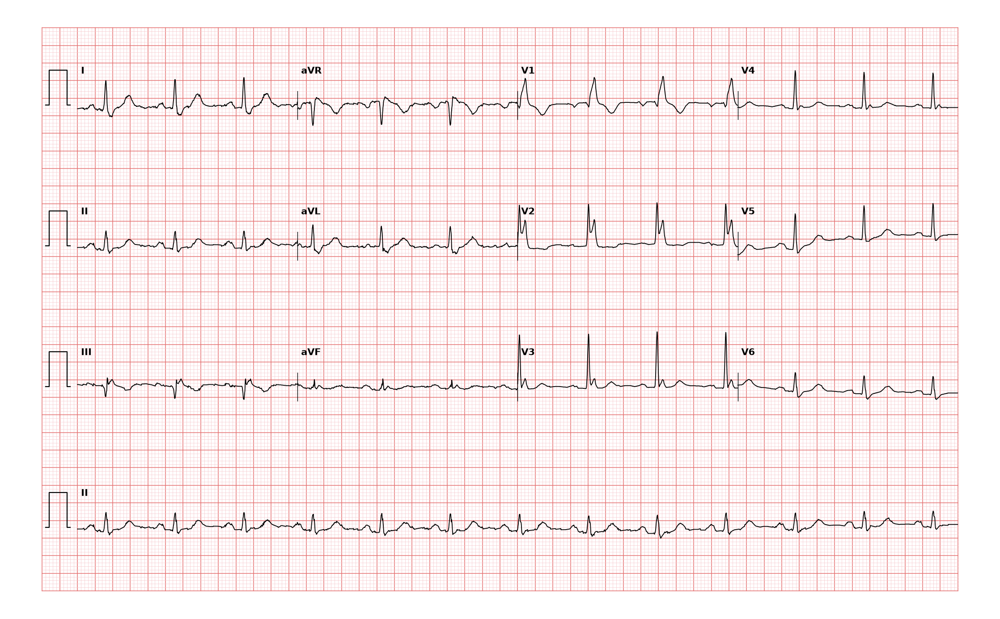

## 문제
78세 여자가 건강검진 심전도에서 각차단이 있다는 말을 듣고 걱정이 되어 외래에 왔다. 어지러움·실신·가슴 통증·호흡곤란은 없고 매일 40분씩 걷는다. 고혈압으로 암로디핀을 복용한다. 혈압 132/76 mmHg, 맥박 84회/분으로 규칙적이다. 심음은 정상이고 심잡음은 없으며 하지 부종은 없다. 1년 전 심장초음파는 정상이었다. 12유도 심전도는 그림과 같다. 다음 처치로 가장 적절한 것은?

- A. 혈전용해제 정맥 투여
- B. 전기생리검사
- C. 추가 검사나 치료 없이 경과 관찰
- D. 영구 심박조율기 삽입
- E. 관상동맥조영술

_12유도 심전도, 25 mm/s · 10 mm/mV, 3×4 + II 리듬 스트립 (PTB-XL ECG dataset, PhysioNet, CC BY 4.0 — 원신호 그대로 작도)_

## 정답 및 해설
> 정답: C

- **정답 핵심**: V1 에서 넓은 양성 R′ 과 T파 역위, V2 에서 rSR′(M 모양), I·V5·V6 에서 넓고 끌리는 S파가 보이며 QRS 는 0.12초 이상이다 — 완전 우각차단이다. 축은 정상이라 좌전속차단을 동반한 이중속차단이 아니고, PR 이 정상이며 QRS 탈락이 없다. 증상이 없고 심장초음파가 정상인 단독 우각차단은 예후가 좋으므로 추가 검사나 치료 없이 경과 관찰한다.
- **원리**: <b>왜 우각차단은 V1 에 R′ 을 만드는가</b>: 좌각은 정상이라 심실중격과 좌심실은 먼저 정상 속도로 흥분한다(rS 의 첫 부분). 우심실은 우각을 쓰지 못하고 좌심실에서 심근을 따라 느리게 전달된 흥분으로 늦게 탈분극한다 — 이 늦은 우심실 전기력이 오른쪽·앞쪽을 향해 V1 에 두 번째 양성파(R′)를, I·V6 에 넓은 S파를 만든다.  <b>왜 단독 우각차단은 위험하지 않은가</b>: 심실의 전도는 좌각(전속·후속)으로 유지된다. 방실 전도 자체가 끊길 위험은 남은 다발까지 함께 병든 경우에만 커진다. 그래서 우각차단에 <b>좌전속·좌후속차단(축 이상)이 겹치고 실신이 있을 때</b> 간헐적 완전 방실차단을 의심해 전기생리검사나 심박조율기를 고려한다.  <b>언제 원인을 찾는가</b>: 새로 생긴 우각차단에 흉통·호흡곤란이 있으면 폐색전증·급성 관상동맥증후군을, 심잡음·부종이 있으면 선천 심질환·폐고혈압을 찾는다. 이 환자는 그런 소견이 없고 1년 전 심장초음파도 정상이다.
- **비교**: <table><thead><tr><th style="width:24%">항목</th><th style="width:38%">경과 관찰(정답)</th><th>영구 심박조율기(가장 가까운 오답)</th></tr></thead><tbody> <tr><td>심전도</td><td><b>단독</b> 우각차단, 축 정상, PR 정상</td><td>이중·삼중속차단, 교대 각차단, Mobitz II·3도 방실차단</td></tr> <tr><td>증상</td><td>없음</td><td><b>실신</b>·서맥 증상</td></tr> <tr><td>왜</td><td>좌각으로 전도가 유지된다</td><td>남은 다발마저 막히면 완전 방실차단</td></tr> <tr><td>이 환자</td><td>무증상 · 축 정상 · 심초음파 정상 — 일치</td><td>실신·축 이상 없음 — 불일치</td></tr> </tbody></table> 각차단 자체가 아니라 「남은 전도로가 위험한가(축·PR·실신)」가 심박조율기를 정한다.
- **오답 이유**:
  - ① 혈전용해제 정맥 투여는 급성 흉통과 함께 ST 상승 심근경색이 확인되고 일차 관상동맥중재술을 제때 할 수 없을 때라면 정답이 된다.
  - ② 전기생리검사는 이중속차단 환자가 실신했는데 비침습 감시로 원인을 밝히지 못해 히스-심실 간격을 재야 할 때라면 정답이 된다.
  - ④ 영구 심박조율기는 우각차단에 좌전속차단(좌축편위)이 겹친 이중속차단 환자가 원인 모를 실신을 겪었거나 교대 각차단이 보였다면 정답이 된다.
  - ⑤ 관상동맥조영술은 새로 생긴 각차단과 함께 지속되는 허혈성 흉통이나 트로포닌 상승이 있는 급성 관상동맥증후군이라면 고려한다.
- **함정**: 「각차단」이라는 말을 듣고 심박조율기를 고르는 것 — 무증상 단독 우각차단은 치료 대상이 아니다.
- **학습목표**: 증상이 없고 구조적 심질환 징후가 없는 단독 완전 우각차단은 추가 검사나 치료 없이 경과 관찰하며, 심박조율기는 이중속차단에 실신이 있거나 고도 방실차단일 때 쓴다
- **근거·출처**: Loscalzo J, Fauci AS, Kasper DL, et al., eds. Harrison's Principles of Internal Medicine, 22nd ed. McGraw Hill; 2025. Chapter 247: Electrocardiography · Loscalzo J, Fauci AS, Kasper DL, et al., eds. Harrison's Principles of Internal Medicine, 22nd ed. McGraw Hill; 2025. Chapter 252: The Bradyarrhythmias: Disorders of the Atrioventricular Node · Wagner P, Strodthoff N, Bousseljot RD, et al. PTB-XL, a large publicly available electrocardiography dataset. Sci Data. 2020;7:154

## 출처
- PTB-XL ECG dataset v1.0.3 (PhysioNet, CC BY 4.0) · record 4051 · Creative Commons Attribution 4.0 International · https://physionet.org/content/ptb-xl/1.0.3/LICENSE.txt
