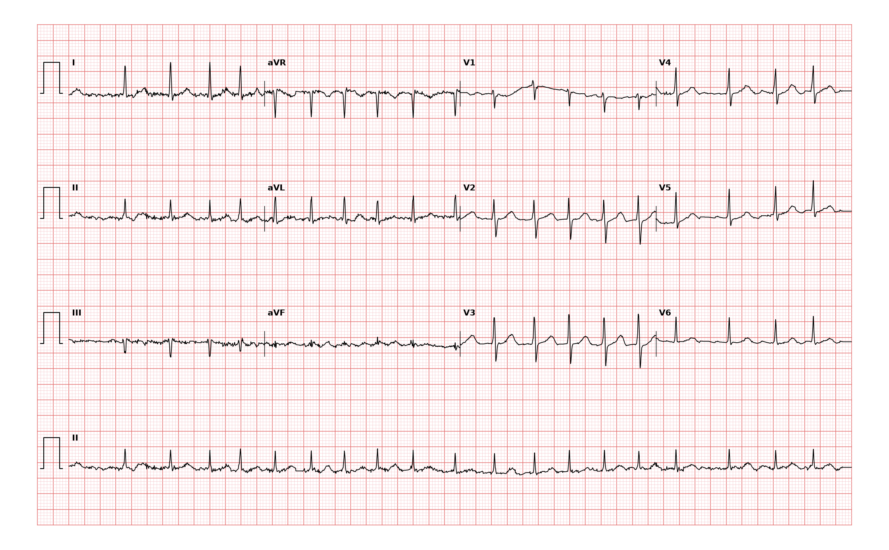

## 문제
A 49-year-old woman comes to the emergency department because of palpitations that began 6 hours ago after an evening of heavy alcohol intake. She has mild shortness of breath on exertion but no chest pain or syncope. She has obesity (BMI 37 kg/m²) and loud snoring. She takes no medications. Blood pressure is 136/84 mm Hg and pulse is irregular at about 115/min. Lungs are clear. Serum potassium and TSH are normal. A 12-lead ECG is shown. Which of the following is the most likely diagnosis?

- A. Atrial fibrillation
- B. Multifocal atrial tachycardia
- C. Atrial flutter with variable block
- D. Sinus tachycardia with premature atrial contractions
- E. Monomorphic ventricular tachycardia

_12-lead ECG, 25 mm/s, 10 mm/mV, 3×4 + lead II rhythm strip (PTB-XL, PhysioNet, CC BY 4.0; raw signal, no filtering)_

## 정답 및 해설
> 정답: A

- **정답 핵심**: The lead II rhythm strip shows an irregularly irregular ventricular rhythm at an average of about 110–120/min with narrow QRS complexes. No discrete, repeating P waves precede the QRS complexes; instead the baseline shows fine, irregular undulations (fibrillatory waves). An irregularly irregular narrow-complex rhythm without organized atrial activity is atrial fibrillation. Alcohol binge, obesity, and probable sleep apnea are recognized triggers.
- **원리**: <b>Why the rhythm is irregularly irregular</b>: in atrial fibrillation, multiple wavelets of re-entry and rapid focal firing (often from the pulmonary veins) activate the atria chaotically at 350–600/min. No organized P wave forms, only low-amplitude fibrillatory waves. The AV node receives far more impulses than it can conduct and lets them through at random intervals, depending on its refractoriness at each moment — so the ventricular rhythm has no pattern at all.  <b>Why the QRS is narrow</b>: once an impulse passes the AV node, the ventricles are activated through the normal His-Purkinje system. A wide irregular rhythm would raise concern for AF with bundle branch block or pre-excitation.  <b>Why alcohol and obesity matter</b>: acute alcohol excess ("holiday heart") alters atrial refractoriness and autonomic tone; obesity and obstructive sleep apnea enlarge and stretch the left atrium and create fibrosis, a substrate for re-entry. Treating these factors reduces recurrence.
- **비교**: <table><thead><tr><th style="width:24%">Feature</th><th style="width:38%">Atrial fibrillation (answer)</th><th>Multifocal atrial tachycardia (closest distractor)</th></tr></thead><tbody> <tr><td>Atrial activity</td><td><b>No discrete P waves</b>, fibrillatory baseline</td><td><b>≥ 3 distinct P-wave morphologies</b> with an isoelectric baseline</td></tr> <tr><td>PR interval</td><td>Not measurable</td><td>Varies with each P wave</td></tr> <tr><td>Typical setting</td><td>Alcohol, obesity, hypertension, valve disease, age</td><td>Severe COPD, hypoxemia, theophylline</td></tr> <tr><td>This patient</td><td>No P waves · wavy baseline — match</td><td>No distinct P waves · no lung disease — mismatch</td></tr> </tbody></table> Both are irregular; look for discrete P waves before every QRS — present and varied in MAT, absent in AF.
- **오답 이유**:
  - (B) Multifocal atrial tachycardia would be correct if each QRS were preceded by a discrete P wave of at least three different shapes with varying PR intervals, typically in severe COPD.
  - (C) Atrial flutter with variable block would show regular sawtooth F waves at about 300/min, best seen in II, III, and aVF, with groups of QRS complexes at fixed ratios.
  - (D) Sinus tachycardia with premature atrial contractions would show a regular sinus rhythm with upright P waves, interrupted by occasional early beats with differently shaped P waves.
  - (E) Monomorphic ventricular tachycardia would be correct if the rhythm were regular with wide QRS complexes (≥ 120 ms), AV dissociation, or fusion and capture beats.
- **함정**: Calling any irregular tachycardia 'atrial flutter' or 'MAT' — first ask whether discrete P waves exist; if not, it is atrial fibrillation.
- **학습목표**: Interpret an irregularly irregular narrow-complex rhythm without discrete P waves and with a fibrillatory baseline as atrial fibrillation, and distinguish it from multifocal atrial tachycardia and atrial flutter with variable block
- **근거·출처**: Loscalzo J, Fauci AS, Kasper DL, et al., eds. Harrison's Principles of Internal Medicine, 22nd ed. McGraw Hill; 2025. Chapter 258: Atrial Fibrillation · Loscalzo J, Fauci AS, Kasper DL, et al., eds. Harrison's Principles of Internal Medicine, 22nd ed. McGraw Hill; 2025. Chapter 247: Electrocardiography · Wagner P, Strodthoff N, Bousseljot RD, et al. PTB-XL, a large publicly available electrocardiography dataset. Sci Data. 2020;7:154

## 출처
- PTB-XL ECG dataset v1.0.3 (PhysioNet, CC BY 4.0) · record 2673 · Creative Commons Attribution 4.0 International · https://physionet.org/content/ptb-xl/1.0.3/LICENSE.txt
