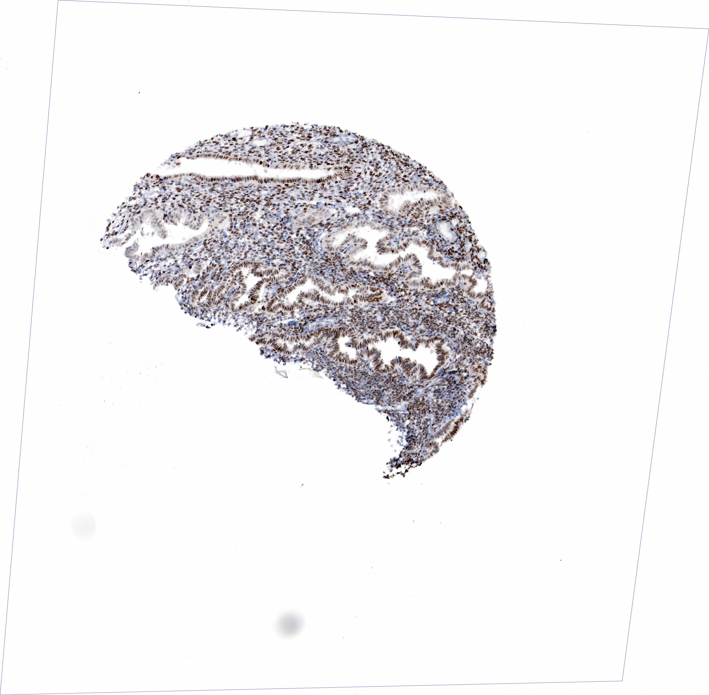

## 문제
36세 여자가 1년 동안 임신이 되지 않아 난임 검사를 받았다. 월경 주기는 28일로 규칙적이고, 마지막 월경 시작 10일째에 자궁내막 생검을 하였다. 복용하는 약은 없다. 생검 조직에 한 가지 호르몬 수용체에 대한 면역조직화학염색을 하였고, 그 결과는 그림과 같다(갈색 = 양성). 이 수용체가 세포 기능을 바꾸는 방식으로 가장 적절한 것은?

- A. G단백질을 활성화해 세포 안 cAMP 를 늘린다
- B. 수용체 자체의 티로신 인산화효소를 활성화한다
- C. 결합한 JAK 인산화효소를 통해 STAT 단백질을 인산화한다
- D. 이온 통로를 열어 세포막 전위를 바꾼다
- E. 리간드와 결합한 뒤 DNA 의 반응 요소에 붙어 유전자 전사를 조절한다

_면역조직화학염색(DAB 갈색, 헤마톡실린 대조염색) 조직 마이크로어레이 코어, 원본 배율 그대로 (Human Protein Atlas, CC BY 4.0 — 크롭·보정 없음)_

## 정답 및 해설
> 정답: E

- **정답 핵심**: 갈색 신호가 자궁내막 샘세포와 간질세포의 <b>핵</b>에만 있고 세포막·세포질은 염색되지 않았다. 핵에 자리한 호르몬 수용체는 스테로이드 계열(에스트로겐·프로게스테론) 핵수용체이며, 리간드와 결합하면 이합체를 이루어 DNA 의 호르몬 반응 요소에 붙어 표적 유전자의 전사를 바꾼다. 막 수용체(G단백질 연결·티로신 인산화효소·사이토카인·이온 통로형)라면 신호가 세포막에 보여야 한다.
- **원리**: <b>왜 염색 위치가 기전을 말해 주는가</b>: 면역조직화학염색은 항원(수용체 단백질)이 세포 안 어디에 있는지를 그대로 보여 준다. 펩타이드 호르몬·성장인자·사이토카인은 물에 녹고 지질막을 통과하지 못하므로 그 수용체는 <b>세포막</b>에 있다. 반면 스테로이드·갑상샘호르몬·비타민 D 는 지용성이라 막을 지나 들어오고, 그 수용체는 세포질 또는 <b>핵</b> 안에서 리간드를 기다린다.  <b>핵수용체는 어떻게 일하는가</b>: 리간드가 결합하면 수용체 모양이 바뀌어 열충격단백질이 떨어지고, 이합체를 이루어 DNA 결합 영역(아연 손가락)으로 표적 유전자 앞의 호르몬 반응 요소에 붙는다. 그다음 보조활성인자를 불러 전사를 늘리거나 줄인다 — 효과가 나타나는 데 수 시간이 걸리고 오래 간다.  <b>자궁내막에서의 의미</b>: 증식기에는 에스트로겐이 프로게스테론 수용체의 발현을 늘려 두어, 배란 뒤 황체가 내는 프로게스테론이 분비기 변화를 일으킬 수 있게 준비한다. 그래서 증식기 내막의 샘과 간질 모두에서 프로게스테론 수용체 핵 염색이 강하다.
- **비교**: <table><thead><tr><th style="width:24%">항목</th><th style="width:38%">핵수용체(정답)</th><th>G단백질 연결 수용체(가장 가까운 오답)</th></tr></thead><tbody> <tr><td>리간드</td><td>스테로이드·갑상샘호르몬·비타민 D(지용성)</td><td>펩타이드·아민 호르몬(수용성 — LH·FSH·글루카곤)</td></tr> <tr><td>수용체 위치</td><td><b>핵·세포질</b> — 핵 염색</td><td><b>세포막</b> — 막 염색</td></tr> <tr><td>신호</td><td>DNA 반응 요소 결합 → 전사 조절</td><td>Gs → 아데닐산 고리화효소 → cAMP → PKA</td></tr> <tr><td>속도</td><td>수 시간~일, 지속</td><td>초~분, 빠르고 짧다</td></tr> <tr><td>이 그림</td><td>샘·간질세포 핵만 갈색 — 일치</td><td>막 신호 없음 — 불일치</td></tr> </tbody></table> 염색이 막에 있으면 막 수용체(2차 전령), 핵에 있으면 전사 조절이다 — 같은 자궁내막이라도 LH·FSH 수용체라면 이런 핵 염색이 나오지 않는다.
- **오답 이유**:
  - ① G단백질을 활성화해 cAMP 를 늘리는 방식은 LH·FSH·hCG·글루카곤처럼 수용성 호르몬의 막 수용체라면 정답이 되고, 그때 염색은 세포막에 보인다.
  - ② 수용체 티로신 인산화효소는 인슐린·IGF-1·EGF 수용체의 방식으로, 염색이 세포막에 선 모양으로 나타났다면 정답이 된다.
  - ③ JAK-STAT 경로는 프로락틴·성장호르몬·에리스로포이에틴 같은 사이토카인 계열 막 수용체라면 정답이 되며, 수용체 자체는 막에 있다.
  - ④ 이온 통로형 수용체는 아세틸콜린 니코틴 수용체·GABA-A 수용체처럼 신경전달물질이 리간드일 때라면 정답이 되고 호르몬 수용체 방식이 아니다.
- **함정**: 갈색 신호의 위치(핵 대 막)를 보지 않고 「호르몬이면 cAMP」라고 일반화하는 것.
- **학습목표**: 자궁내막 샘·간질세포의 핵에 국한된 호르몬 수용체 면역염색을 보고, 그 수용체가 리간드 결합 후 DNA 에 붙어 전사를 조절하는 핵수용체임을 안다
- **근거·출처**: Loscalzo J, Fauci AS, Kasper DL, et al., eds. Harrison's Principles of Internal Medicine, 22nd ed. McGraw Hill; 2025. Chapter 389: Mechanisms of Hormone Action · Uhlén M, Fagerberg L, Hallström BM, et al. Tissue-based map of the human proteome. Science. 2015;347(6220):1260419

## 출처
- Human Protein Atlas, PGR / Endometrium 1 (CC BY 4.0), https://images.proteinatlas.org/68/377_B_6_3.jpg · Creative Commons Attribution 4.0 International · https://www.proteinatlas.org/about/licence
