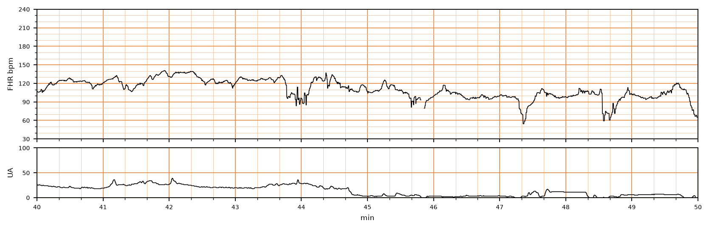

## 문제
A 36-year-old woman, gravida 2, para 1, at 38 weeks' gestation is admitted in active labor. Her pregnancy has been uncomplicated. Membranes ruptured spontaneously 3 hours ago, and the amniotic fluid is clear and scant. She is afebrile, and her blood pressure is 116/70 mm Hg. She is receiving no oxytocin. A 10-minute segment of continuous fetal heart rate and uterine activity monitoring obtained 40 minutes after the start of the recording is shown. Which of the following is the most likely cause of the abrupt decreases in fetal heart rate near the end of this segment?

- A. Fetal head compression
- B. Uteroplacental insufficiency
- C. Fetal anemia
- D. Maternal fever
- E. Umbilical cord compression

_Intrapartum fetal heart rate (top) and uterine activity (bottom), minutes 40–50 of the recording; 3 cm/min, vertical lines = 1 min (CTU-UHB Intrapartum Cardiotocography Database, PhysioNet, ODC-BY 1.0 — raw 4 Hz data, no smoothing)_

## 정답 및 해설
> 정답: E

- **정답 핵심**: Near minutes 47 and 48.5, the fetal heart rate falls abruptly from about 100/min to about 55–60/min within roughly 15 seconds and recovers just as quickly — a variable deceleration. Variable decelerations are caused by umbilical cord compression, which is more likely after rupture of membranes with scant fluid. Early decelerations (head compression) and late decelerations (uteroplacental insufficiency) are gradual, taking 30 seconds or more to reach the nadir.
- **원리**: <b>왜 제대 압박은 「급격한」 감속을 만드는가</b>: 제대가 눌리면 먼저 벽이 얇은 제대정맥이 막혀 태아 정맥 환류가 줄고, 이어 제대동맥이 막히면 태아 말초 저항이 갑자기 올라 혈압이 오른다. 압수용체가 이 혈압 상승을 감지해 <b>미주신경 반사</b>로 심박을 즉시 떨어뜨린다. 신경 반사라서 시작과 회복이 몇 초 안에 일어나고, 모양·깊이·시점이 매번 다르다 — 그래서 「가변성」이라 부른다.  <b>왜 조기·후기 감속은 완만한가</b>: 조기 감속은 수축 때 태아 머리가 눌려 생기는 미주신경 반응으로 수축과 거울처럼 겹치며 서서히 내려간다. 후기 감속은 수축 중 태반 혈류가 줄어 태아 저산소가 생기고, 화학수용체를 거쳐(또는 심근 저산소로) 수축 정점보다 늦게 완만히 떨어진다. 둘 다 시작에서 최저점까지 30초 이상 걸린다.  <b>양수가 적을 때</b>: 양막이 터져 양수가 줄면 제대를 둘러싼 완충이 없어 압박이 쉬워진다 — 가변성 감속이 반복되면 산모 체위 변경, 필요하면 양수 주입으로 완충을 되돌린다.
- **비교**: <table><thead><tr><th style="width:24%">Feature</th><th style="width:38%">Variable deceleration — cord compression (answer)</th><th>Late deceleration — uteroplacental insufficiency (closest distractor)</th></tr></thead><tbody> <tr><td>Onset to nadir</td><td><b>&lt; 30 s</b>, abrupt</td><td>≥ 30 s, gradual</td></tr> <tr><td>Timing</td><td>Variable, need not match contractions</td><td>Nadir <b>after</b> the contraction peak</td></tr> <tr><td>Mechanism</td><td>Baroreceptor-vagal reflex</td><td>Fetal hypoxemia (chemoreceptor / myocardial)</td></tr> <tr><td>Shape</td><td>V or U shape, changes from one to the next</td><td>Uniform, shallow, mirrors each contraction</td></tr> <tr><td>This tracing</td><td>~100 → 55/min within ~15 s, quick recovery — fits</td><td>Not gradual — does not fit</td></tr> </tbody></table> Read the slope first: abrupt means cord, gradual means look at timing (early = head, late = placenta).
- **오답 이유**:
  - (A) Fetal head compression would be correct if gradual decelerations began and ended with each contraction, their nadir coinciding with the contraction peak (early decelerations).
  - (B) Uteroplacental insufficiency would be correct if gradual, uniform decelerations reached their nadir after each contraction peak (late decelerations).
  - (C) Fetal anemia would be correct if the tracing showed a smooth sinusoidal pattern of 3–5 cycles per minute, as in Rh alloimmunization or fetomaternal hemorrhage.
  - (D) Maternal fever would be correct if the baseline rose above 160/min (fetal tachycardia) in a febrile mother with suspected intraamniotic infection.
- **함정**: Calling every deceleration that appears late in a segment a late deceleration without measuring how fast it falls.
- **학습목표**: 태아심박동이 15초 안에 급히 떨어졌다 급히 회복하는 가변성 감속을 읽고, 그 기전이 제대 압박에 의한 압수용체·미주신경 반사임을 안다
- **근거·출처**: Macones GA, Hankins GDV, Spong CY, Hauth J, Moore T. The 2008 National Institute of Child Health and Human Development workshop report on electronic fetal monitoring. Obstet Gynecol. 2008;112(3):661-666 · Chudáček V, Spilka J, Burša M, et al. Open access intrapartum CTG database. BMC Pregnancy Childbirth. 2014;14:16

## 출처
- CTU-UHB Intrapartum Cardiotocography Database (PhysioNet, ODC-BY 1.0) · record 1069 · Open Data Commons Attribution License v1.0 · https://opendatacommons.org/licenses/by/1-0/
