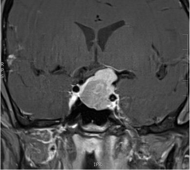

## 문제
35세 남자가 6개월 전부터 이마 쪽 두통이 있고, 최근 운전할 때 옆 차선에서 끼어드는 차를 늦게 본다며 왔다. 복용하는 약은 없다. 혈압 128/80 mmHg, 맥박 76회/분이다. 동공 반사와 안구 운동은 정상이고 다른 신경학적 이상은 없다. 교정 시력은 양쪽 0.9 이다. 뇌 MRI 관상면 조영 증강 T1 강조영상은 그림과 같다. 이 환자에서 시야 검사로 예상되는 결손은?

- A. 반대쪽 동측 반맹
- B. 반대쪽 위쪽 사분맹
- C. 황반 회피를 동반한 반대쪽 동측 반맹
- D. 양이측 반맹
- E. 같은 쪽 단안 시야 결손

_뇌 MRI 관상면 조영 증강 T1 강조영상, 원 그림의 A 패널만 잘라냄 — 방향 표지는 원본의 것 (PMC Open Access Subset, CC BY)_

## 정답 및 해설
> 정답: D

- **정답 핵심**: MRI 에서 안장(sella)에서 위로 솟아 안장위 수조까지 자란 약 2.5 cm 의 고르게 조영되는 종괴가 시신경교차를 아래에서 밀어 올리고, 양쪽 내경동맥 흐름 공백이 종괴 옆에 있다 — 뇌하수체 거대선종이다. 시신경교차에서 교차하는 것은 양쪽 눈의 코쪽 망막 섬유이고, 이것이 담당하는 것은 바깥쪽(관자쪽) 시야이므로 양이측 반맹이 생긴다. 측면에서 끼어드는 차를 늦게 본다는 증상과 일치한다.
- **원리**: <b>왜 교차부 압박은 「양쪽 바깥」 시야를 잃게 하는가</b>: 수정체가 상을 뒤집어 맺으므로 망막의 코쪽 절반은 관자쪽(바깥) 시야를 본다. 코쪽 망막에서 나온 섬유는 시신경교차에서 반대편으로 건너가고, 관자쪽 섬유는 건너지 않는다. 교차부 한가운데를 아래에서 누르면 건너가는 섬유만 다치므로 양쪽 눈의 바깥 시야가 함께 사라진다 — 양이측 반맹이다.  <b>왜 위쪽 바깥부터 시작하는가</b>: 아래쪽 코쪽 망막 섬유는 교차부의 아래 앞쪽을 지나므로, 아래에서 올라오는 뇌하수체 종괴는 이 섬유부터 누른다. 그래서 결손은 흔히 <b>위쪽 바깥 사분면</b>에서 시작해 아래로 번진다(머리인두종처럼 위에서 누르면 아래쪽부터).  <b>시신경로 다음의 병변은 동측 반맹</b>: 교차 뒤(시각로·외측슬상체·시각부챗살·후두엽)는 한쪽 시야의 정보만 모이므로 반대쪽 동측 반맹이 되고, 측두엽의 마이어 고리는 반대쪽 위쪽 사분맹, 후두엽 경색은 황반 회피를 보인다.
- **비교**: <table><thead><tr><th style="width:24%">병변 위치</th><th style="width:38%">시신경교차(정답)</th><th>시각로(가장 가까운 오답)</th></tr></thead><tbody> <tr><td>다치는 섬유</td><td>교차하는 <b>코쪽 망막 섬유</b>(양쪽 눈)</td><td>같은 쪽 관자쪽 + 반대쪽 코쪽 섬유</td></tr> <tr><td>시야 결손</td><td>양이측 반맹(양쪽 바깥)</td><td>반대쪽 동측 반맹(양쪽 눈의 같은 쪽)</td></tr> <tr><td>흔한 원인</td><td>뇌하수체 선종·머리인두종·수막종</td><td>뇌졸중·종양·탈수초</td></tr> <tr><td>이 영상</td><td>안장위 종괴가 교차부를 아래에서 밂 — 일치</td><td>시각로 쪽 병변 없음 — 불일치</td></tr> </tbody></table> 결손이 수직 중앙선에서 끊기면 교차부 또는 그 뒤다 — 「양쪽 바깥」이면 교차부, 「양쪽 같은 쪽」이면 교차 뒤다.
- **오답 이유**:
  - ① 반대쪽 동측 반맹은 병변이 교차부 뒤의 시각로나 외측슬상체에 있을 때라면 정답이 된다.
  - ② 반대쪽 위쪽 사분맹은 측두엽을 지나는 마이어 고리(시각부챗살 아래쪽)가 다쳤을 때라면 정답이 된다.
  - ③ 황반 회피를 동반한 반대쪽 동측 반맹은 뒤대뇌동맥 경색으로 후두엽 시각겉질이 다쳤을 때라면 정답이 된다.
  - ⑤ 같은 쪽 단안 시야 결손은 종괴가 교차부 앞에서 한쪽 시신경만 누르는 경우라면 정답이 되며, 그때는 그 눈의 시력 저하와 상대구심동공장애가 함께 온다.
- **함정**: 종괴가 한쪽(왼쪽) 시신경을 더 민다는 이유로 단안 결손을 고르는 것 — 교차부를 아래에서 밀면 교차 섬유가 먼저 다친다.
- **학습목표**: 안장에서 안장위로 자라 시신경교차를 아래에서 미는 종괴를 MRI 에서 읽고, 교차하는 코쪽 망막 섬유가 눌려 양이측 반맹이 생김을 안다
- **근거·출처**: Loscalzo J, Fauci AS, Kasper DL, et al., eds. Harrison's Principles of Internal Medicine, 22nd ed. McGraw Hill; 2025. Chapter 392: Pituitary Tumor Syndromes · Loscalzo J, Fauci AS, Kasper DL, et al., eds. Harrison's Principles of Internal Medicine, 22nd ed. McGraw Hill; 2025. Chapter 34: Disorders of the Eye · A case of thyroid hormone resistance with coincidental pituitary macroadenoma. JCEM Case Rep. 2026;4(4):luag051

## 출처
- A case of thyroid hormone resistance with coincidental pituitary macroadenoma. JCEM Case Rep. 2026 Apr 8;4(4):luag051. doi: 10.1210/jcemcr/luag051 (CC BY) — Figure 1 · CC BY · https://creativecommons.org/licenses/
