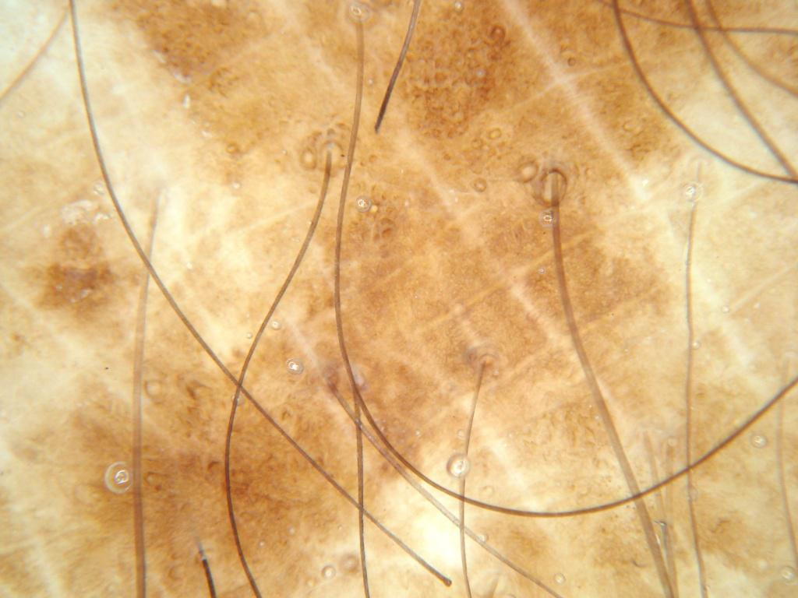

## 문제
A 70-year-old man comes to the physician because his wife noticed a flat brown spot on his upper arm. He thinks it has been present for several years without change. It does not itch or bleed. He worked outdoors as a farmer for 40 years and has many similar but smaller spots on both forearms. He has no personal or family history of skin cancer. Examination shows a 1.5-cm, uniformly light-brown macule with a smooth border on the upper extremity; it is not raised or tender. A dermoscopic photograph of the lesion is shown. Which of the following is the most likely diagnosis?

- A. Junctional melanocytic nevus
- B. Lentigo
- C. Melanoma in situ
- D. Seborrheic keratosis
- E. Pigmented basal cell carcinoma

_Dermoscopic photograph, original image resized only (ISIC Archive, CC0 — no crop or color correction)_

## 정답 및 해설
> 정답: B

- **정답 핵심**: Dermoscopy shows diffuse, evenly distributed light-to-medium brown pigmentation with a faint fingerprint-like pattern and preserved hair follicle openings, without an atypical network, irregular dots or globules, regression, or blue-white structures. In a 70-year-old man with decades of sun exposure and many similar spots, a stable flat lesion with this pattern is a lentigo (solar lentigo). Melanoma in situ would show asymmetry of color and structure, and seborrheic keratosis shows milia-like cysts and comedo-like openings on a raised surface.
- **원리**: <b>흑자는 무엇이 늘어난 병변인가</b>: 일광흑자는 오랜 자외선 노출로 표피 기저층의 <b>멜라닌 색소와 표피돌기</b>가 늘어난 것이다. 멜라닌세포 수는 약간 늘 뿐 둥지를 이루지 않는다. 그래서 색이 고르고, 표피돌기를 따라 생긴 고운 선이 지문 모양 무늬나 희미한 그물로 보이며, 색소가 모낭 개구부를 덮지 않아 개구부가 그대로 남는다.  <b>흑색종은 왜 다르게 보이는가</b>: 흑색종은 비정형 멜라닌세포가 무질서하게 증식해 색과 구조가 한 병변 안에서 <b>고르지 않다</b> — 두께가 다른 비정형 그물, 불규칙한 점·덩이, 퇴행(흰 흉터 모양), 청백색 베일, 비정형 혈관. 얼굴의 악성 흑자(lentigo maligna)는 모낭 개구부 주위로 색소가 비대칭으로 둘러싸 막는 것이 초기 신호다.  <b>지루각화증과의 관계</b>: 일광흑자는 시간이 지나 두꺼워지면 지루각화증으로 바뀔 수 있다. 지루각화증은 표피가 두꺼워진 융기성 병변이라 밀리아 모양 낭종·면포 모양 개구부·뇌회 모양 무늬가 보인다.
- **비교**: <table><thead><tr><th style="width:24%">Feature</th><th style="width:38%">Lentigo (answer)</th><th>Melanoma in situ (closest distractor)</th></tr></thead><tbody> <tr><td>Color</td><td><b>Uniform</b> light-to-medium brown</td><td>Several shades, asymmetric</td></tr> <tr><td>Structure</td><td>Faint fingerprint-like lines or delicate network</td><td>Atypical network, irregular dots/globules, regression</td></tr> <tr><td>Follicle openings</td><td>Preserved</td><td>Asymmetric perifollicular pigmentation (facial lentigo maligna)</td></tr> <tr><td>History</td><td>Stable for years, many similar spots</td><td>New or changing, an "ugly duckling"</td></tr> <tr><td>This lesion</td><td>Uniform, no atypical structures, stable — fits</td><td>No asymmetry or change — does not fit</td></tr> </tbody></table> Uniformity and stability point to lentigo; asymmetry, multiple colors, or change call for excision biopsy.
- **오답 이유**:
  - (A) A junctional melanocytic nevus would be correct in a younger patient with a small, symmetric lesion showing a regular pigment network that fades at the periphery.
  - (C) Melanoma in situ would be correct if the lesion were new or enlarging and dermoscopy showed several colors, an atypical network, or asymmetric perifollicular pigmentation.
  - (D) Seborrheic keratosis would be correct if the lesion were raised with a stuck-on appearance and dermoscopy showed milia-like cysts and comedo-like openings.
  - (E) Pigmented basal cell carcinoma would be correct if dermoscopy showed arborizing vessels, blue-gray ovoid nests, or leaf-like areas on a pearly papule.
- **함정**: Equating any large brown macule in an older patient with melanoma without reading whether color and structure are uniform.
- **학습목표**: 노인의 햇빛 노출 부위에 고른 연갈색 미만 색소·지문 모양 무늬·보존된 모낭 개구부를 보이는 평평한 병변을 흑자로 판독하고 흑색종과 가른다
- **근거·출처**: Loscalzo J, Fauci AS, Kasper DL, et al., eds. Harrison's Principles of Internal Medicine, 22nd ed. McGraw Hill; 2025. Chapter 81: Cancer of the Skin · Loscalzo J, Fauci AS, Kasper DL, et al., eds. Harrison's Principles of Internal Medicine, 22nd ed. McGraw Hill; 2025. Chapter 59: Approach to the Patient with a Skin Disorder · Codella N, Rotemberg V, Tschandl P, et al. Skin lesion analysis toward melanoma detection 2018: a challenge hosted by the International Skin Imaging Collaboration (ISIC). arXiv:1902.03368

## 출처
- ISIC Archive ISIC_0010065 (CC-0) · CC0 1.0 Universal · https://creativecommons.org/publicdomain/zero/1.0/
