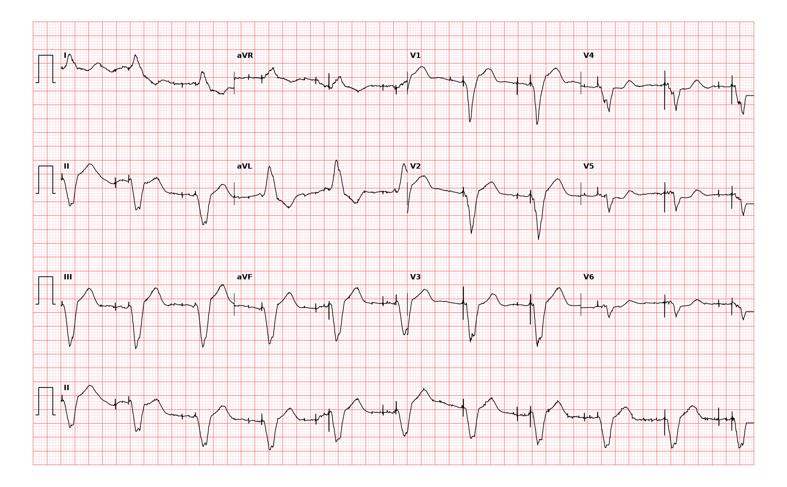

## 문제
77세 남자가 고혈압으로 정기 외래에 왔다. 6년 전 실신으로 다른 병원에서 시술을 받았다고 하나 자세한 기록은 없다. 그 뒤로 실신과 어지러움은 없고, 지금 가슴 통증·두근거림·호흡곤란이 없다. 혈압 136/80 mmHg, 맥박 62회/분으로 규칙적이며, 폐음은 깨끗하고 다리 부종은 없다. 혈청 칼륨은 4.3 mEq/L 이다. 12유도 심전도는 그림과 같다. 심전도 판독으로 가장 적절한 것은?

- A. 고칼륨혈증
- B. 정상 작동하는 인공 심박동기 조율
- C. 완전 좌각차단
- D. 가속 심실 고유 리듬
- E. 3도 방실차단과 심실 이탈 리듬

_12유도 심전도, 25 mm/s · 10 mm/mV, 3×4 + II 리듬 스트립 (PTB-XL ECG dataset, PhysioNet, CC BY 4.0 — 원신호 그대로 작도)_

## 정답 및 해설
> 정답: B

- **정답 핵심**: 리듬 스트립(II)에서 RR 간격이 약 0.97초로 일정해 약 62회/분이고, 모든 QRS 바로 앞에 폭이 거의 없는 날카로운 수직 스파이크가 있다(aVR·aVL·V4~V6 에서 잘 보인다). 스파이크마다 넓은(약 0.16초) QRS 가 뒤따르며, V1~V3 의 깊은 QS 와 II·III·aVF 의 음성 QRS(상방 축)는 우심실 첨부에서 흥분이 시작되는 심실 조율의 모양이다. 매 자극이 심실을 포착하고 설정 박동수 근처에서 규칙적이므로 정상 작동하는 심박동기 조율이다.
- **원리**: <b>왜 조율된 QRS 는 넓고 좌각차단처럼 보이는가</b>: 심박동기 전극은 보통 우심실 첨부(또는 중격)에 놓인다. 흥분이 히스-푸르키니에 전도계를 타지 않고 그 지점에서 심근을 따라 천천히 퍼지므로 QRS 가 넓어진다. 오른쪽에서 시작해 왼쪽으로 늦게 퍼지니 좌각차단과 같은 모양(V1 깊은 QS)이 되고, 첨부(아래)에서 위로 퍼지니 하벽 유도가 음성인 <b>상방 축</b>이 된다.  <b>스파이크가 결정적 단서다</b>: 전기 자극은 수 밀리초짜리 펄스라 심전도에 폭 없는 수직선으로 남는다. 양극 전극에서는 작아 몇 유도에서만 보일 수 있으므로 12유도 전체를 훑는다. 스파이크 → 넓은 QRS 가 매번 이어지면 <b>포착</b>이 정상이고, 스파이크 뒤 QRS 가 없으면 포착 실패, 자기 박동이 있는데도 스파이크가 나오면 감지 실패다.  <b>정상 작동의 확인</b>: 박동수가 설정 하한(흔히 60회/분) 근처에서 규칙적이고, 포착·감지 실패가 없으며, 환자가 증상이 없으면 정상 작동으로 판독한다.
- **비교**: <table><thead><tr><th style="width:24%">항목</th><th style="width:38%">심박동기 조율(정답)</th><th>완전 좌각차단(가장 가까운 오답)</th></tr></thead><tbody> <tr><td>QRS 앞</td><td><b>날카로운 수직 스파이크</b></td><td>P파(동리듬) — 스파이크 없음</td></tr> <tr><td>QRS 모양</td><td>넓다 · V1 깊은 QS</td><td>넓다 · V1 깊은 QS · I·V6 넓은 R</td></tr> <tr><td>축</td><td>우심실 첨부 조율 → <b>상방(좌축)</b></td><td>정상~좌축</td></tr> <tr><td>박동수</td><td>설정 하한 근처에서 매우 규칙적</td><td>동리듬의 변동</td></tr> <tr><td>이 심전도</td><td>스파이크 · 상방 축 · 약 62회/분 — 일치</td><td>스파이크가 있다 — 불일치</td></tr> </tbody></table> 넓은 QRS 를 보면 먼저 그 앞에 P파가 있는지, 스파이크가 있는지부터 본다 — 스파이크가 있으면 각차단 진단을 내리지 않는다.
- **오답 이유**:
  - ① 고칼륨혈증은 높고 뾰족한 T파, P파 소실, 점점 넓어지는 QRS 가 있고 혈청 칼륨이 높을 때라면 정답이 된다.
  - ③ 완전 좌각차단은 QRS 앞에 스파이크 없이 동리듬의 P파가 일정한 PR 로 앞서고 I·V6 에 넓고 끝이 갈라진 R파가 있을 때라면 정답이 된다.
  - ④ 가속 심실 고유 리듬은 재관류 직후 등에서 스파이크 없이 넓은 QRS 가 60~100회/분으로 나오고 동리듬과 번갈아 나타날 때라면 정답이 된다.
  - ⑤ 3도 방실차단과 심실 이탈 리듬은 P파가 QRS 와 무관하게 더 빨리 나오고 넓은 QRS 가 30~40회/분으로 느릴 때라면 정답이 된다.
- **함정**: 넓은 QRS 의 좌각차단 모양만 보고 각차단으로 판독하는 것 — QRS 앞의 스파이크를 먼저 찾는다.
- **학습목표**: 모든 넓은 QRS 앞의 날카로운 수직 스파이크와 그 뒤의 일정한 포착을 정상 작동하는 인공 심박동기 조율로 판독하고, 좌각차단·가속 심실 고유 리듬과 가른다
- **근거·출처**: Loscalzo J, Fauci AS, Kasper DL, et al., eds. Harrison's Principles of Internal Medicine, 22nd ed. McGraw Hill; 2025. Chapter 247: Electrocardiography · Loscalzo J, Fauci AS, Kasper DL, et al., eds. Harrison's Principles of Internal Medicine, 22nd ed. McGraw Hill; 2025. Chapter 252: The Bradyarrhythmias: Disorders of the Atrioventricular Node · Wagner P, Strodthoff N, Bousseljot RD, et al. PTB-XL, a large publicly available electrocardiography dataset. Sci Data. 2020;7:154

## 출처
- PTB-XL ECG dataset v1.0.3 (PhysioNet, CC BY 4.0) · record 16995 · Creative Commons Attribution 4.0 International · https://physionet.org/content/ptb-xl/1.0.3/LICENSE.txt
