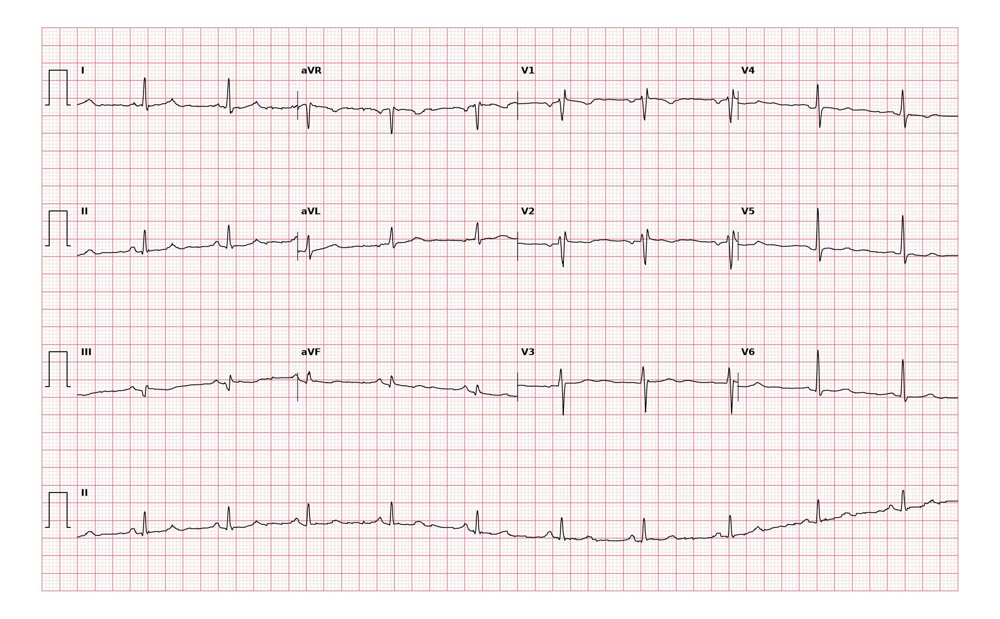

## 문제
56세 여자가 1년 전부터 계단을 오를 때 숨이 차고 가끔 두근거린다며 외래에 왔다. 가슴 통증과 실신은 없다. 혈압 118/72 mmHg, 맥박 64회/분으로 규칙적이고 산소포화도 97% 이다. 흉골 왼쪽 위 경계에서 2/6 등급 수축기 박출 잡음이 들리며, 제2심음은 넓게 분열되고 호흡에 따라 변하지 않는다. 폐음은 깨끗하고 다리 부종은 없다. 흉부 X선에서 폐동맥 음영이 약간 두드러진다. 12유도 심전도는 그림과 같다. 다음으로 할 검사로 가장 적절한 것은?

- A. 경흉부 심장초음파
- B. 추가 검사 없이 경과 관찰
- C. 운동부하 심전도
- D. 관상동맥 조영술
- E. 24시간 홀터 감시

_12유도 심전도, 25 mm/s · 10 mm/mV, 3×4 + II 리듬 스트립 (PTB-XL ECG dataset, PhysioNet, CC BY 4.0 — 원신호 그대로 작도)_

## 정답 및 해설
> 정답: A

- **정답 핵심**: 심전도는 동리듬 약 63회/분, PR 정상이고 V1·V2 에서 rSr′ 이 있으나 QRS 폭이 0.12초 미만이며 I·V6 에 작은 S파가 있다 — 불완전 우각차단이다. 불완전 우각차단만이라면 흔한 정상 변이지만, 이 환자는 운동 시 숨참과 함께 제2심음의 <b>고정 분열</b>, 흉골 왼쪽 위 경계의 수축기 박출 잡음(폐동맥판을 지나는 혈류 증가), 폐동맥 음영 증가가 있다. 우심실 용적 과부하 — 이차공 심방중격결손을 의심해야 하므로 단락과 우심실 크기를 보는 경흉부 심장초음파가 다음 검사다.
- **원리**: <b>왜 심방중격결손에서 우각차단 모양이 생기는가</b>: 심방 수준에서 좌→우 단락이 생기면 우심방·우심실로 피가 더 들어와 <b>우심실 용적 과부하</b>가 된다. 늘어난 우심실 유출로가 늦게 탈분극하면서 V1 의 늦은 r′ 이 나타난다 — 전도계 병이 아니라 우심실 확장 때문이라 QRS 폭은 대개 0.12초를 넘지 않는다(불완전 우각차단).  <b>왜 제2심음이 고정 분열되는가</b>: 평소에는 들숨 때 우심 환류가 늘어 폐동맥판이 늦게 닫혀 분열이 넓어진다. 심방중격결손에서는 두 심방이 연결되어 있어 호흡에 따른 환류 변화가 양쪽으로 나뉘고, 우심실 박출량이 늘 많아 폐동맥판이 <b>항상</b> 늦게 닫힌다 — 분열이 넓고 호흡에 따라 변하지 않는다. 잡음은 결손을 지나는 피가 아니라(압력 차가 작아 소리가 없다) 늘어난 혈류가 폐동맥판을 지나며 나는 상대적 협착음이다.  <b>왜 지금 찾아야 하는가</b>: 성인이 되어 숨참·심방성 부정맥(두근거림)으로 드러나고, 오래 두면 우심부전·폐고혈압이 생긴다. 초음파로 단락의 크기와 우심실 확장을 확인해 폐쇄 시점을 정한다.
- **비교**: <table><thead><tr><th style="width:24%">항목</th><th style="width:38%">경흉부 심장초음파(정답)</th><th>추가 검사 없이 경과 관찰(가장 가까운 오답)</th></tr></thead><tbody> <tr><td>대상</td><td>불완전 우각차단 + <b>우심실 용적 과부하 징후</b></td><td>증상·잡음 없는 불완전 우각차단 단독</td></tr> <tr><td>심음</td><td>고정 분열 · 폐동맥판 부위 박출 잡음</td><td>정상 생리적 분열 · 잡음 없음</td></tr> <tr><td>증상</td><td>운동 시 숨참 · 두근거림</td><td>없음</td></tr> <tr><td>이 환자</td><td>고정 분열 · 잡음 · 숨참 — 일치</td><td>증상과 심음 이상이 있다 — 불일치</td></tr> </tbody></table> 불완전 우각차단은 그 자체로 치료 대상이 아니다 — 심음·증상이 함께 있으면 우심실 용적 과부하의 원인을 초음파로 찾는다.
- **오답 이유**:
  - ② 추가 검사 없이 경과 관찰은 증상이 없고 제2심음 분열이 생리적이며 잡음이 없는 사람에게 우연히 발견된 불완전 우각차단이라면 정답이 된다.
  - ③ 운동부하 심전도는 운동 때 생기는 전형적 협심증이 있고 휴식 심전도가 해석 가능한 중간 위험 환자라면 정답이 된다.
  - ④ 관상동맥 조영술은 비침습 검사에서 고위험 허혈이 나왔거나 급성 관상동맥 증후군이 의심될 때라면 정답이 된다.
  - ⑤ 24시간 홀터 감시는 두근거림이 주 증상이고 심음·잡음 이상이 없어 부정맥 자체를 확인해야 할 때라면 정답이 된다.
- **함정**: 불완전 우각차단을 정상 변이로만 보고 고정 분열과 박출 잡음을 함께 묶지 않는 것.
- **학습목표**: 불완전 우각차단과 고정된 제2심음 분열·폐동맥판 부위 수축기 박출 잡음이 함께 있으면 심방중격결손을 의심해 경흉부 심장초음파를 한다
- **근거·출처**: Loscalzo J, Fauci AS, Kasper DL, et al., eds. Harrison's Principles of Internal Medicine, 22nd ed. McGraw Hill; 2025. Chapter 280: Congenital Heart Disease in the Adult · Loscalzo J, Fauci AS, Kasper DL, et al., eds. Harrison's Principles of Internal Medicine, 22nd ed. McGraw Hill; 2025. Chapter 247: Electrocardiography · Loscalzo J, Fauci AS, Kasper DL, et al., eds. Harrison's Principles of Internal Medicine, 22nd ed. McGraw Hill; 2025. Chapter 246: Physical Examination of the Cardiovascular System · Wagner P, Strodthoff N, Bousseljot RD, et al. PTB-XL, a large publicly available electrocardiography dataset. Sci Data. 2020;7:154

## 출처
- PTB-XL ECG dataset v1.0.3 (PhysioNet, CC BY 4.0) · record 8359 · Creative Commons Attribution 4.0 International · https://physionet.org/content/ptb-xl/1.0.3/LICENSE.txt
