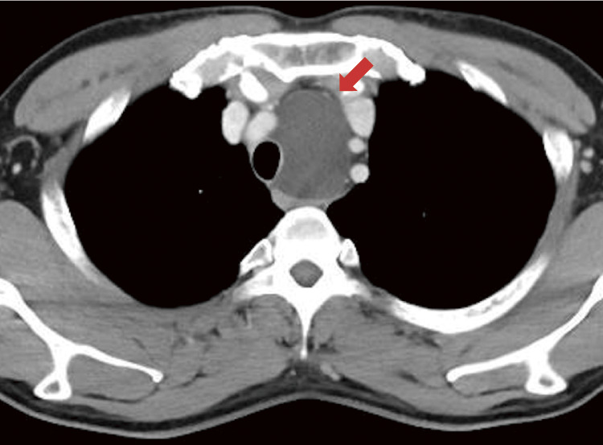

## 문제
47세 남자가 2개월 전부터 목소리가 쉬고 물을 마실 때 가끔 사레가 들린다며 왔다. 흡연력은 없고 상기도 감염 증상은 없었다. 혈압 126/80 mmHg, 맥박 72회/분, 체온 36.6°C 이다. 목에 만져지는 덩이나 림프절은 없다. 갑상샘 기능 검사와 혈청 칼슘은 정상이다. 흉부 조영 증강 CT 는 그림과 같다. 이 환자의 쉰 목소리의 기전으로 가장 적절한 것은?

- A. 성대 점막의 종양 침윤
- B. 반복 음성 남용에 의한 성대 결절
- C. 왼쪽 되돌이후두신경의 압박
- D. 오른쪽 되돌이후두신경의 압박
- E. 위후두신경 바깥가지의 압박

_흉부 조영 증강 CT 축상면, 단일 패널 그대로 — 빨간 화살표는 저자의 원래 표시 (PMC Open Access Subset, CC BY — 보정 없음)_

## 정답 및 해설
> 정답: C

- **정답 핵심**: CT 의 흉곽 입구 높이에서 기관 <b>왼쪽</b>에 경계가 매끈한 저음영 낭성 종괴가 있고 기관을 오른쪽으로 밀고 있다. 이 종괴는 기관과 식도 사이 고랑을 따라 올라가는 왼쪽 되돌이후두신경의 주행로를 차지한다. 되돌이후두신경은 윤상갑상근을 뺀 모든 후두 내근을 지배하므로 압박되면 같은 쪽 성대가 마비되어 쉰 목소리와 흡인(사레)이 생긴다.
- **원리**: <b>왜 왼쪽 신경이 종격동 병변에 약한가</b>: 미주신경에서 갈라진 되돌이후두신경은 좌우 주행이 다르다. 오른쪽은 빗장밑동맥을 감고 목 아래에서 바로 올라가지만, <b>왼쪽은 대동맥궁 아래를 감아</b> 종격동 깊이 내려갔다가 기관과 식도 사이 고랑을 따라 길게 올라온다. 그래서 대동맥궁 동맥류, 왼쪽 폐문·대동맥폐동맥창 림프절(폐암), 상부 종격동 종괴, 확장된 왼쪽 심방(Ortner 증후군)이 왼쪽 신경을 누른다.  <b>무엇이 마비되는가</b>: 되돌이후두신경은 성대를 벌리는 유일한 근육(뒤반지모뿔근)과 닫는 근육들을 지배한다. 한쪽이 마비되면 성대가 가운데 근처에 고정되어 소리를 낼 때 틈이 남아 바람 새는 쉰 목소리가 나고, 삼킬 때 성문이 덜 닫혀 사레가 든다.  <b>위후두신경 바깥가지</b>는 성대를 팽팽하게 하는 윤상갑상근만 지배하므로, 손상되면 쉰 목소리보다 높은 음을 못 내는 증상이 두드러진다(갑상샘 수술의 합병증).
- **비교**: <table><thead><tr><th style="width:24%">항목</th><th style="width:38%">왼쪽 되돌이후두신경(정답)</th><th>오른쪽 되돌이후두신경(가장 가까운 오답)</th></tr></thead><tbody> <tr><td>감는 구조</td><td>대동맥궁(동맥관 인대 옆)</td><td>오른쪽 빗장밑동맥</td></tr> <tr><td>종격동 안 주행</td><td><b>길다</b> — 기관식도고랑을 따라 흉곽 안에서 올라온다</td><td>짧다 — 주로 목에 있다</td></tr> <tr><td>흔한 압박 원인</td><td>대동맥궁 동맥류·폐문 림프절·상부 종격동 종괴·큰 좌심방</td><td>폐첨부 종양·목 아래 병변·갑상샘 수술</td></tr> <tr><td>이 CT</td><td>종괴가 기관 왼쪽, 기관을 오른쪽으로 밂 — 일치</td><td>기관 오른쪽에 종괴 없음 — 불일치</td></tr> </tbody></table> 쉰 목소리와 흉부 영상이 함께 나오면 먼저 「종괴가 어느 쪽 기관식도고랑에 있는가」를 본다 — 흉곽 안 병변은 대부분 왼쪽 신경이다.
- **오답 이유**:
  - ① 성대 점막의 종양 침윤은 오랜 흡연자에게 후두경에서 성대 표면의 덩이가 보일 때라면 정답이 되며, 종격동 종괴로는 설명되지 않는다.
  - ② 성대 결절은 교사·가수처럼 목을 많이 쓰는 사람의 양쪽 성대 앞 1/3 의 대칭적 결절이라면 정답이 되고, 사레를 동반하지 않는다.
  - ④ 오른쪽 되돌이후두신경의 압박은 종괴가 기관 오른쪽 또는 오른쪽 폐첨부·빗장밑동맥 주위에 있었다면 정답이 된다.
  - ⑤ 위후두신경 바깥가지의 압박은 갑상샘 위극 수술 뒤 높은 음을 못 내는 증상이 주로 나타날 때라면 정답이 된다.
- **함정**: 쉰 목소리를 후두 자체 질환으로만 생각하고 흉부 CT 에서 신경 주행로를 보지 않는 것.
- **학습목표**: 흉곽 입구에서 기관 왼쪽을 차지하는 종격동 종괴가 왼쪽 되돌이후두신경을 눌러 쉰 목소리를 만든다는 것을 CT 로 판단한다
- **근거·출처**: Loscalzo J, Fauci AS, Kasper DL, et al., eds. Harrison's Principles of Internal Medicine, 22nd ed. McGraw Hill; 2025. Chapter 306: Disorders of the Mediastinum · Improvement in recurrent laryngeal nerve paralysis and tracheal deviation after surgical resection of a mediastinal parathyroid cyst: a case report. Surg Case Rep. 2025 (PMC11850213)

## 출처
- Improvement in Recurrent Laryngeal Nerve Paralysis and Tracheal Deviation after Surgical Resection of a Mediastinal Parathyroid Cyst: A Case Report. Surg Case Rep. 2025 Jan 31;11(1):24-0083. doi: 10.70352/scrj.cr.24-0083 (CC BY) — Fig. 2 · CC BY · https://creativecommons.org/licenses/
