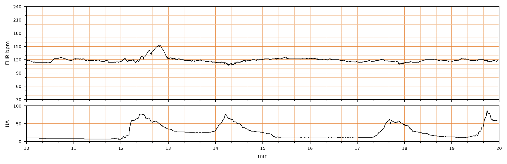

## 문제
29세 초산부가 임신 40주에 규칙적인 진통으로 입원하였다. 임신 경과 중 특이 사항은 없었고 양막은 터지지 않았다. 혈압 118/72 mmHg, 체온 36.8°C 이며 옥시토신은 쓰지 않았다. 내진에서 자궁경부는 4 cm 열려 있다. 전자 태아 감시를 시작한 뒤 10분 동안의 태아심박동과 자궁활동 기록은 그림과 같다. 기록 12~13분 사이에 보이는 태아심박동 변화가 의미하는 것으로 가장 적절한 것은?

- A. 그 시점에 태아 대사성 산증이 없음을 강하게 시사한다
- B. 제대 압박이 반복되고 있음을 시사한다
- C. 자궁태반 기능 부전으로 태아 저산소증이 있음을 시사한다
- D. 태아 머리 압박에 의한 미주신경 반응을 시사한다
- E. 태아 빈혈을 시사한다

_분만 중 태아심박동(위)과 자궁활동(아래), 기록 시작 후 10~20분 구간, 굵은 세로선 = 1분 (PhysioNet CTU-UHB, ODC-BY 1.0 — 4 Hz 원자료, 평활화 없음)_

## 정답 및 해설
> 정답: A

- **정답 핵심**: 기저 태아심박동은 약 115~120회/분이고, 12.2분부터 자궁수축과 함께 약 150회/분까지 30회/분 이상 올라 약 40초 지속된 뒤 기저선으로 돌아온다 — 가속(32주 이후 15회/분 이상, 15초 이상)이다. 가속은 태아의 자율신경계가 정상적으로 반응한다는 뜻으로, 가속이 있으면 그 시점에 태아 대사성 산증이 없을 가능성이 매우 높다. 이 10분 구간에 감속은 없다.
- **원리**: <b>왜 가속은 안심 소견인가</b>: 태아가 움직이거나 자극을 받으면 교감신경 긴장이 올라 심박이 잠깐 빨라진다. 이 반응이 나타나려면 뇌간의 심박 조절 중추와 자율신경 경로가 산소를 충분히 받고 있어야 한다. 태아에게 저산소증이 진행해 대사성 산증이 생기면 중추신경계가 억제되어 가속과 변이도가 먼저 사라진다. 그래서 <b>가속이 있다는 것은 그 순간 중추가 잘 작동한다는 증거</b>이고, 자연 가속이나 두피 자극에 대한 가속은 태아 산증이 없음을 강하게 예측한다.  <b>정의</b>: 32주 이후에는 기저선보다 15회/분 이상, 15초 이상(2분 미만) 오르면 가속이다(32주 전에는 10회/분·10초).  <b>반대 방향의 변화</b>: 감속은 원인에 따라 모양이 다르다 — 제대 압박은 급격한 가변성 감속, 머리 압박은 수축과 겹치는 완만한 조기 감속, 자궁태반 기능 부전은 수축 정점 뒤에 최저점이 오는 완만한 후기 감속이다.
- **비교**: <table><thead><tr><th style="width:24%">항목</th><th style="width:38%">가속(정답)</th><th>가변성 감속 — 제대 압박(가장 가까운 오답)</th></tr></thead><tbody> <tr><td>방향</td><td>기저선 <b>위로</b> 15회/분 이상</td><td>기저선 <b>아래로</b> 15회/분 이상</td></tr> <tr><td>지속</td><td>15초 이상 2분 미만</td><td>15초 이상, 30초 안에 급격히 하강</td></tr> <tr><td>의미</td><td>태아 중추·자율신경 정상 — 산증 없음 시사</td><td>제대 혈류 차단에 대한 압수용체 반사</td></tr> <tr><td>이 기록</td><td>12.2~13분 약 118 → 150회/분 상승 — 일치</td><td>기저선 아래로 떨어지는 변화 없음 — 불일치</td></tr> </tbody></table> 제대 압박 초기에 감속 앞뒤로 짧은 「어깨」 상승이 붙을 수 있지만, 그때는 반드시 급격한 하강이 함께 있다 — 하강 없이 오르기만 하면 가속이다.
- **오답 이유**:
  - ② 제대 압박은 태아심박동이 30초 안에 급격히 떨어졌다가 급격히 회복하는 가변성 감속이 반복될 때라면 정답이 된다.
  - ③ 자궁태반 기능 부전은 수축마다 완만하게 떨어져 수축 정점보다 늦게 최저점에 이르는 후기 감속이 반복될 때라면 정답이 된다.
  - ④ 태아 머리 압박은 수축의 시작·정점·끝과 거울처럼 겹치는 완만한 조기 감속이 보일 때라면 정답이 된다.
  - ⑤ 태아 빈혈은 분당 3~5회 주기로 매끈하게 오르내리는 사인파 양상이 보일 때라면 정답이 된다.
- **함정**: 수축과 함께 나타나는 변화를 모두 감속으로 읽고 방향(위·아래)을 확인하지 않는 것.
- **학습목표**: 분만 중 태아심박동이 기저선보다 15회/분 이상 15초 이상 오르는 가속을 읽고, 가속이 있으면 그 시점에 태아 대사성 산증이 없음을 강하게 시사함을 안다
- **근거·출처**: Macones GA, Hankins GDV, Spong CY, Hauth J, Moore T. The 2008 National Institute of Child Health and Human Development workshop report on electronic fetal monitoring. Obstet Gynecol. 2008;112(3):661-666 · Chudáček V, Spilka J, Burša M, et al. Open access intrapartum CTG database. BMC Pregnancy Childbirth. 2014;14:16

## 출처
- CTU-UHB Intrapartum Cardiotocography Database (PhysioNet, ODC-BY 1.0) · record 1047 · Open Data Commons Attribution License v1.0 · https://opendatacommons.org/licenses/by/1-0/
