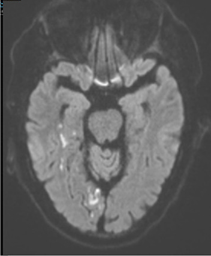

## 문제
A 69-year-old man comes to the emergency department 5 hours after he suddenly had difficulty seeing while reading the newspaper. He has hypertension and atrial fibrillation, and his anticoagulant was stopped 2 weeks ago before a dental procedure and has not been restarted. Blood pressure is 158/92 mm Hg and pulse is 96/min and irregularly irregular. He is alert and fluent, follows commands, and has normal strength and sensation in all extremities. Confrontation testing shows a visual field defect. An axial diffusion-weighted MR image of the brain is shown. Occlusion of which of the following arteries is the most likely cause?

- A. Left posterior cerebral artery
- B. Right middle cerebral artery
- C. Right anterior cerebral artery
- D. Right ophthalmic artery
- E. Right posterior cerebral artery

_Axial diffusion-weighted MR image of the brain, left panel of the published figure only; slice number cropped, displayed in radiologic convention (PMC Open Access Subset, CC BY — no other adjustment)_

## 정답 및 해설
> 정답: E

- **정답 핵심**: The diffusion-weighted image shows restricted diffusion (bright signal) in the medial occipital cortex along the calcarine region and the inferior temporo-occipital cortex on the image's left, which is the patient's right in radiologic convention. This is the territory of the right posterior cerebral artery; the left hemisphere is normal. Interruption of anticoagulation in atrial fibrillation explains a cardioembolic occlusion, and the clinical result is a left homonymous hemianopia without weakness or aphasia.
- **원리**: <b>왜 뒤대뇌동맥 경색은 시야만 앗아 가는가</b>: 뒤대뇌동맥은 바닥동맥 끝에서 갈라져 후두엽(새발톱고랑 양쪽의 일차 시각겉질)과 측두엽 아래쪽, 시상 일부를 먹여 살린다. 운동·감각을 맡는 중심앞·뒤이랑과 언어 영역은 중간대뇌동맥 영역이므로, 뒤대뇌동맥의 피질 가지만 막히면 <b>힘·감각·말은 멀쩡하고 반대쪽 동측 반맹</b>만 남는다. 환자는 한쪽으로 부딪히거나 글 줄의 한쪽 끝을 놓치는 것으로 알아챈다.  <b>왜 좌우가 반대인가</b>: 시신경교차 뒤에서는 양쪽 눈의 같은 쪽 시야 정보가 반대편 반구로 모인다 — 오른쪽 후두엽은 왼쪽 시야를 본다. 영상은 방사선 규약(화면 왼쪽 = 환자 오른쪽)으로 표시하므로, 화면 왼쪽의 병변은 오른쪽 반구다.  <b>원인</b>: 심방세동에서 항응고를 끊으면 좌심방귀에서 생긴 혈전이 떨어져 나가 뒤순환으로 가기도 한다. 확산 제한은 수 분~수 시간 안에 나타나는 급성 세포독성 부종의 표시다.
- **비교**: <table><thead><tr><th style="width:24%">Feature</th><th style="width:38%">Right PCA infarct (answer)</th><th>Right MCA infarct (closest distractor)</th></tr></thead><tbody> <tr><td>Cortex involved</td><td>Medial occipital (calcarine) and inferior temporal</td><td>Lateral frontal, parietal, superior temporal</td></tr> <tr><td>Visual field</td><td>Left homonymous hemianopia, often macular sparing</td><td>Left homonymous hemianopia or quadrantanopia possible</td></tr> <tr><td>Motor / sensory</td><td><b>Normal</b> (cortical branch occlusion)</td><td><b>Left face and arm weakness</b> and sensory loss</td></tr> <tr><td>Other</td><td>Isolated visual symptoms</td><td>Left neglect, gaze deviation to the right</td></tr> <tr><td>This patient</td><td>Medial occipital DWI signal · normal strength — fits</td><td>No lateral hemispheric lesion · no weakness — does not fit</td></tr> </tbody></table> A field cut with otherwise normal neurologic findings points to the posterior circulation; weakness or neglect points to the MCA.
- **오답 이유**:
  - (A) Left posterior cerebral artery would be correct if the diffusion signal were in the occipital lobe on the image's right side, producing a right homonymous hemianopia, sometimes with alexia without agraphia.
  - (B) Right middle cerebral artery would be correct if the lesion involved the lateral frontoparietal cortex and the patient had left face and arm weakness and left neglect.
  - (C) Right anterior cerebral artery would be correct if the lesion lay along the medial frontal and parietal lobes and the patient had left leg weakness.
  - (D) Right ophthalmic artery would be correct if he had sudden painless monocular vision loss in the right eye with a normal brain MRI (central retinal artery occlusion).
- **함정**: Forgetting radiologic convention and picking the left PCA because the lesion is on the left side of the screen.
- **학습목표**: 후두엽 안쪽과 측두-후두 아래쪽 피질의 확산 제한을 읽고 뒤대뇌동맥 영역 경색으로, 쪽(좌우)과 함께 판단한다
- **근거·출처**: Loscalzo J, Fauci AS, Kasper DL, et al., eds. Harrison's Principles of Internal Medicine, 22nd ed. McGraw Hill; 2025. Chapter 438: Ischemic Stroke · Case report: isolated homonymous hemianopia after reversal of anticoagulation with andexanet alfa. Front Neurol. 2026;17:1922229

## 출처
- Case Report: Isolated homonymous hemianopia after reversal of anticoagulation with andexanet alfa. Front Neurol. 2026 Jul 30;17:1922229. doi: 10.3389/fneur.2026.1922229 (CC BY) — Figure 2 · CC BY · https://creativecommons.org/licenses/
