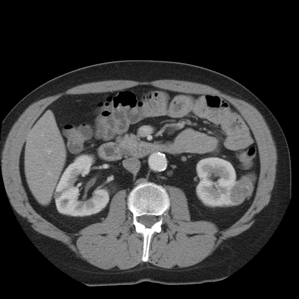

## 문제
A 49-year-old man is referred because microscopic hematuria was found on a routine health examination. He has no flank pain or weight loss. He has smoked half a pack of cigarettes daily for 25 years. Blood pressure is 134/86 mm Hg. Hemoglobin is 14.6 g/dL and creatinine is 0.9 mg/dL. Urinalysis shows 10–20 erythrocytes per high-power field without casts. Contrast-enhanced CT of the abdomen shows a solid, enhancing renal mass measuring 4.3 cm in its largest dimension, as shown in the axial image; the other kidney is normal, and there is no lymphadenopathy or venous thrombus. CT of the chest shows no metastases. Which of the following is the most appropriate next step in management?

- A. Systemic immune checkpoint inhibitor therapy
- B. Left partial nephrectomy
- C. Left radical nephrectomy
- D. Right partial nephrectomy
- E. Percutaneous needle biopsy of the left renal mass before any treatment

_Axial contrast-enhanced abdominal CT, arterial phase, standard radiologic orientation (The Cancer Imaging Archive, CC BY 4.0; converted from DICOM without cropping)_

## 정답 및 해설
> 정답: B

- **정답 핵심**: In radiologic convention the screen's right is the patient's left: the CT shows a rounded, exophytic solid mass in the lateral portion of the left kidney that enhances less than the normal cortex, with a normal right kidney. A solid enhancing renal mass is presumed to be renal cell carcinoma. A localized tumor of 7 cm or less (T1) that is peripheral and exophytic is best treated by partial nephrectomy, which gives the same cancer control as radical nephrectomy while preserving renal function; a biopsy would not change the plan for a surgical candidate.
- **원리**: <b>왜 콩팥을 남기는가</b>: 근치적 콩팥절제술 뒤에는 남은 콩팥 하나가 모든 일을 맡아 사구체 여과율이 떨어지고, 시간이 지나며 만성 콩팥병·심혈관 사건 위험이 커진다. 7 cm 이하(T1)의 국한된 종괴는 종양만 정상 조직 테두리와 함께 떼어 내도 재발률이 근치적 절제와 비슷하므로, <b>같은 암 치료 효과에 콩팥 기능을 지키는</b> 부분 콩팥절제술이 표준이다. 종괴가 바깥으로 튀어나와(외장성) 콩팥문에서 멀면 수술도 쉽다.  <b>왜 조직검사 없이 수술하는가</b>: 조영 증강되는 고형 종괴는 대부분 신세포암이고, 바늘 조직검사 결과가 어떻든 수술할 환자라면 방침이 바뀌지 않는다. 조직검사는 전이성 질환의 전신치료 전, 림프종·전이암이 의심될 때, 감시를 고려하는 작은 종괴에서 쓴다.  <b>왜 쪽을 영상에서 읽는가</b>: 축상 CT 는 환자의 발쪽에서 올려다본 방향(방사선 규약)이라 화면 오른쪽이 환자 왼쪽이다. 수술할 쪽을 틀리는 것은 가장 치명적인 오류다.
- **비교**: <table><thead><tr><th style="width:24%">Feature</th><th style="width:38%">Partial nephrectomy (answer)</th><th>Radical nephrectomy (closest distractor)</th></tr></thead><tbody> <tr><td>Typical tumor</td><td>≤ 7 cm (T1), peripheral or exophytic</td><td>Large (often &gt; 7 cm), central, replacing the kidney, or venous invasion</td></tr> <tr><td>Cancer control in T1</td><td>Equivalent</td><td>Equivalent</td></tr> <tr><td>Renal function</td><td><b>Preserved</b></td><td>Loss of one kidney — higher risk of CKD</td></tr> <tr><td>This patient</td><td>4.3 cm exophytic mass · no metastasis — fits</td><td>Removes a kidney unnecessarily — does not fit</td></tr> </tbody></table> Size and location decide: nephron-sparing surgery whenever the tumor can be removed completely, radical removal when it cannot.
- **오답 이유**:
  - (A) Immune checkpoint inhibitor therapy would be correct if chest CT or other staging had shown distant metastases from renal cell carcinoma.
  - (C) Left radical nephrectomy would be correct if the left mass were larger than 7 cm, centrally located near the hilum, or invading the renal vein.
  - (D) Right partial nephrectomy would be correct only if the mass were in the right kidney, which in radiologic convention would appear on the left side of the image.
  - (E) Percutaneous biopsy would be correct before systemic therapy for metastatic disease or when lymphoma or metastasis to the kidney is suspected.
- **함정**: Reading the mass as right-sided because it is on the right of the screen, or choosing radical nephrectomy for every renal cancer.
- **학습목표**: 원격 전이가 없는 7 cm 이하(T1) 콩팥 고형 종괴는 조직검사 없이 영상에서 종괴가 있는 쪽의 부분 콩팥절제술을 하며, 근치적 절제와 가른다
- **근거·출처**: Loscalzo J, Fauci AS, Kasper DL, et al., eds. Harrison's Principles of Internal Medicine, 22nd ed. McGraw Hill; 2025. Chapter 90: Renal Cell Carcinoma · Campbell SC, Uzzo RG, Karam JA, et al. Renal mass and localized renal cancer: evaluation, management, and follow-up: AUA guideline: part II. J Urol. 2021;206(2):209-218 · Heller N, Isensee F, Maier-Hein KH, et al. The state of the art in kidney and kidney tumor segmentation in contrast-enhanced CT imaging: results of the KiTS19 challenge. Med Image Anal. 2021;67:101821

## 출처
- The Cancer Imaging Archive (CC BY 3.0) · KiTS-00094 · Creative Commons Attribution 3.0 Unported · https://www.cancerimagingarchive.net/data-usage-policies-and-restrictions/
