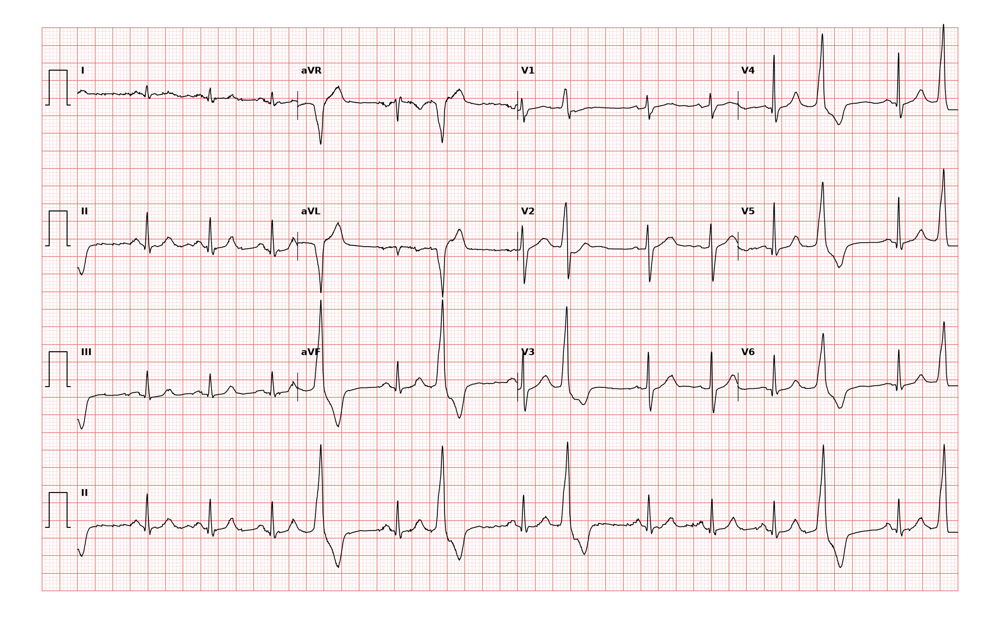

## 문제
70세 남자가 건강검진에서 맥이 불규칙하다는 말을 듣고 왔다. 가끔 가슴이 덜컥하는 느낌이 있으나 실신, 가슴 통증, 호흡곤란은 없다. 고혈압으로 약을 먹고 있다. 혈압 132/78 mmHg 이고, 맥박은 촉진상 규칙과 불규칙이 섞여 있다. 심음은 정상이고 잡음은 없다. 혈청 칼륨 4.1 mEq/L, 마그네슘 2.0 mg/dL 이다. 12유도 심전도는 그림과 같다. 심전도 판독으로 가장 적절한 것은?

- A. 심실 기외수축 이단맥
- B. 심방 기외수축 이단맥
- C. Mobitz 2형 2도 방실차단
- D. 간헐적 좌각차단
- E. 심방세동

_12유도 심전도, 25 mm/s · 10 mm/mV, 3×4 + II 리듬 스트립 (PTB-XL ECG dataset, PhysioNet, CC BY 4.0 — 원신호 그대로 작도)_

## 정답 및 해설
> 정답: A

- **정답 핵심**: 리듬 스트립(II) 앞부분은 P파가 앞선 좁은 QRS 의 동리듬이고, 중반부터는 좁은 정상 박동 하나마다 <b>P파 없이</b> 일찍 오는 넓고(약 0.14초) 모양이 전혀 다른 QRS 가 하나씩 번갈아 나온다. 넓은 박동의 T파는 QRS 와 반대 방향이고 뒤에 긴 휴지기가 따른다(aVL·aVF·V1~V6 에서 같은 모양). 조기 박동이 정상 박동과 1:1 로 짝을 이루므로 심실 기외수축 이단맥이다.
- **원리**: <b>왜 심실에서 생긴 박동은 넓은가</b>: 정상 박동은 히스-푸르키니에 전도계를 타고 양쪽 심실이 거의 동시에 흥분해 QRS 가 좁다(0.12초 미만). 심실 근육 한 곳에서 생긴 기외수축은 전도계 밖에서 근육을 따라 천천히 퍼지므로 <b>QRS 가 넓고 이상한 모양</b>이며, 재분극도 비정상 순서라 T파가 QRS 주 방향과 반대가 된다. 심방을 거치지 않으니 앞에 P파가 없다.  <b>왜 뒤에 긴 휴지기가 오는가</b>: 심실 기외수축은 대개 동결절을 거꾸로 재설정하지 못한다. 다음 동박동이 제때 오지만 심실이 아직 불응기여서 전도되지 못하고, 그다음 동박동에서야 심실이 흥분한다 — 기외수축 앞뒤 간격의 합이 정상 RR 두 개와 같은 <b>완전 보상 휴지기</b>다.  <b>이단맥</b>: 정상 박동과 기외수축이 1:1 로 번갈아 나오면 이단맥, 2:1 이면 삼단맥이다. 맥을 짚으면 약한 기외수축이 잘 느껴지지 않아 맥이 불규칙하거나 느리게 느껴진다.
- **비교**: <table><thead><tr><th style="width:24%">항목</th><th style="width:38%">심실 기외수축 이단맥(정답)</th><th>심방 기외수축 이단맥(가장 가까운 오답)</th></tr></thead><tbody> <tr><td>조기 박동 앞</td><td><b>P파 없음</b></td><td>모양이 다른 조기 P파</td></tr> <tr><td>QRS</td><td><b>넓다(≥ 0.12초)</b>·이상한 모양</td><td>대개 좁다(정상 박동과 비슷)</td></tr> <tr><td>T파</td><td>QRS 와 반대 방향</td><td>정상 박동과 비슷</td></tr> <tr><td>휴지기</td><td>대개 완전 보상</td><td>대개 불완전(동결절 재설정)</td></tr> <tr><td>이 심전도</td><td>P파 없는 넓은 조기 QRS 가 1:1 교대 — 일치</td><td>넓은 QRS — 불일치</td></tr> </tbody></table> 심방 기외수축도 변행 전도로 넓어질 수 있지만, 그때는 조기 P파가 앞에 보인다 — 넓은 조기 박동 앞의 T파를 먼저 살핀다.
- **오답 이유**:
  - ② 심방 기외수축 이단맥은 정상 박동과 번갈아 나오는 조기 박동 앞에 모양이 다른 P파가 있고 QRS 가 정상처럼 좁을 때라면 정답이 된다.
  - ③ Mobitz 2형 2도 방실차단은 PR 간격이 일정한 P파 뒤에 QRS 가 갑자기 빠지는 박동이 있을 때라면 정답이 되며, 조기 박동이 없다.
  - ④ 간헐적 좌각차단은 넓은 QRS 앞에 정상 PR 의 P파가 있고 박동이 일찍 오지 않으며 심박수 변화에 따라 나타날 때라면 정답이 된다.
  - ⑤ 심방세동은 P파 없이 기저선이 잔물결처럼 떨리고 좁은 QRS 의 RR 간격이 완전히 불규칙할 때라면 정답이 된다.
- **함정**: 넓은 박동을 각차단으로 읽고 그것이 일찍 온다는 점(조기성)과 P파가 없다는 점을 놓치는 것.
- **학습목표**: 정상 동박동과 넓은 조기 QRS 가 1:1 로 번갈아 나오는 리듬을 심실 기외수축 이단맥으로 판독하고, 심방 기외수축 이단맥·2도 방실차단과 가른다
- **근거·출처**: Loscalzo J, Fauci AS, Kasper DL, et al., eds. Harrison's Principles of Internal Medicine, 22nd ed. McGraw Hill; 2025. Chapter 260: Premature Ventricular Contractions, Nonsustained Ventricular Tachycardia, and Accelerated Idioventricular Rhythm · Loscalzo J, Fauci AS, Kasper DL, et al., eds. Harrison's Principles of Internal Medicine, 22nd ed. McGraw Hill; 2025. Chapter 247: Electrocardiography · Wagner P, Strodthoff N, Bousseljot RD, et al. PTB-XL, a large publicly available electrocardiography dataset. Sci Data. 2020;7:154

## 출처
- PTB-XL ECG dataset v1.0.3 (PhysioNet, CC BY 4.0) · record 18366 · Creative Commons Attribution 4.0 International · https://physionet.org/content/ptb-xl/1.0.3/LICENSE.txt
