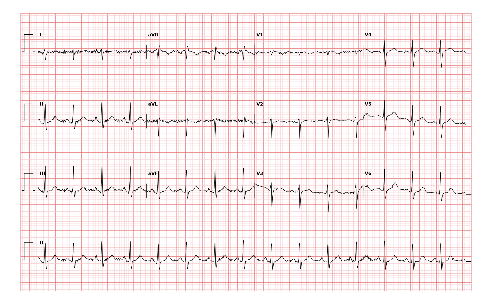

## 문제
63세 여자가 무릎 인공관절 수술 전 검사에서 심전도 이상이 있다며 순환기내과에 의뢰되었다. 6개월 전부터 계단을 두 층 오르면 숨이 조금 찬다고 한다. 가슴 통증, 실신, 다리 부종은 없고 흡연하지 않는다. 혈압 128/80 mmHg, 맥박 88회/분, 산소포화도 96% 이다. 심음은 정상이고 잡음은 없으며 폐음은 깨끗하다. 흉부 X선은 정상이다. 12유도 심전도는 그림과 같다. 다음 처치로 가장 적절한 것은?

- A. 추가 검사 없이 6개월 뒤 심전도 재검
- B. 경흉부 심장초음파
- C. 영구 심박동기 삽입
- D. 관상동맥 조영술
- E. 전기생리검사

_12유도 심전도, 25 mm/s · 10 mm/mV, 3×4 + II 리듬 스트립 (PTB-XL ECG dataset, PhysioNet, CC BY 4.0 — 원신호 그대로 작도)_

## 정답 및 해설
> 정답: B

- **정답 핵심**: 동리듬 약 88회/분에 QRS 는 좁고, I 에서 rS(음성 우세)·II·III·aVF 에서 큰 R(III 가 가장 큼)로 우축 편위다. 이 모양은 좌후속차단에서 나오지만, 좌후속차단은 <b>우축 편위를 일으키는 다른 원인(우심실비대·폐고혈압·폐색전·측벽 경색)을 배제한 뒤에만</b> 붙이는 진단이다. 운동 시 숨참이 있으므로 우심실 비대·폐고혈압을 확인하기 위해 경흉부 심장초음파를 먼저 한다. 단독 속차단은 심박동기의 적응증이 아니다.
- **원리**: <b>왜 좌후속차단은 우축을 만드는가</b>: 좌각은 앞속(좌심실 앞위쪽)과 뒤속(좌심실 뒤아래쪽)으로 갈라진다. 뒤속이 막히면 흥분이 앞속을 타고 먼저 앞위쪽을 깨운 뒤 아래·오른쪽으로 늦게 퍼진다. 마지막 힘이 오른쪽 아래를 향하므로 I 는 rS(음성), III 은 큰 R 의 <b>우축 편위</b>가 되고, 전도계 안의 일부만 막힌 것이라 QRS 는 좁다.  <b>왜 배제 진단인가</b>: 같은 우축 편위는 우심실이 두꺼워지거나(폐고혈압·폐동맥판 협착·만성 폐질환), 급성 우심실 압력 부하(폐색전), 측벽 경색으로 왼쪽 힘이 사라질 때, 키 크고 마른 젊은 사람의 정상 변이에서도 나온다. 뒤속은 굵고 혈액 공급이 이중이라 단독으로 막히는 일이 드물다. 그래서 우축을 보면 먼저 <b>우심실 쪽 원인</b>을 찾고, 없을 때만 좌후속차단이라고 부른다.  <b>숨참과 함께라면</b>: 우심실비대·폐고혈압을 가장 쉽게 확인하는 검사는 경흉부 심장초음파(우심실 벽 두께·크기, 삼첨판 역류 속도로 추정한 폐동맥 수축기압)다.
- **비교**: <table><thead><tr><th style="width:24%">항목</th><th style="width:38%">경흉부 심장초음파(정답)</th><th>6개월 뒤 심전도 재검(가장 가까운 오답)</th></tr></thead><tbody> <tr><td>대상</td><td>우축 편위 + <b>증상(운동 시 숨참)</b> — 우심실 원인 배제 필요</td><td>증상 없는 키 크고 마른 젊은 사람의 우축 정상 변이</td></tr> <tr><td>찾는 것</td><td>우심실비대·폐고혈압·판막 질환</td><td>변화가 생기는지</td></tr> <tr><td>이 환자</td><td>63세 · 숨참 · 새로 발견된 우축 — 일치</td><td>증상이 있다 — 불일치</td></tr> </tbody></table> 좌후속차단이라는 이름은 우심실 쪽 원인을 지운 뒤에 붙인다 — 증상이 있으면 그 확인이 먼저다.
- **오답 이유**:
  - ① 추가 검사 없이 재검하는 것은 증상이 없는 키 크고 마른 젊은 사람에게서 우연히 본 우축 편위라면 정답이 된다.
  - ③ 영구 심박동기 삽입은 2도 Mobitz 2형·3도 방실차단이나 교대 각차단처럼 고도 전도 장애에 증상이 있을 때라면 정답이 되며, 단독 속차단은 적응증이 아니다.
  - ④ 관상동맥 조영술은 전형적 협심증과 비침습 검사의 고위험 허혈이 있거나 급성 관상동맥 증후군이 의심될 때라면 정답이 된다.
  - ⑤ 전기생리검사는 각차단이 있는 환자가 설명되지 않는 실신을 겪어 히스-심실 전도 지연을 확인해야 할 때라면 정답이 된다.
- **함정**: 우축 편위를 보자마자 좌후속차단으로 확정하고 우심실비대·폐고혈압 확인을 건너뛰거나, 속차단을 심박동기 적응증으로 착각하는 것.
- **학습목표**: 좁은 QRS 의 우축 편위(I rS·III 큰 R)를 좌후속차단 양상으로 읽되, 좌후속차단은 배제 진단이므로 우심실비대·폐고혈압을 먼저 심장초음파로 확인한다
- **근거·출처**: Loscalzo J, Fauci AS, Kasper DL, et al., eds. Harrison's Principles of Internal Medicine, 22nd ed. McGraw Hill; 2025. Chapter 247: Electrocardiography · Loscalzo J, Fauci AS, Kasper DL, et al., eds. Harrison's Principles of Internal Medicine, 22nd ed. McGraw Hill; 2025. Chapter 252: The Bradyarrhythmias: Disorders of the Atrioventricular Node · Wagner P, Strodthoff N, Bousseljot RD, et al. PTB-XL, a large publicly available electrocardiography dataset. Sci Data. 2020;7:154

## 출처
- PTB-XL ECG dataset v1.0.3 (PhysioNet, CC BY 4.0) · record 6938 · Creative Commons Attribution 4.0 International · https://physionet.org/content/ptb-xl/1.0.3/LICENSE.txt
