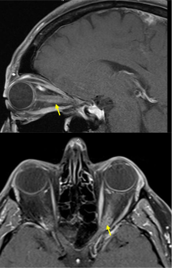

## 문제
A 48-year-old man comes to the physician because of blurred vision for 5 days. The blurring is worse in one eye, and he has pain behind that eye that increases when he moves his eyes. He has no history of diabetes mellitus, hypertension, or trauma. Blood pressure is 124/78 mm Hg. Visual acuity is 20/200 in the more affected eye and 20/40 in the other eye, and color vision is reduced in the more affected eye. Extraocular movements are full. Contrast-enhanced MR images of the orbits are shown. Which of the following is the most likely finding on the swinging flashlight test?

- A. Miosis of the left pupil that is more obvious in dim light
- B. Fixed dilated left pupil that does not constrict to light or near
- C. Relative afferent pupillary defect in the left eye
- D. Relative afferent pupillary defect in the right eye
- E. Bilateral light-near dissociation

_Contrast-enhanced fat-suppressed T1-weighted MR images of the orbits (top: oblique sagittal, bottom: axial), right column of the published figure only; panel letters cropped, arrows are the authors' originals, axial image in radiologic convention (PMC Open Access Subset, CC BY)_

## 정답 및 해설
> 정답: C

- **정답 핵심**: The MR images show enhancement along the sheath of the <b>left</b> intraorbital optic nerve (arrows; on the axial image the patient's left is on the viewer's right). Optic neuritis of the more affected (left) eye reduces afferent input from that eye, so when the light swings from the right to the left eye both pupils dilate — a left relative afferent pupillary defect. Painful eye movement, reduced acuity and color desaturation fit optic neuritis.
- **원리**: <b>왜 동공 반사가 「구심」 결함으로 나타나는가</b>: 빛 반사의 들신경은 시신경이고, 시신경 정보는 시각교차와 시삭을 거쳐 양쪽 덮개앞핵으로 고르게 간다. 덮개앞핵은 양쪽 에딩거-베스트팔핵으로 신호를 보내므로, 한쪽 눈에 빛을 비추면 <b>두 동공이 똑같이</b> 수축한다(직접·간접 반사). 따라서 한쪽 시신경이 손상되면 동공 크기는 쉴 때 같고, 손상된 눈에 빛을 줄 때만 양쪽 수축이 약해진다. 빛을 정상 눈에서 손상 눈으로 옮기면 들어오는 신호가 줄어 두 동공이 오히려 커진다 — 상대 구심동공운동장애다.  <b>시신경염의 영상</b>: 조영 지방억제 T1 에서 염증이 있는 시신경과 신경집이 조영증강된다. 눈을 움직일 때의 통증은 바깥눈근육이 붙는 Zinn 고리에서 염증이 있는 신경집이 당겨지기 때문이다.  <b>원심 결함은 다르다</b>: 동공 크기가 짝짝이(동공부동)면 날신경(동안신경 부교감 — 산대·고정) 또는 교감신경(호너 — 축동, 어두울 때 더 뚜렷) 이상이다.
- **비교**: <table><thead><tr><th style="width:24%">Feature</th><th style="width:38%">Left RAPD (answer)</th><th>Right RAPD (closest distractor)</th></tr></thead><tbody> <tr><td>Lesion</td><td><b>Left</b> optic nerve</td><td>Right optic nerve</td></tr> <tr><td>MRI here</td><td>Enhancing sheath of the left intraorbital optic nerve (viewer's right on the axial image)</td><td>Would need enhancement on the viewer's left</td></tr> <tr><td>Swinging test</td><td>Light moved to the left eye → both pupils dilate</td><td>Light moved to the right eye → both pupils dilate</td></tr> <tr><td>Resting pupils</td><td colspan="2">Equal in size in both cases — an afferent defect never causes anisocoria</td></tr> </tbody></table> Read side from the image convention, not from the screen: in a radiologic axial image the patient's left is on the viewer's right.
- **오답 이유**:
  - (A) Left miosis more obvious in dim light would be correct for a left Horner syndrome with ptosis, such as from a carotid dissection or an apical lung tumor.
  - (B) A fixed dilated left pupil would be correct for a compressive left oculomotor nerve palsy, such as from a posterior communicating artery aneurysm, with ptosis and a down-and-out eye.
  - (D) A right relative afferent pupillary defect would be correct if the enhancing optic nerve were on the viewer's left of the axial image, the patient's right side.
  - (E) Bilateral light-near dissociation would be correct for a dorsal midbrain lesion or Argyll Robertson pupils of neurosyphilis, where pupils react to near but not to light.
- **함정**: Reading the arrow on the viewer's right side of the axial image as the patient's right optic nerve.
- **학습목표**: 안와 MRI 에서 한쪽 시신경 신경집의 조영증강을 읽고 시신경염으로, 같은 쪽 상대 구심동공운동장애를 예측한다
- **근거·출처**: Loscalzo J, Fauci AS, Kasper DL, et al., eds. Harrison's Principles of Internal Medicine, 22nd ed. McGraw Hill; 2025. Chapter 34: Disorders of the Eye · Optic Neuritis Study Group. The clinical profile of optic neuritis: experience of the Optic Neuritis Treatment Trial. Arch Ophthalmol. 1991;109(12):1673-1678

## 출처
- Case Report: Fundus findings in myelin oligodendrocyte glycoprotein-associated optic neuritis. Front Ophthalmol (Lausanne). 2025 Sep 22;5:1620614. doi: 10.3389/fopht.2025.1620614 (CC BY) — Figure 1 · CC BY · https://creativecommons.org/licenses/
