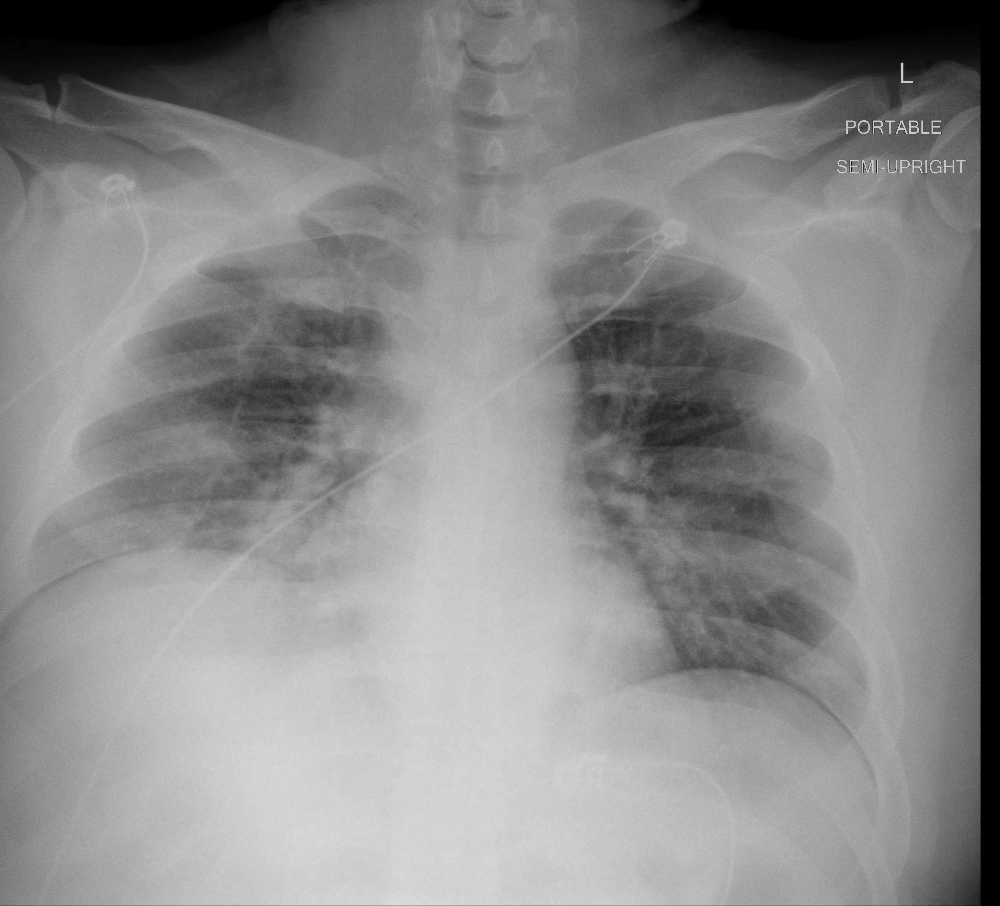

## 문제
38세 남자가 7일 전부터 열과 기침이 나고 2일 전부터 숨이 차서 응급실에 왔다. 비인두 검체의 SARS-CoV-2 역전사 중합효소연쇄반응 검사는 양성이다. 체온 38.6°C, 혈압 128/80 mmHg, 맥박 104회/분, 호흡 26회/분이며 실내 공기에서 산소포화도는 89 % 이다. 양쪽 폐 아래쪽에서 수포음이 들린다. 백혈구 6,200/mm³, 프로칼시토닌 0.08 ng/mL 이다. 코 삽관으로 산소를 주기 시작하였다. 이동식 흉부 X선 사진은 그림과 같다. 이 환자의 치료로 가장 적절한 것은?

- A. 덱사메타손 6 mg 하루 1회 투여
- B. 니르마트렐비르-리토나비르 경구 투여
- C. 하이드록시클로로퀸 경구 투여
- D. 메틸프레드니솔론 1 g 하루 1회 3일 투여
- E. 반코마이신과 피페라실린-타조박탐 정맥 투여

_이동식 반좌위 흉부 전후면 X선, 글자·좌우 표지는 원본의 것, 크기 조정만 (The Cancer Imaging Archive, CC BY 4.0 — 크롭·창 조절 없음)_

## 정답 및 해설
> 정답: A

- **정답 핵심**: 흉부 X선에서 오른쪽 중·하폐야가 우세한 양측 반점상 공기공간 음영이 있고, 실내 공기 산소포화도 89 % 로 산소가 필요한 SARS-CoV-2 폐렴이다. 산소가 필요한 입원 환자에게는 덱사메타손 6 mg 을 하루 1회(최대 10일) 주면 사망률이 준다. 니르마트렐비르-리토나비르는 산소가 필요 없는 외래 고위험 환자용이다.
- **원리**: <b>왜 병기마다 치료가 다른가</b>: SARS-CoV-2 감염은 처음 며칠 동안은 <b>바이러스 증식</b>이 주된 문제이고, 일주일쯤 지나 폐렴과 저산소증이 생기는 시기에는 <b>숙주의 과도한 염증 반응</b>이 폐포 손상을 키운다. 그래서 초기·경증(산소 불필요) 단계에서는 바이러스 증식을 막는 항바이러스제가 중증 진행을 줄이고, 산소가 필요한 단계에서는 염증을 누르는 코르티코스테로이드가 사망률을 줄인다.  <b>근거</b>: RECOVERY 시험에서 덱사메타손 6 mg 은 산소나 기계환기가 필요한 환자의 28일 사망률을 낮췄지만, 산소가 필요 없는 환자에서는 이득이 없었다(오히려 해로운 경향). 고용량 펄스 스테로이드는 이 이득을 넘는 근거가 없고 감염·고혈당 위험만 키운다.  <b>항생제</b>: 바이러스 폐렴도 양측 음영과 발열을 보이므로 세균 동반 감염을 걱정하게 되지만, 프로칼시토닌이 낮고 백혈구가 정상이면 경험적 광범위 항생제의 근거가 약하다.
- **비교**: <table><thead><tr><th style="width:24%">항목</th><th style="width:38%">덱사메타손(정답)</th><th>니르마트렐비르-리토나비르(가장 가까운 오답)</th></tr></thead><tbody> <tr><td>표적</td><td>숙주 염증 반응</td><td>바이러스 단백분해효소(Mpro)</td></tr> <tr><td>대상</td><td><b>산소가 필요한</b> 입원 환자</td><td>산소가 필요 없는 외래 고위험 환자, 증상 5일 이내</td></tr> <tr><td>이 환자</td><td>산소포화도 89 % · 산소 시작 · 증상 7일 — 일치</td><td>산소 필요 · 증상 5일 넘음 — 불일치</td></tr> </tbody></table> 「산소가 필요한가」가 갈림길이다 — 필요하면 덱사메타손(대개 렘데시비르와 함께), 필요 없으면 위험 인자에 따라 경구 항바이러스제.
- **오답 이유**:
  - ② 니르마트렐비르-리토나비르는 산소가 필요 없는 고위험 외래 환자가 증상 시작 5일 이내에 왔을 때라면 정답이 된다.
  - ③ 하이드록시클로로퀸은 무작위 대조 시험에서 SARS-CoV-2 감염의 경과를 개선하지 못해 이 감염에서 정답이 되는 조건이 없고, 말라리아나 루푸스라면 정답이 된다.
  - ④ 메틸프레드니솔론 펄스는 루푸스 신염이나 혈관염 같은 자가면역 질환의 급성 악화라면 정답이 되며, 이 감염에서는 6 mg 덱사메타손보다 나은 근거가 없다.
  - ⑤ 반코마이신과 피페라실린-타조박탐은 프로칼시토닌이 높고 객담에서 균이 보이는 등 세균성 원내 폐렴이 의심될 때라면 정답이 된다.
- **함정**: 양측 폐 음영과 발열을 세균 폐렴으로 보고 광범위 항생제부터 고르거나, 산소 필요 여부를 보지 않고 항바이러스제를 고르는 것.
- **학습목표**: SARS-CoV-2 감염으로 입원해 산소가 필요한 폐렴 환자에게는 덱사메타손을 쓰고, 외래 항바이러스제의 적응증과 구별한다
- **근거·출처**: Loscalzo J, Fauci AS, Kasper DL, et al., eds. Harrison's Principles of Internal Medicine, 22nd ed. McGraw Hill; 2025. Chapter 205: SARS-CoV-2 and COVID-19 · RECOVERY Collaborative Group, Horby P, Lim WS, et al. Dexamethasone in hospitalized patients with Covid-19. N Engl J Med. 2021;384(8):693-704

## 출처
- COVID-19-AR, The Cancer Imaging Archive (CC BY 4.0) · series …71380344 · Creative Commons Attribution 4.0 International · https://www.cancerimagingarchive.net/data-usage-policies-and-restrictions/
