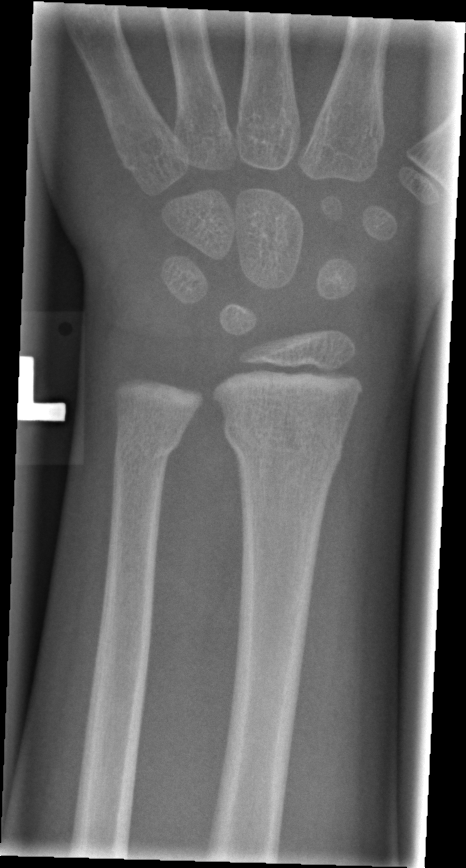

## 문제
A 6-year-old boy is brought to the emergency department 2 hours after he fell from a playground swing onto his outstretched left hand. He has pain in the left wrist and does not want to use the hand. He has no history of fractures, and his growth and diet are normal. Vital signs are normal. Examination shows mild swelling and point tenderness over the distal forearm without visible deformity. Radial pulse, capillary refill and finger movements are normal. An anteroposterior radiograph of the left wrist is shown. Which of the following characteristics of this patient's bone best explains the injury pattern seen?

- A. Low bone mineral density from vitamin D deficiency
- B. Avascular necrosis of an ossification center
- C. Excessive collagen cross-linking that makes cortical bone brittle
- D. Porous, compliant metaphyseal bone that buckles under axial compression
- E. Physeal cartilage that is weaker than the surrounding ligaments and bone

_Anteroposterior radiograph of the left wrist; the L marker is the original, resized only (GRAZPEDWRI-DX, figshare, CC BY 4.0)_

## 정답 및 해설
> 정답: D

- **정답 핵심**: The radiograph shows a focal outward bulge of the cortex of the distal radial metaphysis without a fracture line, displacement or extension into the growth plate — a buckle (torus) fracture. In children the metaphysis is porous and compliant, so an axial load on an outstretched hand compresses and buckles the cortex instead of breaking through it. The physis is not involved, so this is not a Salter-Harris injury.
- **원리**: <b>왜 아이의 뼈는 「찌그러지는가」</b>: 소아의 골간단은 성장판 바로 옆에서 새 뼈가 계속 만들어지는 곳이라 해면골이 많고 피질이 얇으며 구멍이 많다(다공성). 이 뼈는 어른 뼈보다 덜 단단하지만 더 잘 휜다. 손을 짚고 넘어지면 힘이 손목에서 팔뚝 방향으로 축을 따라 전달되는데, 다공성 골간단 피질은 끊어지기 전에 <b>압축되면서 바깥으로 불룩하게 접힌다</b> — 버클(torus, 「불룩한 고리」) 골절이다.  <b>같은 성질의 다른 결과</b>: 굽히는 힘이 걸리면 한쪽 피질만 부러지고 반대쪽은 휘어 버티는 생나무 골절이 되고, 힘이 성장판에 걸리면 성장판 골절(Salter-Harris)이 된다. 성장판은 인대보다 약해 소아에서는 인대 손상보다 성장판 골절이 흔하다.  <b>왜 예후가 좋은가</b>: 버클 골절은 한쪽 피질이 끊어지지 않아 안정하고 전위되지 않는다. 그래서 탈착식 손목 부목으로 약 3주 보호하면 충분하고 추적 X선도 대개 필요 없다(FORCE 시험).
- **비교**: <table><thead><tr><th style="width:24%">Feature</th><th style="width:38%">Buckle (torus) fracture (answer)</th><th>Physeal (Salter-Harris) fracture (closest distractor)</th></tr></thead><tbody> <tr><td>Site</td><td><b>Metaphysis</b>, 2–4 cm from the physis</td><td>Through the physis ± metaphysis or epiphysis</td></tr> <tr><td>Bone property</td><td>Porous, compliant metaphyseal cortex buckles in compression</td><td>Physeal cartilage weaker than ligaments</td></tr> <tr><td>Radiograph</td><td>Cortical bulge, no fracture line through the cortex</td><td>Widened physis or fragment of metaphysis/epiphysis</td></tr> <tr><td>This film</td><td>Bulge of the distal radial metaphyseal cortex, physis intact — fits</td><td>Physis normal — does not fit</td></tr> </tbody></table> Both injuries come from the same fall; the radiograph tells you which weak point failed — the metaphyseal cortex or the growth plate.
- **오답 이유**:
  - (A) Low bone mineral density from vitamin D deficiency would be correct if the child had rickets with cupping and fraying of the metaphyses and a poor diet.
  - (B) Avascular necrosis of an ossification center would be correct for a painful flattened, sclerotic epiphysis such as Legg-Calvé-Perthes disease or Kienböck disease.
  - (C) Brittle bone would be correct for osteogenesis imperfecta, which causes repeated fractures with minor trauma and blue sclerae, but that disease reflects defective type I collagen.
  - (E) Physeal cartilage weaker than ligaments would be correct if the radiograph showed widening of the growth plate or a fracture through the physis (Salter-Harris injury).
- **함정**: Assuming every pediatric wrist injury after a fall involves the growth plate without looking at where the cortex changes.
- **학습목표**: 소아 원위 요골 골간단의 피질 팽륜(버클 골절)을 읽고 그 손상 양상을 소아 골간단 뼈의 성질로 설명한다
- **근거·출처**: Perry DC, Achten J, Knight R, et al. Immobilisation of torus fractures of the wrist in children (FORCE): a randomised controlled equivalence trial in the UK. Lancet. 2022;400(10345):39-47 · Nagy E, Janisch M, Hržić F, et al. A pediatric wrist trauma X-ray dataset (GRAZPEDWRI-DX) for machine learning. Sci Data. 2022;9:222

## 출처
- GRAZPEDWRI-DX (figshare, CC BY 4.0) · Creative Commons Attribution 4.0 International · https://creativecommons.org/licenses/by/4.0/
