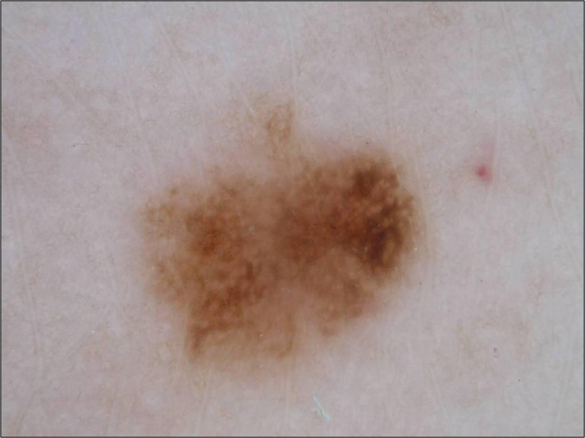

## 문제
25세 여자가 다리의 갈색 점이 최근 몇 달 사이 커지고 모양이 변했다며 왔다. 통증이나 가려움, 출혈은 없다. 피부암의 가족력은 없고 어릴 때 햇볕에 심하게 탄 적이 여러 번 있다. 다리에 지름 약 1 cm 의 편평한 갈색 반이 있고, 만져지는 림프절은 없다. 병변의 더모스코피 사진은 그림과 같다. 다음 처치로 가장 적절한 것은?

- A. 3개월 뒤 더모스코피로 재검
- B. 2 cm 경계를 두고 광범위 절제
- C. 레이저로 색소를 제거
- D. 1~3 mm 경계를 두고 병변 전체를 절제 생검
- E. 병변 일부를 면도 생검

_더모스코피 사진, 원본 그대로 크기 조정만 (ISIC Archive, CC-0 — 크롭·색 보정 없음)_

## 정답 및 해설
> 정답: D

- **정답 핵심**: 더모스코피에서 병변이 비대칭이고 경계가 불규칙하게 삐져나오며 연갈색~짙은 갈색의 여러 색조와 고르지 않은 색소망·구상 구조가 있다. 최근 커지고 변한 병변(Evolving)이므로 흑색종을 의심한다. 진단과 두께(Breslow) 측정을 위해 1~3 mm 경계를 두고 병변 전체를 피하지방까지 절제 생검한다.
- **원리**: <b>왜 「전체를」 「좁게」 떼는가</b>: 흑색종의 예후와 이후 수술 범위는 <b>Breslow 두께</b>(표피 과립층에서 가장 깊은 종양세포까지의 깊이)로 정해진다. 병변 일부만 떼거나 얕게 깎으면 가장 깊은 부분을 놓쳐 두께를 과소평가하고 병기가 틀어진다. 그래서 진단 단계에서는 병변 전체를 1~3 mm 정상 피부와 함께 피하지방까지 절제한다.  <b>왜 처음부터 넓게 떼지 않는가</b>: 최종 절제 경계는 두께에 따라 달라지고(제자리암 0.5~1 cm, ≤ 1 mm 는 1 cm, > 2 mm 는 2 cm), 감시 림프절 생검 여부도 두께로 정한다. 처음부터 넓게 떼면 림프 흐름이 바뀌어 감시 림프절 지도화가 부정확해진다.  <b>더모스코피의 단서</b>: 정상 모반은 대칭이고 색소망이 고르며 한두 가지 색이다. 흑색종은 멜라닌세포가 무질서하게 증식해 비대칭·여러 색·불규칙 색소망·경계의 삐죽한 돌출을 만든다(ABCDE 의 확대판).
- **비교**: <table><thead><tr><th style="width:24%">항목</th><th style="width:38%">좁은 경계 절제 생검(정답)</th><th>2 cm 광범위 절제(가장 가까운 오답)</th></tr></thead><tbody> <tr><td>시점</td><td><b>진단 전</b> — 의심 병변</td><td>조직 진단 · 두께 확인 뒤</td></tr> <tr><td>경계</td><td>1~3 mm</td><td>두께 > 2 mm 흑색종에서 2 cm</td></tr> <tr><td>목적</td><td>진단 + Breslow 두께 측정</td><td>국소 재발 방지(최종 치료)</td></tr> <tr><td>이 환자</td><td>조직 진단 없음 — 일치</td><td>두께를 모름 — 너무 이르다</td></tr> </tbody></table> 순서는 「의심 → 좁은 경계 전체 절제 생검 → 두께 확인 → 두께에 맞춘 재절제 ± 감시 림프절 생검」이다.
- **오답 이유**:
  - ① 3개월 뒤 재검은 더모스코피 소견이 경미하게 비정형이지만 변화 병력이 없는 편평한 병변에서 단기 추적을 택할 때라면 정답이 된다.
  - ② 2 cm 광범위 절제는 생검으로 두께 2 mm 초과 흑색종이 확인된 뒤의 최종 수술이라면 정답이 된다.
  - ③ 레이저 색소 제거는 일광흑자나 오타모반처럼 양성이 확실한 색소 병변이라면 정답이 되며, 의심 병변에서는 조직을 없애 진단을 막는다.
  - ⑤ 면도 생검은 표피에 국한된 지루각화증·피부색 모반처럼 악성을 의심하지 않는 융기 병변이라면 정답이 된다.
- **함정**: 흑색종을 의심하자마자 최종 수술 경계(2 cm)를 고르거나 일부만 떼는 생검을 고르는 것.
- **학습목표**: 더모스코피에서 비대칭·불규칙 경계·다색조·불규칙 색소망을 보이는 색소 병변은 흑색종을 의심해 좁은 경계의 절제 생검을 한다
- **근거·출처**: Loscalzo J, Fauci AS, Kasper DL, et al., eds. Harrison's Principles of Internal Medicine, 22nd ed. McGraw Hill; 2025. Chapter 81: Cancer of the Skin · Swetter SM, Tsao H, Bichakjian CK, et al. Guidelines of care for the management of primary cutaneous melanoma. J Am Acad Dermatol. 2019;80(1):208-250

## 출처
- ISIC Archive ISIC_0000054 (CC-0) · CC0 1.0 Universal · https://creativecommons.org/publicdomain/zero/1.0/
