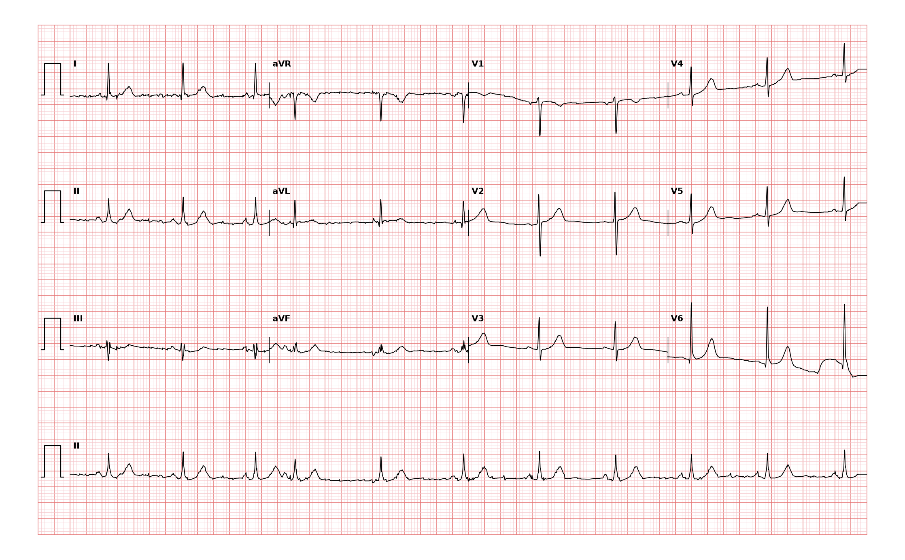

## 문제
76세 여자가 2주 전부터 가끔 심장이 한 번씩 건너뛰는 느낌이 든다며 왔다. 어지럼, 실신, 가슴 통증은 없다. 고혈압으로 약을 먹고 있다. 혈압 134/78 mmHg, 맥박 76회/분이며 가끔 불규칙하다. 심잡음은 없다. 혈청 칼륨 4.2 mEq/L, 갑상샘자극호르몬은 정상이다. 12유도 심전도는 그림과 같다. 심전도 판독으로 가장 적절한 것은?

- A. 심방 기외수축
- B. 심실 기외수축
- C. 2도 방실차단(Mobitz I형)
- D. 동정지
- E. 심방세동

_12유도 심전도, 25 mm/s · 10 mm/mV, 3×4 + II 리듬 스트립 (PTB-XL ECG dataset, PhysioNet, CC BY 4.0 — 원신호 그대로 작도)_

## 정답 및 해설
> 정답: A

- **정답 핵심**: II 리듬 스트립에서 규칙적인 동리듬 사이에 넷째 박동이 <b>일찍</b> 나온다. 이 박동의 QRS 는 동리듬 박동과 같은 <b>좁은</b> 모양이고, 앞의 T파 끝에 겹친 모양이 다른 P파가 있으며, 그 뒤 휴지는 동리듬 두 주기보다 짧다(비보상). 심방에서 일찍 시작된 박동 — 심방 기외수축이다.
- **원리**: <b>왜 QRS 가 좁은가</b>: 심방에서 생긴 이른 박동도 방실결절과 히스-푸르킨예 계통이라는 정상 전도 길을 따라 심실로 내려가므로 심실은 평소처럼 동시에 탈분극한다 — QRS 가 좁고 모양이 같다. 반대로 심실 기외수축은 심실 근육에서 시작해 근육끼리 느리게 퍼지므로 QRS 가 넓고 기괴하다.  <b>왜 P파가 다르고 앞 T 에 숨는가</b>: 동결절이 아닌 다른 심방 부위에서 시작하므로 P파의 축과 모양이 다르고, 일찍 오기 때문에 앞 박동의 T파 위에 얹혀 T파가 뾰족하거나 패여 보인다.  <b>왜 휴지가 비보상인가</b>: 이른 심방 박동은 동결절까지 거꾸로 전도되어 동결절을 「재설정」한다. 그래서 다음 동박동이 새 시점에서 한 주기 뒤에 오며, 기외수축 앞뒤 간격의 합이 동리듬 두 주기보다 짧다. 심실 기외수축은 대개 동결절에 닿지 못해 동리듬 시계가 그대로 가므로 완전 보상 휴지가 된다.
- **비교**: <table><thead><tr><th style="width:24%">항목</th><th style="width:38%">심방 기외수축(정답)</th><th>심실 기외수축(가장 가까운 오답)</th></tr></thead><tbody> <tr><td>QRS</td><td><b>좁고</b> 동리듬과 같은 모양</td><td>넓고(≥ 120 ms) 기괴함</td></tr> <tr><td>선행 P</td><td>이소성 P(앞 T 에 겹침)</td><td>없음</td></tr> <tr><td>ST-T</td><td>정상 박동과 비슷</td><td>QRS 와 반대 방향</td></tr> <tr><td>휴지</td><td>비보상(동결절 재설정)</td><td>대개 완전 보상</td></tr> <tr><td>이 기록</td><td>좁은 조기 QRS · 비보상 휴지 — 일치</td><td>넓은 QRS 없음 — 불일치</td></tr> </tbody></table> 이른 박동이 보이면 먼저 QRS 폭을 본다 — 좁으면 위(심방·접합부)에서, 넓으면 심실 또는 변행 전도다.
- **오답 이유**:
  - ② 심실 기외수축은 이른 박동의 QRS 가 120 ms 이상으로 넓고 기괴하며 앞에 P파가 없고 완전 보상 휴지가 따를 때라면 정답이 된다.
  - ③ Mobitz I형 2도 방실차단은 PR 간격이 점점 길어지다 P파 뒤 QRS 가 빠지는 묶음이 반복될 때라면 정답이 된다.
  - ④ 동정지는 이른 박동 없이 P파와 QRS 가 함께 갑자기 사라져 긴 쉼이 생길 때라면 정답이 된다.
  - ⑤ 심방세동은 P파가 없고 RR 간격이 처음부터 끝까지 전혀 규칙 없이 불규칙할 때라면 정답이 된다.
- **함정**: 불규칙한 맥을 보고 심방세동을 고르면서 대부분의 박동 앞에 규칙적인 P파가 있다는 것을 놓치는 것.
- **학습목표**: 이른 시점에 이소성 P파 뒤 좁은 QRS 가 나오고 비보상 휴지가 따르는 박동을 심방 기외수축으로 판독한다
- **근거·출처**: Loscalzo J, Fauci AS, Kasper DL, et al., eds. Harrison's Principles of Internal Medicine, 22nd ed. McGraw Hill; 2025. Chapter 253: Approach to Supraventricular Arrhythmias · Wagner P, Strodthoff N, Bousseljot RD, et al. PTB-XL, a large publicly available electrocardiography dataset. Sci Data. 2020;7:154

## 출처
- PTB-XL ECG dataset v1.0.3 (PhysioNet, CC BY 4.0) · record 1413 · Creative Commons Attribution 4.0 International · https://physionet.org/content/ptb-xl/1.0.3/LICENSE.txt
