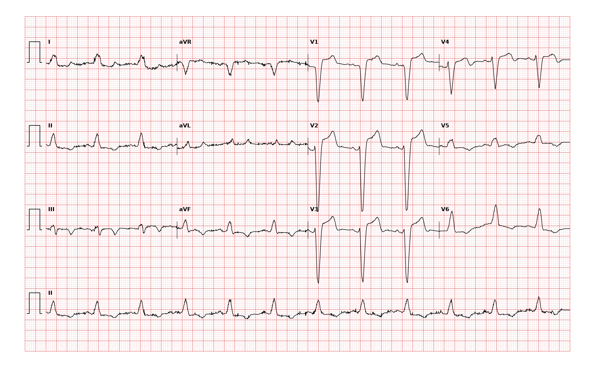

## 문제
69세 남자가 건강검진에서 심전도 이상이 있다는 말을 듣고 왔다. 가슴 통증, 숨참, 실신은 없고 평소 계단 3층을 쉬지 않고 오른다. 이전 심전도는 없다. 혈압 132/80 mmHg, 맥박 84회/분이다. 심잡음은 없고 다리 부종도 없다. 혈청 고감도 트로포닌은 정상이다. 12유도 심전도는 그림과 같다. 다음 처치로 가장 적절한 것은?

- A. 혈전용해제 투여
- B. 추가 검사 없이 1년 뒤 심전도 재검
- C. 경흉부 심장초음파
- D. 영구 심박동기 삽입
- E. 응급 관상동맥조영술

_12유도 심전도, 25 mm/s · 10 mm/mV, 3×4 + II 리듬 스트립 (PTB-XL ECG dataset, PhysioNet, CC BY 4.0 — 원신호 그대로 작도)_

## 정답 및 해설
> 정답: C

- **정답 핵심**: QRS 가 약 150 ms 로 넓고 V1~V3 에 깊고 넓은 QS/rS, I·V6 에 중격 q 없는 넓고 끝이 패인 R 이 있어 <b>완전 좌각차단</b>이다. V1~V3 의 ST 상승과 측벽 T 역위는 QRS 와 반대 방향인 이차성 변화로, 흉통·트로포닌 상승이 없으므로 급성 심근경색이 아니다. 새로 발견된 좌각차단은 심근병증·허혈성 심질환·대동맥판 질환 같은 구조적 심질환과 연관되므로 먼저 심장초음파로 좌심실 기능과 구조를 본다.
- **원리**: <b>왜 QRS 가 넓고 V6 에 q 가 없는가</b>: 정상에서는 왼쪽 각의 중격 가지가 중격을 왼쪽 → 오른쪽으로 먼저 탈분극시켜 I·V6 에 작은 q 를 만든다. 왼쪽 각이 막히면 흥분이 오른쪽 각으로 먼저 내려가 중격을 오른쪽 → 왼쪽으로 지나고, 왼쪽 심실은 근육끼리 천천히 퍼지는 흥분으로 늦게 탈분극한다. 그래서 중격 q 가 사라지고, 왼쪽을 보는 I·V6 에 넓고 패인 R, 오른쪽 앞을 보는 V1~V3 에 깊고 넓은 S 가 생긴다.  <b>왜 ST 가 반대로 가는가</b>: 탈분극 순서가 비정상이면 재분극 순서도 바뀌어 ST-T 가 QRS 의 주 방향과 반대로 간다(이차성 변화). 그래서 V1~V3 의 ST 상승은 좌각차단에서 기대되는 소견이고, 경색 판단에는 QRS 와 <b>같은 방향</b>의 ST 변화(Sgarbossa 기준)를 본다.  <b>왜 심장초음파인가</b>: 좌각차단은 심근병증, 허혈성 심질환, 고혈압성 심장병, 대동맥판 협착에서 흔하고, 그 자체로 왼쪽 심실의 수축을 비동기화해 수축 기능을 떨어뜨린다. 좌심실 박출률이 낮으면 심장재동기화 치료의 대상이 될 수 있다.
- **비교**: <table><thead><tr><th style="width:24%">항목</th><th style="width:38%">경흉부 심장초음파(정답)</th><th>응급 관상동맥조영술(가장 가까운 오답)</th></tr></thead><tbody> <tr><td>임상</td><td><b>무증상</b>, 우연히 발견</td><td>허혈성 흉통 · 혈역학 불안정</td></tr> <tr><td>ST 변화</td><td>QRS 와 반대 방향(불일치) — 좌각차단에서 기대됨</td><td>QRS 와 같은 방향 ST 상승 ≥ 1 mm 등 Sgarbossa 양성</td></tr> <tr><td>트로포닌</td><td>정상</td><td>상승</td></tr> <tr><td>이 환자</td><td>증상 없음 · 트로포닌 정상 — 일치</td><td>흉통·트로포닌 상승 없음 — 불일치</td></tr> </tbody></table> 좌각차단 자체는 응급이 아니다 — 증상과 트로포닌, 그리고 QRS 와 같은 방향의 ST 변화가 있을 때만 급성 경색으로 다룬다.
- **오답 이유**:
  - ① 혈전용해제는 관상동맥중재술을 제때 할 수 없는 곳에서 급성 ST 분절 상승 심근경색이 확실할 때라면 정답이 된다.
  - ② 1년 뒤 재검만 하는 것은 이미 심장초음파로 구조적 심질환을 배제한 오래된 좌각차단이라면 정답이 된다.
  - ④ 영구 심박동기 삽입은 좌각차단에 실신과 함께 고도 방실차단이 기록되거나 교대 각차단이 있을 때라면 정답이 된다.
  - ⑤ 응급 관상동맥조영술은 허혈성 흉통이 있고 QRS 와 같은 방향의 ST 상승처럼 Sgarbossa 기준을 만족할 때라면 정답이 된다.
- **함정**: V1~V3 의 ST 상승을 급성 전벽 경색으로 읽고 증상과 트로포닌을 확인하지 않는 것.
- **학습목표**: 증상 없이 처음 발견된 완전 좌각차단의 V1~V3 ST 상승은 이차성 변화로 보고, 구조적 심질환을 찾기 위해 심장초음파를 한다
- **근거·출처**: Loscalzo J, Fauci AS, Kasper DL, et al., eds. Harrison's Principles of Internal Medicine, 22nd ed. McGraw Hill; 2025. Chapter 247: Electrocardiography · Wagner P, Strodthoff N, Bousseljot RD, et al. PTB-XL, a large publicly available electrocardiography dataset. Sci Data. 2020;7:154

## 출처
- PTB-XL ECG dataset v1.0.3 (PhysioNet, CC BY 4.0) · record 5367 · Creative Commons Attribution 4.0 International · https://physionet.org/content/ptb-xl/1.0.3/LICENSE.txt
