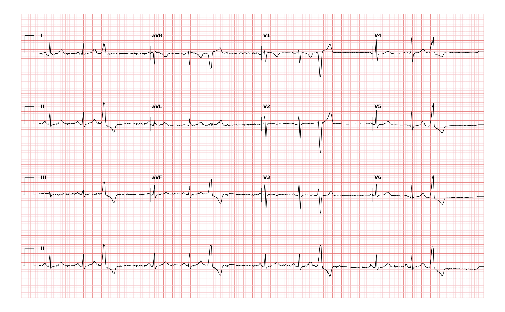

## 문제
A 43-year-old woman comes to the physician because of intermittent palpitations for 1 month, which she describes as a pause followed by a forceful beat. Symptoms are worse after drinking coffee and when she lies on her left side. She has no chest pain, dyspnea or syncope and takes no medications. Blood pressure is 122/76 mm Hg and pulse is 78/min and irregular. Cardiac examination shows no murmurs. Serum potassium, magnesium and thyroid-stimulating hormone concentrations are normal. A 12-lead ECG is shown. Which of the following is the most likely diagnosis?

- A. Mobitz type II second-degree atrioventricular block
- B. Ventricular trigeminy
- C. Atrial trigeminy with aberrant ventricular conduction
- D. Intermittent ventricular preexcitation
- E. Intermittent left bundle branch block

_12-lead ECG, 25 mm/s, 10 mm/mV, 3×4 + lead II rhythm strip (PTB-XL, PhysioNet, CC BY 4.0; raw signal, no filtering)_

## 정답 및 해설
> 정답: B

- **정답 핵심**: On the lead II rhythm strip every third beat comes early with a wide (> 120 ms), bizarre QRS complex that is <b>not preceded by a P wave</b>, has an ST-T segment opposite to the QRS, and is followed by a <b>full compensatory pause</b>. Two normal sinus beats then one premature ventricular contraction repeating is ventricular trigeminy.
- **원리**: <b>Why the beat is wide and bizarre</b>: A premature ventricular contraction starts in ventricular muscle, so activation spreads cell to cell instead of through the fast His-Purkinje system; the QRS widens and its shape depends on where it starts. Because repolarization follows the abnormal activation path, the ST-T points opposite to the QRS.  <b>Why the pause is fully compensatory</b>: The ventricular impulse usually does not reach the sinus node (it is blocked retrogradely in the AV node), so the sinus node keeps firing on schedule. The next sinus P wave arrives while the ventricles are refractory and is not conducted, and the following one conducts on time — the R-R interval surrounding the PVC equals two sinus cycles.  <b>Why it feels like a skipped beat</b>: The early beat ejects little blood (short filling time), and the beat after the pause ejects more forcefully because of longer filling and post-extrasystolic potentiation. Frequent PVCs without structural heart disease are usually benign, but a very high burden (> 10–15% of beats) can cause cardiomyopathy.
- **비교**: <table><thead><tr><th style="width:24%">Feature</th><th style="width:38%">Ventricular trigeminy (answer)</th><th>Atrial trigeminy with aberrancy (closest distractor)</th></tr></thead><tbody> <tr><td>Preceding P wave</td><td><b>None</b></td><td>Premature, abnormal P wave (often on the preceding T)</td></tr> <tr><td>QRS shape</td><td>Wide and bizarre, unlike a bundle branch pattern</td><td>Usually typical RBBB or LBBB morphology</td></tr> <tr><td>Pause</td><td>Full compensatory</td><td>Usually noncompensatory (sinus node reset)</td></tr> <tr><td>This ECG</td><td>No P before the wide beats, compensatory pause — fits</td><td>No premature P wave — does not fit</td></tr> </tbody></table> Look at the T wave just before the wide beat: a hidden premature P favors aberrancy; a clean T with a compensatory pause favors a ventricular origin.
- **오답 이유**:
  - (A) Mobitz type II block would be correct if P waves came on time with a constant PR interval and an occasional P wave was suddenly not followed by any QRS complex.
  - (C) Atrial trigeminy with aberrant conduction would be correct if each wide early beat followed a premature P wave and had a typical bundle branch block shape with a noncompensatory pause.
  - (D) Intermittent preexcitation would be correct if the wide beats had a short PR interval and a delta wave and occurred on time rather than early.
  - (E) Intermittent left bundle branch block would be correct if the wide beats were preceded by normal sinus P waves with an unchanged PR interval and were not premature.
- **함정**: Calling every wide early beat aberrancy without looking for a premature P wave or measuring the pause.
- **학습목표**: 매 세 번째 박동이 선행 P 없는 넓고 기괴한 조기 QRS 와 완전 보상 휴지를 보이면 심실 기외수축 삼단맥으로 판독하고 변행 전도와 구별한다
- **근거·출처**: Loscalzo J, Fauci AS, Kasper DL, et al., eds. Harrison's Principles of Internal Medicine, 22nd ed. McGraw Hill; 2025. Chapter 260: Premature Ventricular Contractions, Nonsustained Ventricular Tachycardia, and Accelerated Idioventricular Rhythm · Wagner P, Strodthoff N, Bousseljot RD, et al. PTB-XL, a large publicly available electrocardiography dataset. Sci Data. 2020;7:154

## 출처
- PTB-XL ECG dataset v1.0.3 (PhysioNet, CC BY 4.0) · record 13102 · Creative Commons Attribution 4.0 International · https://physionet.org/content/ptb-xl/1.0.3/LICENSE.txt
