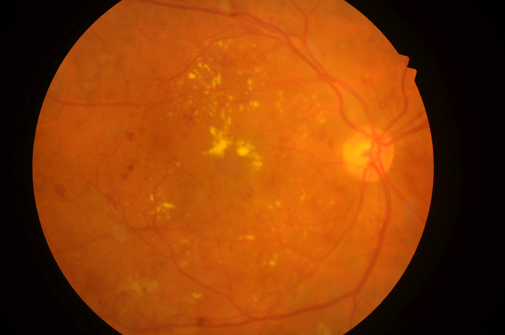

## 문제
15년 전 제2형 당뇨병을 진단받은 환자가 몇 달 전부터 오른눈이 흐리게 보인다며 왔다. 눈의 통증이나 충혈은 없다. 혈당강하제를 불규칙하게 먹었고 당화혈색소는 9.8 % 이다. 혈압은 136/84 mmHg 이다. 오른눈 교정시력은 0.4 이고 안압은 정상이다. 산동 후 오른눈의 안저 사진은 그림과 같다. 황반 주위에 모여 있는 노란 침착물의 성분으로 가장 적절한 것은?

- A. 망막 안으로 새어 나온 적혈구
- B. 망막 표면에 자란 섬유혈관 조직
- C. 혈관 밖으로 새어 나온 지단백과 지질
- D. 축삭 수송이 멈춰 쌓인 신경섬유층 축삭 내용물
- E. 브루크막과 망막색소상피 사이에 쌓인 세포외 침착물

_안저 사진, 원본 그대로 축소만 (IEEE DataPort, CC BY 4.0) ※ 발문의 임상 상황은 문항 구성을 위한 가정이다 — 원 데이터에는 나이·병력이 없다_

## 정답 및 해설
> 정답: C

- **정답 핵심**: 황반을 둘러싸고 경계가 뚜렷한 밝은 노란 밀랍 같은 점들이 무리 지어 있고, 주변 망막에 점상·얼룩 출혈이 흩어져 있다. 당뇨망막병증의 <b>경성삼출물</b>이다. 투과성이 높아진 미세동맥류·모세혈관에서 혈장이 새면 물은 다시 흡수되고 큰 분자인 지단백·지질이 바깥망상층에 남아 노란 침착물이 된다.
- **원리**: <b>왜 노란 점이 고리 모양으로 모이는가</b>: 당뇨병의 고혈당은 모세혈관 주위세포를 잃게 하고 기저막을 두껍게 해 혈관벽이 약해진다. 약해진 벽이 부풀면 미세동맥류가 되고, 이 미세동맥류와 손상된 모세혈관에서 혈장이 샌다. 샌 액체 중 물과 작은 분자는 주변 모세혈관·망막색소상피가 다시 흡수하지만 <b>지단백과 지질은 흡수되지 않고 바깥망상층에 남는다</b>. 그래서 새는 지점을 가운데 두고 고리(윤상) 모양으로 노란 침착물이 쌓인다.  <b>왜 시력이 떨어지는가</b>: 경성삼출물 자체보다 그것을 만든 <b>황반부종</b>(망막 두께 증가)이 시력을 떨어뜨린다. 경성삼출물이 중심와 가까이 있으면 황반부종이 중심을 침범했을 가능성이 높아 빛간섭단층촬영(OCT)으로 두께를 재고, 중심부 황반부종이면 유리체강내 항VEGF 주사가 1차 치료다.  <b>혈당이 단서가 되는 이유</b>: 망막병증의 진행은 고혈당 노출 기간과 정도에 비례하므로 오랜 유병 기간과 높은 당화혈색소는 배경이 될 뿐, 침착물의 성분은 그림의 모양(경계·색·분포)으로 가른다.
- **비교**: <table><thead><tr><th style="width:22%">항목</th><th style="width:39%">경성삼출물(정답)</th><th>면화반(가장 가까운 오답)</th></tr></thead><tbody> <tr><td>색·경계</td><td><b>노란색, 경계 뚜렷</b>, 밀랍처럼 빛남</td><td>흰색, <b>경계 흐림</b>, 솜털 모양</td></tr> <tr><td>성분</td><td>새어 나온 지단백·지질</td><td>허혈로 축삭 수송이 멈춰 부푼 신경섬유층 축삭</td></tr> <tr><td>분포</td><td>황반 주위에 고리·무리</td><td>시신경유두 주위 큰 혈관 근처에 몇 개</td></tr> <tr><td>뜻하는 것</td><td>혈관 누출(부종)</td><td>모세혈관 폐쇄(허혈)</td></tr> </tbody></table> 노란색이고 경계가 뚜렷하면 누출의 흔적, 흰색이고 흐리면 허혈의 흔적이다 — 어느 쪽으로 물어도 이 두 축(색·경계)으로 답한다.
- **오답 이유**:
  - ① 망막 안으로 새어 나온 적혈구는 노란 점이 아니라 붉은 점상·얼룩 출혈을 물었다면 정답이 된다.
  - ② 섬유혈관 조직은 시신경유두나 망막 표면에 가는 신생혈관과 흰 막이 자라는 증식 당뇨망막병증이라면 정답이 된다.
  - ④ 신경섬유층 축삭 내용물은 경계가 흐린 흰 솜털 모양 병변이 시신경유두 가까이에 있는 면화반이라면 정답이 된다.
  - ⑤ 브루크막과 망막색소상피 사이 침착물은 노인의 황반에 작고 둥근 노란 점이 출혈 없이 흩어진 드루젠이라면 정답이 된다.
- **함정**: 노랗거나 흰 망막 병변을 모두 「삼출물」로 묶어 면화반(허혈)과 경성삼출물(누출)의 기전을 섞는 것.
- **제작 가정**: IDRiD 는 안저 사진과 망막병증 등급만 있고 나이·성별·병력이 없다 — 오래 혈당 조절이 나빴던 당뇨병 환자의 시력 저하 상황과 혈액검사 수치를 가정했다 (가정한 정보: 15년 전 제2형 당뇨병을 진단받은 · 당화혈색소는 9.8 % 이다 · 오른눈 교정시력은 0.4)
- **학습목표**: 당뇨망막병증 안저에서 황반 주위에 고리 모양으로 모인 경계 뚜렷한 노란 침착물을 새어 나온 지단백의 침착(경성삼출물)으로 읽고 면화반·드루젠과 가른다
- **근거·출처**: Loscalzo J, Fauci AS, Kasper DL, et al., eds. Harrison's Principles of Internal Medicine, 22nd ed. McGraw Hill; 2025. Chapter 417: Diabetes Mellitus: Complications · Flaxel CJ, Adelman RA, Bailey ST, et al. Diabetic Retinopathy Preferred Practice Pattern. Ophthalmology. 2020;127(1):P66-P145 · Porwal P, Pachade S, Kamble R, et al. Indian Diabetic Retinopathy Image Dataset (IDRiD): a database for diabetic retinopathy screening research. Data. 2018;3(3):25

## 출처
- IDRiD (IEEE DataPort, CC BY 4.0) · IDRiD_022 · Creative Commons Attribution 4.0 International · https://creativecommons.org/licenses/by/4.0/
