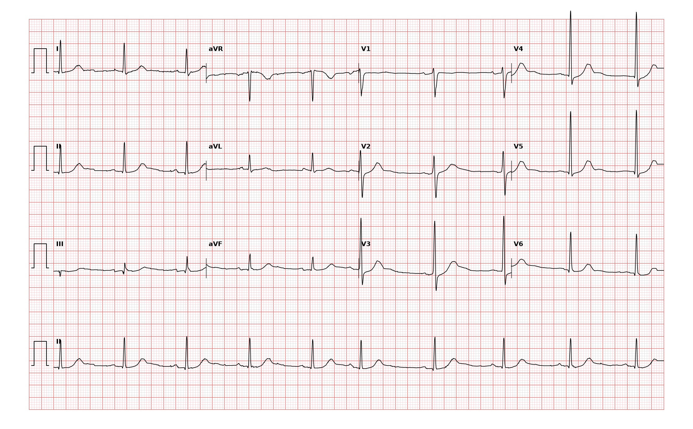

## 문제
A 72-year-old man comes for a preoperative evaluation before elective inguinal hernia repair. He walks 2 km daily without chest pain, dyspnea, or palpitations. He has no history of hypertension, and he takes no medications. He is 168 cm tall and weighs 63 kg. Blood pressure is 124/76 mm Hg, and pulse is 66/min and regular. No murmurs are heard. Serum electrolyte concentrations are within the reference ranges. A 12-lead ECG is shown. Which of the following best describes this ECG?

- A. Low QRS voltage in the limb leads
- B. Increased precordial QRS voltage without ST-T abnormalities
- C. Left ventricular hypertrophy with a repolarization (strain) abnormality
- D. Right ventricular hypertrophy with right axis deviation
- E. Complete left bundle branch block

_12-lead ECG, 25 mm/s, 10 mm/mV, 3×4 + lead II rhythm strip (PTB-XL, PhysioNet, CC BY 4.0; raw signal, no filtering)_

## 정답 및 해설
> 정답: B

- **정답 핵심**: The rhythm is sinus at about 65/min with a narrow QRS. The R waves in V4 and V5 reach about 25 to 26 mm and the S waves in V1 and V2 about 10 mm, so the precordial QRS voltage is high. The ST segments are isoelectric and the T waves are upright in I, II, V4 to V6, so there is no strain pattern. In a thin, normotensive man, high voltage alone is a common normal variant.
- **원리**: <b>왜 마른 사람에서 전압이 커지는가</b>: 흉부 유도는 심장 바로 앞 피부에 붙는다. 전극과 심장 사이의 거리가 가깝고 그 사이 조직(지방·폐 공기)이 적을수록 같은 심근 기전력이 더 크게 기록된다. 그래서 젊거나 마른 사람, 흉벽이 얇은 사람은 좌심실 비대가 없어도 흉부 유도 R 이 크다. 반대로 비만·폐기종·심낭삼출은 전압을 줄인다.  <b>왜 ST-T 가 중요한가</b>: 진짜 좌심실 비대에서는 두꺼워진 심근의 재분극이 늦고 심내막하 허혈이 겹쳐 R 이 큰 유도(I·aVL·V5·V6)에서 ST 하강과 비대칭 T 역위가 생긴다(strain). 전압만 큰 것과 달리 이 재분극 이상은 실제 비대·심혈관 위험과 더 강하게 연관된다.  <b>전압 기준의 한계</b>: Sokolow-Lyon(S V1 + R V5/V6 ≥ 35 mm)·Cornell(R aVL + S V3) 기준은 특이도는 높지만 민감도가 낮고 체형에 크게 좌우된다. 비대가 의심되면 심장초음파로 벽 두께와 질량을 잰다.
- **비교**: <table><thead><tr><th style="width:24%">Feature</th><th style="width:38%">High voltage only (answer)</th><th>LVH with strain (closest distractor)</th></tr></thead><tbody> <tr><td>Precordial R/S</td><td>Tall R in V4–V5, deep S in V1–V2</td><td>Tall R, deep S</td></tr> <tr><td>ST segment / T wave in V5–V6</td><td><b>Isoelectric ST, upright T</b></td><td><b>Downsloping ST depression, asymmetric T inversion</b></td></tr> <tr><td>Typical setting</td><td>Thin or young adult, no hypertension</td><td>Long-standing hypertension, aortic stenosis</td></tr> <tr><td>This patient</td><td>Normotensive, thin, normal repolarization — fits</td><td>No ST-T change — does not fit</td></tr> </tbody></table> Voltage tells how big the QRS is; the ST-T tells whether the myocardium is strained. Read both before calling hypertrophy.
- **오답 이유**:
  - (A) Low limb-lead voltage would be correct if every limb-lead QRS were under 5 mm, as in obesity, pericardial effusion, or hypothyroidism.
  - (C) LVH with strain would be correct if the leads with tall R waves showed downsloping ST depression and asymmetric T-wave inversion in a patient with long-standing hypertension.
  - (D) Right ventricular hypertrophy would be correct if V1 showed a dominant R wave with right axis deviation and deep S waves in V5 and V6.
  - (E) Complete left bundle branch block would be correct if the QRS were 120 ms or longer with broad notched R waves in I and V6 and no septal q waves.
- **함정**: Calling tall precordial R waves left ventricular hypertrophy without checking the ST segments, T waves, and body habitus.
- **학습목표**: Read tall precordial R waves with normal ST segments and T waves as increased QRS voltage without a repolarization abnormality, and distinguish it from left ventricular hypertrophy with strain
- **근거·출처**: Loscalzo J, Fauci AS, Kasper DL, et al., eds. Harrison's Principles of Internal Medicine, 22nd ed. McGraw Hill; 2025. Chapter 247: Electrocardiography · Hancock EW, Deal BJ, Mirvis DM, et al. AHA/ACCF/HRS recommendations for the standardization and interpretation of the electrocardiogram: part V: electrocardiogram changes associated with cardiac chamber hypertrophy. J Am Coll Cardiol. 2009;53(11):992-1002 · Wagner P, Strodthoff N, Bousseljot RD, et al. PTB-XL, a large publicly available electrocardiography dataset. Sci Data. 2020;7:154

## 출처
- PTB-XL ECG dataset v1.0.3 (PhysioNet, CC BY 4.0) · record 4464 · Creative Commons Attribution 4.0 International · https://physionet.org/content/ptb-xl/1.0.3/LICENSE.txt
